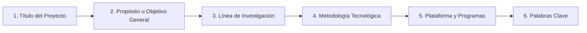

# 📘 Guía Maestra de Formato y Estructura para Trabajos de Grado (UNERG)
### Área de Ingeniería en Sistemas • Programa de Formación en Ingeniería en Informática
> **Documento de Referencia Oficial para la Redacción y Maquetación de Informes Técnicos y Proyectos de Grado**  
> *Basado en las normativas institucionales de la Universidad Nacional Experimental de los Llanos Centrales «Rómulo Gallegos» (UNERG), las directrices de la Coordinación de Pasantías y Proyectos de Grado, y los estándares metodológicos aplicados en NotiFast.*

---

## 🎯 1. Propósito de esta Guía

El propósito de esta guía es servir como **manual técnico exhaustivo y reutilizable** para redactar cualquier trabajo o informe de proyecto de grado en el área de informática y sistemas. Contiene todas las reglas tipográficas, de espaciado, maquetación, redacción y estructura lógica aplicadas en la versión definitiva de **NotiFast 2**, permitiendo replicar con exactitud el estándar para cualquier otro tema de investigación sin riesgo de observaciones de formato.

---

## 📐 2. Parámetros Físicos y Tipográficos Generales

| Parámetro | Valor Oficial UNERG | Medida OpenXML (dxa / pt) |
|---|---|---|
| **Tamaño de Papel** | Carta (*Letter* — $8.5 \times 11$ pulgadas) | $12\,240 \times 15\,840 \text{ dxa}$ |
| **Margen Superior** | $2.5 \text{ cm}$ | $1\,417 \text{ dxa}$ |
| **Margen Inferior** | $2.5 \text{ cm}$ | $1\,417 \text{ dxa}$ |
| **Margen Izquierdo** | $3.0 \text{ cm}$ | $1\,701 \text{ dxa}$ |
| **Margen Derecho** | $3.0 \text{ cm}$ | $1\,701 \text{ dxa}$ |
| **Ancho Imprimible Neto** | $15.59 \text{ cm}$ | $8\,838 \text{ dxa}$ |
| **Tipo de Letra Oficial** | **Times New Roman** (alternativas admitidas: Arial o Calibri) | `w:ascii="Times New Roman"` |
| **Tamaño del Texto General** | **11 pt** | `w:sz val="22"` |
| **Interlineado** | **Sencillo** ($1.0$ líneas) | `w:line="240" w:lineRule="auto"` |
| **Espaciado posterior entre párrafos** | $6 \text{ pt}$ | `w:after="120"` |
| **Sangría de primera línea** | $1.0 \text{ cm}$ en párrafos ordinarios | `w:firstLine="567"` |
| **Alineación del texto** | Justificada (*both*) | `w:jc w:val="both"` |

> [!IMPORTANT]
> **Jerarquía de Títulos y Subtítulos:**
> - **Nivel 1 (Capítulos / Secciones principales, ej. `4. DIAGNÓSTICO SITUACIONAL`):** Tamaño **14 pt** (`sz="28"`), Mayúsculas sostenidas, Negrita, Centrado, Espaciado anterior $18 \text{ pt}$ (`360 dxa`) y posterior $9 \text{ pt}$ (`180 dxa`).
> - **Nivel 2 (Subsecciones, ej. `4.1. Descripción del contexto...`):** Tamaño **12 pt** (`sz="24"`), Negrita, Alineado a la izquierda, Espaciado anterior $12 \text{ pt}$ (`240 dxa`) y posterior $6 \text{ pt}$ (`120 dxa`).
> - **Nivel 3 (Apartados, ej. `4.3.1. Objetivo General`):** Tamaño **11 pt** (`sz="22"`), Negrita y Cursiva, Alineado a la izquierda, Espaciado anterior $10 \text{ pt}$ (`200 dxa`) y posterior $5 \text{ pt}$ (`100 dxa`).

---

## 📄 3. Numeración y Secciones del Documento

El documento se divide estrictamente en **tres secciones de numeración**:

```mermaid
flowchart TD
    S1["Sección 1: PORTADA"] -->|Página 1 - Sin número visible| S2["Sección 2: PRELIMINARES"]
    S2 -->|Índice General (ii)<br/>Resumen (iii)| S3["Sección 3: CUERPO DEL INFORME"]
    S3 -->|4. Diagnóstico (pág. 1 contada, NO marcada)<br/>Páginas siguientes: 2, 3, 4, 5...| FIN["Fin del Documento"]
```

### 1. Sección 1 — Portada
- Es la primera página del documento.
- **No lleva número de página visible** (`w:titlePg` con encabezado/pie vacío `footer1.xml`).

### 2. Sección 2 — Páginas Preliminares
- Abarca: **Índice General** y **Resumen**.
- Formato de numeración: **Números romanos en minúscula** (`ii, iii, iv...`).
- Ubicación: **Centrado en la parte inferior de la página** (a $720 \text{ dxa} \approx 1.27 \text{ cm}$ del borde).
- El Índice General inicia obligatoriamente en la página **`ii`** (`w:pgNumType w:fmt="lowerRoman" w:start="2"`).

### 3. Sección 3 — Cuerpo Principal del Proyecto
- Abarca desde la sección **4. DIAGNÓSTICO SITUACIONAL** hasta el final de la obra.
- Formato de numeración: **Números arábigos** (`1, 2, 3, 4...`).
- Ubicación: **Centrado en la parte inferior de la página**.
- **Regla de Oro UNERG:** *La primera página de cada sección/capítulo se cuenta mas no se marca.*
  - En OpenXML se implementa activando `<w:titlePg/>` en la sección 3.
  - La primera página física del cuerpo actúa como página `1` (pero no imprime número).
  - La segunda página física imprime el número **`2`**, la tercera imprime **`3`**, y así consecutivamente.

---

## 🎨 4. Especificación Detallada Sección por Sección

### 4.1. PORTADA INSTITUCIONAL
Debe replicar con fidelidad matemática el prototipo formal de la UNERG:

1. **Membrete Superior (12 pt, interlineado sencillo, centrado):**
   ```
   REPÚBLICA BOLIVARIANA DE VENEZUELA
   MINISTERIO DEL PODER POPULAR PARA LA EDUCACIÓN UNIVERSITARIA
   UNIVERSIDAD NACIONAL EXPERIMENTAL DE LOS LLANOS CENTRALES "RÓMULO GALLEGOS"
   ```
2. **Logotipo de la UNERG:**
   - **Dimensiones Exactas:** **5.0 cm de ancho $\times$ 2.3 cm de alto** ($1\,800\,000 \text{ EMUs} \times 828\,000 \text{ EMUs}$).
   - **Alineación:** Estrictamente **centrado** en la página.
3. **Coordinación y Programa Académico:**
   - **14 pt, Negrita, Mayúsculas sostenidas, centrado:**
   ```
   ÁREA DE INGENIERÍA EN SISTEMAS
   PROGRAMA DE FORMACIÓN EN INGENIERÍA EN INFORMÁTICA
   ```
4. **Espacio en blanco separador:** $\approx 420 \text{ dxa}$.
5. **Título del Proyecto:**
   - **16 pt, Negrita, Mayúsculas sostenidas, centrado, interlineado sencillo:**
   - Debe ser explicativo, preciso y breve (máximo $\approx 30$ palabras).
6. **Espacio en blanco separador:** $\approx 380 \text{ dxa}$.
7. **Modalidad de Grado (12 pt, cursiva, centrado):**
   ```
   Proyecto de Grado presentado como requisito para optar al Título de
   Ingeniero en Informática
   ```
8. **Espacio en blanco separador:** $\approx 480 \text{ dxa}$.
9. **Tabla de Autor y Tutor (12 pt, sin bordes visibles, ancho completo $8\,838 \text{ dxa}$):**
   - Columna izquierda: **Tutor Académico:** `Prof. [Nombre y Apellido]`
   - Columna derecha: **Autor:** `Br. [Nombre y Apellido]`, `C.I.: V-XX.XXX.XXX`, `correo@gmail.com`
10. **Lugar y Fecha (12 pt, Negrita, centrado al pie):**
    ```
    San Juan de los Morros, [Mes] de [Año]
    ```

---

### 4.2. ÍNDICE GENERAL (Tabla de Contenido)
- **Título:** `ÍNDICE GENERAL` (14 pt, Negrita, Mayúsculas, Centrado).
- **Encabezado de Columnas:** `CONTENIDO` (alineado a la izquierda) y `PÁG.` (alineado a la derecha).
- **Línea de Puntos Guía (*Dot Leaders*):**
  - Debe implementarse mediante un tabulador nativo derecho configurado en la posición exacta del margen derecho:  
    `<w:tab w:val="right" w:leader="dot" w:pos="8838"/>`
  - Esto garantiza que los puntos suspensivos lleguen de forma uniforme y milimétrica hasta el número de página sin espacios irregulares.
- **Sangrías Jerárquicas:**
  - Nivel 1 (Capítulos / Preliminares): Sangría izquierda $0 \text{ cm}$ (`0 dxa`), texto en **Negrita 11 pt**.
  - Nivel 2 (Subsecciones `X.X`): Sangría izquierda $0.63 \text{ cm}$ (`360 dxa`), texto regular 10.5 pt.
  - Nivel 3 (Apartados `X.X.X`): Sangría izquierda $1.27 \text{ cm}$ (`720 dxa`), texto regular 10.5 pt.

---

### 4.3. RESUMEN (Estructura de 6 Pasos — Cátedra Prof. Flor Ana Bolívar)

> [!IMPORTANT]
> **Reglas Inquebrantables del Resumen en UNERG:**
> 1. Debe estar redactado en **un solo párrafo** continuo.
> 2. **Límite de extensión:** Máximo **300 palabras** (rango ideal: 220–260 palabras).
> 3. Debe incluir los **6 componentes metodológicos en el orden exacto:**



#### Estructura de la Página del Resumen:
1. **Membrete reducido** (10 pt, centrado).
2. **Título repetido del proyecto** (11 pt, negrita, centrado).
3. **Metadatos alineados a la derecha (10 pt):**
   - `Autor: Br. [Nombre]`
   - `Tutor Académico: Prof. [Nombre]`
   - `Línea de Investigación: [Nombre de la Línea Oficial, ej. Aplicaciones Móviles]`
   - `Fecha: [Mes, Año]`
4. **Título de sección:** `RESUMEN` (14 pt, Negrita, Centrado).
5. **Cuerpo del Resumen (Párrafo Único, Sangría 1 cm, Justificado, 11 pt, Interlineado sencillo):**
   - **Comienzo inmediato con el título:** *"El proyecto de investigación «[TÍTULO EXACTO]» tiene como propósito general..."*
   - **Propósito:** Definir el objetivo general de la herramienta de software.
   - **Línea de Investigación:** *"La investigación se inserta formalmente en la línea de investigación en [Línea] del Programa de Ingeniería en Informática de la UNERG."*
   - **Metodología Tecnológica:** Tipo de investigación (Proyecto Factible, diseño de campo tecnológico) y metodología de software (Scrum, TDD, cascada adaptada, etc.).
   - **Plataforma y Programas:** Lenguaje de desarrollo, frameworks, IDE, base de datos, sistemas operativos y herramientas de prueba.
6. **Palabras Clave:**
   - Ubicadas inmediatamente debajo del párrafo:  
     `Palabras clave: Término 1, Término 2, Término 3, Término 4, Término 5.`

---

### 4.4. DIAGNÓSTICO SITUACIONAL (Capítulo 4)

#### 4.4.1. Sección 4.1: Descripción del Contexto de la Situación Problemática
> [!NOTE]
> Esta sección se compone obligatoriamente de **5 Enfoques Estructurados**, donde cada enfoque debe redactarse en un **párrafo individual de mínimo $\frac{1}{2}$ cuartilla** (aproximadamente 180 a 220 palabras y 15 a 18 líneas de texto continuo):

1. **Enfoque global de la problemática:**  
   Analiza la situación a nivel internacional y macrotendencia: cómo la tecnología, la sobrecarga cognitiva o la dispersión afectan la disciplina de estudio en el mundo.
2. **Situación actual:**  
   Aterriza la realidad al entorno geográfico e institucional concreto (Venezuela, Estado Guárico, UNERG, campus universitario, aulas físicas, restricciones de conectividad, prácticas de laboratorio).
3. **Descripción del problema:**  
   Desglosa operativamente las fricciones cotidianas: pérdidas de tiempo, registros caóticos, falta de trazabilidad, errores en cálculos manuales y desarticulación de la información.
4. **Planteamiento de la solución del problema:**  
   Presenta el producto de software a desarrollar: nombre del sistema, paradigma de ingeniería (*offline-first*, cliente-servidor, cloud), módulos principales y aporte de valor inmediato.
5. **Bases teóricas y tecnológicas que fundamentan la solución:**  
   Fundamenta la solución en dos vertientes:
   - *Vertiente teórica-disciplinar:* Teorías pedagógicas, cognitivas o de administración que justifican la propuesta (ej. Teoría de la Carga Cognitiva de Sweller, Aprendizaje Autorregulado de Zimmerman).
   - *Vertiente de ingeniería de software:* Arquitectura de software empleada (*Clean Architecture*, MVC, MVI), patrones de diseño y estándares de calidad.
6. **Interrogantes de la Investigación:**  
   Párrafo de enlace (*"Por lo tanto, se plantea la necesidad de desarrollar... buscando dar respuesta a las siguientes interrogantes:"*) seguido de las **preguntas de investigación numeradas** (1 a 5).

---

#### 4.4.2. Sección 4.2: Justificación del Problema
Debe estructurarse desglosando formalmente cuatro perspectivas de impacto:
- **Perspectiva Tecnológica:** Aporte a la línea de software, aplicación de arquitecturas modernas, optimización de algoritmos y precedentes en la escuela de informática.
- **Perspectiva Práctica:** Utilidad operativa real para los usuarios finales, eliminación de herramientas externas no comunicadas y optimización del tiempo de trabajo.
- **Perspectiva Social:** Reducción del estrés y la ansiedad, fomento de la autorregulación, impacto en el rendimiento colectivo y pertinencia comunitaria.
- **Perspectiva Institucional / Metodológica:** Valor agregado para la UNERG como solución creada desde el seno estudiantil y validación de la modalidad de proyecto factible.

---

#### 4.4.3. Sección 4.3: Objetivos del Proyecto
- **4.3.1. Objetivo General:**  
  Un solo párrafo que describe en infinitivo el resultado macro final esperado (Qué se va a hacer, Cómo se va a hacer y Para qué se va a hacer).
- **4.3.2. Objetivos Específicos:**  
  Conjunto de pasos lógicos y cronológicos (habitualmente 5) que cubren el ciclo completo de la ingeniería:
  1. *Diagnosticar* (Levantamiento de requerimientos).
  2. *Diseñar* (Arquitectura de software y prototipo UI/UX).
  3. *Elaborar / Desarrollar algoritmos* (Lógica matemática o núcleo de procesamiento).
  4. *Implementar / Construir* (Codificación de los módulos principales).
  5. *Validar / Probar* (Pruebas de usabilidad, rendimiento y verificación).

---

#### 4.4.4. Sección 4.4: Procesos que van a Automatizar dentro de la Empresa / Institución
Se detallan mediante viñetas con **prefijos en negrita** destacando cada proceso:
- `•  1. Proceso A: ` Descripción del proceso antes vs. cómo queda automatizado con el software.
- `•  2. Proceso B: ` ...

---

### 4.5. DETERMINACIÓN, INSTALACIÓN Y CONFIGURACIÓN DE LAS HERRAMIENTAS DE DESARROLLO (Capítulo 5)

Debe estructurarse exactamente en estos 5 sub-puntos técnicos:

1. **5.1. Plataforma de Desarrollo:**
   - *Hardware de desarrollo:* Especificaciones de procesador, memoria RAM, almacenamiento SSD y tarjetas gráficas empleadas por el autor.
   - *Sistema operativo:* Plataforma anfitriona (Linux x86_64, Windows, etc.) y ventajas de compilación/KVM.
   - *Plataforma móvil/web de destino:* `compileSdk`, `minSdk`, navegadores o arquitecturas soportadas.
2. **5.2. Arquitectura de la Aplicación:**
   - Desglose por capas (Presentación, Dominio, Datos).
   - Patrón de presentación (MVI, MVVM, MVC) y Flujo Unidireccional de Datos (UDF).
   - Inyección de dependencias e interfaces de persistencia.
3. **5.3. Selección del Entorno de Aplicación:**
   - Justificación de la decisión tecnológica (ej. ¿Por qué Nativo en vez de Híbrido? ¿Por qué Offline-First sobre Cloud-First?).
   - Argumentos de rendimiento (fps, consumo de batería, soporte en reposo).
4. **5.4. Especificaciones e Instalación de la Tecnología de Desarrollo (con Tabla 1):**
   - **Norma de Tablas UNERG:** El rótulo y descripción deben ir obligatoriamente **EN LA PARTE SUPERIOR DE LA TABLA**:  
     `Tabla 1. Especificaciones del Stack Tecnológico y Herramientas de Desarrollo.`
   - La tabla debe tener ancho completo ($8\,838 \text{ dxa}$), cabeceras contrastadas y tipografía interior entre **9 pt y 11 pt** ($\ge 8 \text{ pt}$).
   - **Separación:** Espacio de $1.5$ líneas antes y después de la tabla.
   - **Pasos de Instalación:** Lista numerada con los comandos y pasos de configuración del entorno (SDKs, variables de entorno, compilación y pruebas).
5. **5.5. Metodología para el Desarrollo de la Aplicación:**
   - Marco de trabajo ágil (Scrum adaptado, TDD, Kanban).
   - Desglose formal de las 5 fases del ciclo de vida del software:
     1. *Fase de Análisis de Requisitos*
     2. *Fase de Diseño del Sistema*
     3. *Fase de Codificación (Implementación)*
     4. *Fase de Pruebas y Verificación*
     5. *Fase de Despliegue y Mantenimiento*

---

## ✍️ 5. Estilo de Redacción y Buenas Prácticas Académicas

1. **Voz Gramatical Estricta:**
   - Todo el informe debe redactarse en **3ra persona del singular** o mediante pasiva refleja impersonal (*«se implementó»*, *«se determinó»*, *«el autor evaluó»*).
   - Queda totalmente prohibido el uso de la primera persona del singular o plural (*«hicimos»*, *«desarrollamos»*, *«mi proyecto»*).
2. **Acrónimos y Siglas:**
   - La primera vez que aparece cualquier sigla en el informe, **debe expandirse su significado completo** antes de indicar la sigla entre paréntesis:  
     *Ejemplo:* *«Universidad Nacional Experimental de los Llanos Centrales "Rómulo Gallegos" (UNERG)»*, *«Interfaz de Usuario / Experiencia de Usuario (User Interface / User Experience, UI/UX)»*, *«Extracción, Transformación y Carga (Extraction, Transformation, and Loading, ETL)»*.
3. **Términos en Otros Idiomas:**
   - Toda palabra técnica proveniente del inglés o que no posea traducción oficial adecuada al español **debe colocarse en cursivas**:  
     *Ejemplos:* *Hub Educativo*, *offline-first*, *single source of truth*, *framework*, *clean architecture*, *appDataFolder*, *diffing*, *Doze Mode*, *sprints*, *test-driven development*, *parser*, *design system*.
4. **Referencias Bibliográficas:**
   - Sistema numérico IEEE entre corchetes cuadrados consecutivos según orden de aparición: `[1]`, `[2]`.

---

## 💻 6. Automatización Técnica en Python (OpenXML + LibreOffice)

Para generar el archivo `.docx` con fidelidad milimétrica y garantizar que los números del **Índice General** coincidan con las páginas reales del documento, se utiliza un motor en Python basado en **dos pasadas**:

```python
# Resumen conceptual del algoritmo de dos pasadas:
# Paso 1: Generar borrador XML -> Convertir a PDF headless con LibreOffice
subprocess.run(['libreoffice', '--headless', '--convert-to', 'pdf', temp_docx, '--outdir', '/tmp'])

# Paso 2: Escanear página por página con pdftotext para mapear la ubicación exacta de cada título
for page_num in range(1, total_pages + 1):
    txt = extract_text_from_pdf_page(temp_pdf, page_num)
    # Detectar encabezados y asociar con el número de página real

# Paso 3: Regenerar el documento final inyectando el mapeo real en el Índice General
generate_final_docx(real_page_map, output_docx_path)
```

---

## ✅ 7. Lista de Verificación (Checklist) Pre-Entrega

Antes de imprimir o consignar el documento a los jurados o a la Coordinación, verifique cada uno de los siguientes puntos:

- [ ] **Márgenes:** ¿Superior e inferior a 2.5 cm; izquierdo y derecho a 3.0 cm?
- [ ] **Portada:** ¿Logo UNERG centrado a 5.0 cm $\times$ 2.3 cm? ¿Título en 16 pt negrita? ¿Coordinación en 14 pt negrita? ¿Sin número de página visible?
- [ ] **Índice General:** ¿Inicia en la página `ii`? ¿Los números de página coinciden al 100% con los títulos del documento? ¿Los puntos guía llegan alineados al borde derecho?
- [ ] **Resumen:** ¿Está redactado en un solo párrafo? ¿Tiene 300 palabras o menos? ¿Comienza con el título del proyecto? ¿Declara la Línea de Investigación («Aplicaciones Móviles»)? ¿Incluye Palabras Clave al final?
- [ ] **Diagnóstico (4.1):** ¿Contiene los 5 enfoques requeridos? ¿Cada enfoque tiene mínimo $\frac{1}{2}$ cuartilla (~180-220 palabras)? ¿Termina con las 5 interrogantes de investigación?
- [ ] **Justificación (4.2):** ¿Cubre las perspectivas tecnológica, práctica, social e institucional?
- [ ] **Objetivos (4.3):** ¿Objetivo general en infinitivo? ¿5 objetivos específicos técnicos y ordenados?
- [ ] **Capítulo 5:** ¿Subdividido en 5.1 a 5.5? ¿La Tabla 1 tiene su título en la parte superior? ¿Se detalla la plataforma, arquitectura y pasos de instalación?
- [ ] **Numeración de cuerpo:** ¿La primera página del capítulo 4 se cuenta como página 1 pero no tiene número visible? ¿La siguiente página muestra el número 2 centrado en el pie?
- [ ] **Estilo:** ¿Está escrito 100% en 3ra persona? ¿Todos los anglicismos están en cursiva? ¿Se definieron las siglas en su primera aparición?
