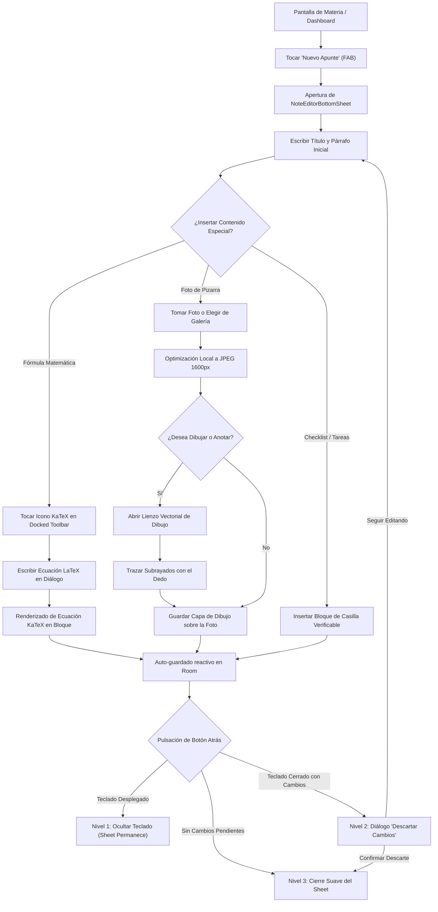
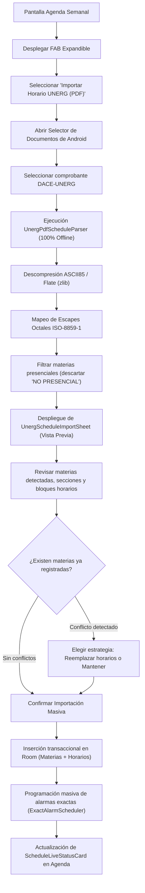
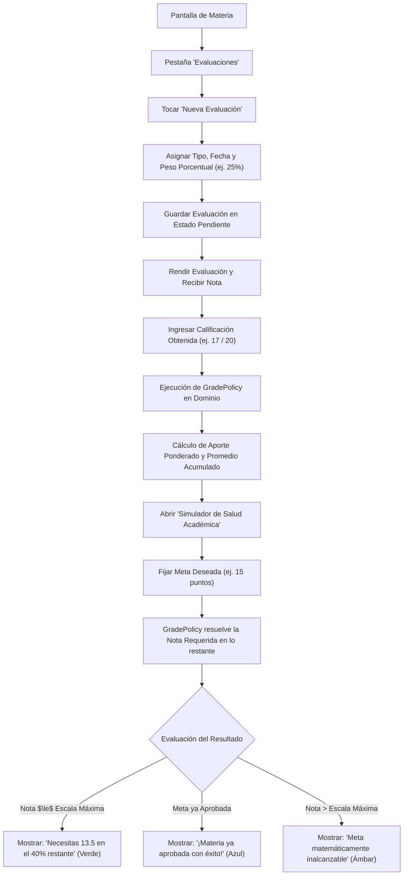
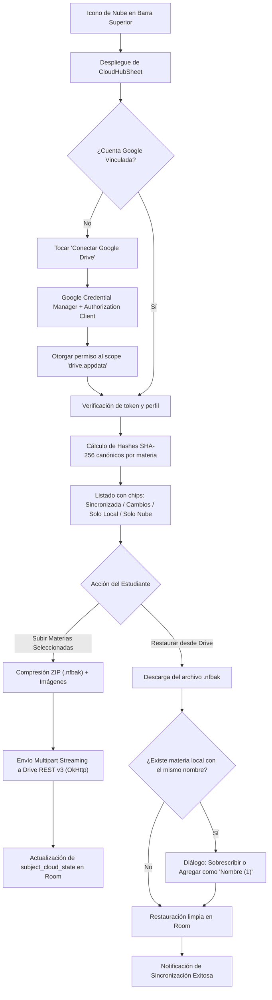
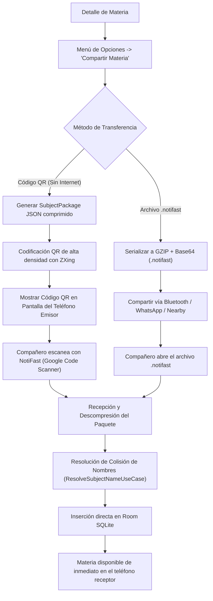

# Flujos de Experiencia de Usuario (UX Flows): NotiFast

Este documento detalla la arquitectura de interacción y los diagramas de flujo paso a paso para los cinco recorridos críticos del estudiante dentro de NotiFast.

---

## Flujo 1: Cuaderno de Estudio y Editor por Bloques (OneNote-like)

### Características de Interacción Clave:
- **`DockedAccessoryToolbar`:** Barra de herramientas suspendida sobre el teclado mediante `Modifier.imePadding()`.
- **Three-Tier Back Handling:** El primer toque de atrás siempre repliega el teclado virtual sin cerrar la hoja ni disparar advertencias innecesarias.
- **Persistencia en `SavedStateHandle`:** Los borradores se mantienen vivos aunque Android destruya la actividad por falta de memoria mientras el usuario consulta un PDF en otra app.

---

## Flujo 2: Agenda Reactiva e Importación de Horarios UNERG (PDF DACE)

### Características de Interacción Clave:
- **Cero Entrada Manual:** Una inscripción de 7 materias con 18 bloques de clase se importa en menos de 2 segundos.
- **Asignación Semántica Inteligente:** El parser deduce automáticamente el color accesible y el icono (ej. *Cálculo* $\rightarrow$ `Calculate`, *Programación* $\rightarrow$ `Computer`).
- **Puntualidad Doze-Safe:** Cada clase presencial queda de inmediato agendada en `AlarmManager` para alertar 15 minutos antes.

---

## Flujo 3: Calificaciones Multiescala y Simulador Predictivo

### Características de Interacción Clave:
- **Rigor IEEE 754:** Cero errores de redondeo acumulado.
- **Tipografía Monoespaciada Tabular:** Todos los cálculos se muestran en `JetBrains Mono` para comparación visual inmediata.
- **Empatía Cognitiva:** Materias sin evaluar muestran `—` en lugar de `0.0` para no generar ansiedad infundada.

---

## Flujo 4: Respaldo Privado en Google Drive (`CloudHubSheet`)

### Características de Interacción Clave:
- **Privacidad Total:** Los datos viajan a la carpeta oculta `appDataFolder` del propio Drive del alumno; ningún servidor ajeno tiene acceso.
- **Control Granular:** El estudiante puede elegir subir una sola materia, todas o solo restaurar las notas de un semestre anterior.

---

## Flujo 5: Transferencia P2P Offline (.notifast y QR)

### Características de Interacción Clave:
- **100% Sin Infraestructura:** Funciona en sótanos universitarios sin red celular ni Wi-Fi.
- **Portabilidad Total:** Incluye apuntes, horarios y plan de evaluación en un solo archivo ligero.
