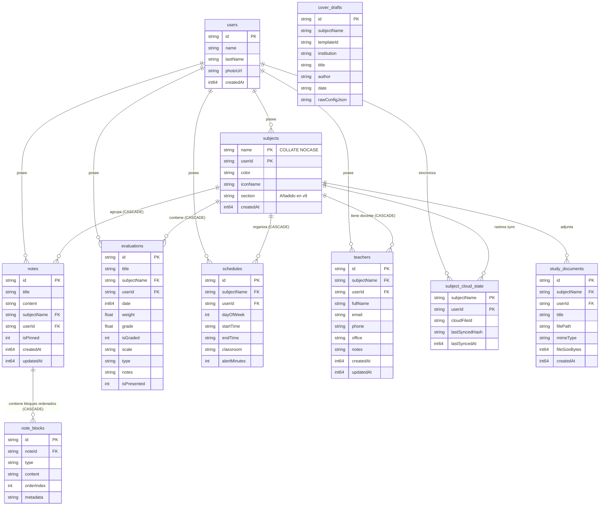

# Modelo de Datos y Persistencia: NotiFast

| Metadato | Valor |
|---|---|
| **Motor de Base de Datos** | Room SQLite `2.7.2` |
| **Versión del Esquema Actual** | Versión 9 (`version = 9`) |
| **Estrategia de Migración** | Migraciones incrementales no destructivas (`1➔2➔3➔4➔5➔6➔7➔8➔9`) |
| **Almacenamiento Clave-Valor** | Jetpack DataStore Preferences `1.1.2` |
| **Archivos Multimedia** | Almacenamiento local en `context.filesDir` (`files/images/`) |
| **Documentos Relacionados** | [Arquitectura del Sistema](./system-overview.md) · [Integraciones](./integrations.md) · [ADR-0001](./adr/0001-offline-first-room-sqlite.md) |

---

## 1. Diagrama Entidad-Relación (ER) del Esquema Room



---

## 2. Especificación de Tablas y Entidades de Room

### 2.1 Tabla `users` (`UserEntity`)
Almacena el perfil local del estudiante generado durante el onboarding offline.
- `id` (TEXT, PK): Identificador único del perfil generado localmente mediante `UUID.randomUUID().toString()`.
- `name` (TEXT, NOT NULL): Nombre del estudiante.
- `lastName` (TEXT, NOT NULL): Apellido del estudiante (opcional en UI, almacenado como cadena vacía si se omite).
- `photoUrl` (TEXT, NULL): Ruta local a la imagen de perfil en el almacenamiento interno privado.
- `createdAt` (INTEGER, NOT NULL): Epoch millis de la creación del perfil.

### 2.2 Tabla `subjects` (`SubjectEntity`)
Representa cada asignatura o cátedra académica.
- Clave primaria compuesta: `(userId, name)`.
- Restricción de Colación: `name COLLATE NOCASE` para impedir nombres duplicados por diferencias de mayúsculas/minúsculas.
- `section` (TEXT, NOT NULL, default `""`): Sección académica oficial (ej. "Sección 01", "Lab B"). Introducida en la migración `v8 ➔ v9`.
- `color` (TEXT, NOT NULL): Código hexadecimal `#RRGGBB` del color temático asignado.
- `iconName` (TEXT, NOT NULL): Identificador del icono vectorial (ej. `Book`, `Calculate`, `Computer`).

### 2.3 Tablas `notes` y `note_blocks` (`NoteEntity` / `NoteBlockEntity`)
Estructura desacoplada del editor por bloques estilo OneNote:
- En `notes`: `id` (PK, UUID), `title`, `content` (resumen plano para búsqueda rápida), `subjectName`, `userId`, `isPinned` (0 o 1), `createdAt`, `updatedAt`.
- En `note_blocks`: `id` (PK), `noteId` (FK con `CASCADE`), `type` (`TEXT`, `MARKDOWN`, `MATH_FORMULA`, `CHECKLIST`, `IMAGE`), `content` (cuerpo de texto, código LaTeX o ruta de imagen), `orderIndex` (orden secuencial de renderizado) y `metadata` (JSON auxiliar con trazos vectoriales de dibujo sobre fotos).

### 2.4 Tabla `evaluations` (`EvaluationEntity`)
Registra cada examen, entrega o actividad calificada:
- `id` (PK, UUID), `title`, `subjectName`, `userId`, `date` (epoch millis del examen o fecha límite).
- `weight` (REAL, NOT NULL): Porcentaje de ponderación de la evaluación (ej. 25.0 para 25%).
- `grade` (REAL, NOT NULL): Calificación obtenida.
- `isGraded` (INTEGER, NOT NULL): Flag booleano (0 = Pendiente, 1 = Calificada).
- `scale` (TEXT, NOT NULL): Escala de la evaluación (`BASE_20`, `BASE_10`, `BASE_100`, `GPA_4`).
- `type` (TEXT, NOT NULL): Tipo de evaluación (`PARCIAL`, `TALLER`, `TESIS`, `PROYECTO`, `QUIZ`).
- `isPresented` (INTEGER, NOT NULL): Flag de presentación previa.

### 2.5 Tabla `schedules` (`ScheduleEntity`)
Gestiona los bloques de clase semanales:
- `id` (PK, UUID), `subjectName`, `userId`.
- `dayOfWeek` (INTEGER, NOT NULL): Valor numérico según `java.time.DayOfWeek` (1 = Lunes a 7 = Domingo).
- `startTime` / `endTime` (TEXT, NOT NULL): Formato 24 horas `HH:mm` (ej. `"08:00"`, `"10:00"`).
- `classroom` (TEXT, NOT NULL): Aula o laboratorio físico asignado (ej. `"Aula 12"`, `"Lab AIS"`).
- `alertMinutes` (INTEGER, NOT NULL): Minutos de antelación para la alarma exacta (ej. 15).

### 2.6 Tabla `teachers` (`TeacherEntity`)
Directorio profesoral vinculado a materias:
- `id` (PK, UUID), `subjectName`, `userId`, `fullName`, `email`, `phone`, `office`, `notes`.
- `createdAt` y `updatedAt` (INTEGER, NOT NULL).

### 2.7 Tabla `subject_cloud_state` (`SubjectCloudStateEntity`)
Tabla de control de sincronización diferencial con Google Drive:
- Clave primaria compuesta: `(userId, subjectName)`.
- `cloudFileId` (TEXT, NOT NULL): Identificador único del archivo `.nfbak` en `appDataFolder` de Google Drive.
- `lastSyncedHash` (TEXT, NOT NULL): Hash SHA-256 canónico de los datos al momento de la última subida/descarga exitosa.
- `lastSyncedAt` (INTEGER, NOT NULL): Marca temporal de sincronización.

---

## 3. Historial de Migraciones de Room SQLite (`NotiFastMigrations.kt`)

Room mantiene la integridad absoluta de los datos existentes mediante 8 objetos de migración formales:

| Migración | Cambio Estructural Realizado |
|---|---|
| **`MIGRATION_1_2`** | Creación inicial de tablas locales (`users`, `subjects`, `notes`, `evaluations`, `schedules`) tras la remoción de Firestore. Creación de índices compuestos. |
| **`MIGRATION_2_3`** | Creación de la tabla `teachers` para incorporar el Directorio Docente con enlace a WhatsApp. |
| **`MIGRATION_3_4`** | Incorporación de la tabla `subject_cloud_state` para la sincronización diferencial SHA-256 con Google Drive `appDataFolder`. |
| **`MIGRATION_4_5`** | Creación de la tabla `study_documents` para soportar adjuntos y biblioteca de documentos en el Área de Estudio (Study Hub). |
| **`MIGRATION_5_6`** | Creación de la tabla `cover_drafts` para persistir borradores de portadas académicas institucionales. |
| **`MIGRATION_6_7`** | Adición del campo `updatedAt` en la tabla `notes` para ordenar por fecha de modificación real. |
| **`MIGRATION_7_8`** | Creación de la tabla `note_blocks` para la arquitectura de notas por bloques OneNote-like con migración automática del contenido previo de `notes.content`. |
| **`MIGRATION_8_9`** | Adición del campo `section: TEXT NOT NULL DEFAULT ''` en la tabla `subjects` para almacenar la sección académica oficial extraída por el parser PDF de la UNERG. |

---

## 4. Jetpack DataStore Preferences

Las preferencias del sistema y ajustes visuales se persisten en `UserPreferencesRepositoryImpl` sobre DataStore Preferences:

| Clave DataStore | Tipo | Propósito |
|---|---|---|
| `active_local_user_id` | String | UUID del perfil activo en el dispositivo. |
| `theme_accent_preset` | String | ID del preset de acento seleccionado (`classic`, `forest_sage`, etc.). |
| `theme_canvas_preset` | String | ID del lienzo de papel seleccionado (`classic/Pergamino`, `Menta`, etc.). |
| `custom_accent_hex` | String | Código Hex `#RRGGBB` si el usuario usa el Estudio Personalizado. |
| `custom_canvas_hex` | String | Código Hex `#RRGGBB` para lienzo personalizado. |
| `is_dark_mode` | Boolean | Forzado de modo oscuro (respetado internamente en Compose). |
| `week_start_day` | String | Día de inicio de semana (`"MONDAY"` o `"SUNDAY"`). |
| `class_alert_minutes` | Int | Minutos de antelación para notificaciones de clases (10, 15, 30). |
| `eval_alert_days` | Int | Días de antelación para recordatorios de exámenes (1, 2, 3, 7). |
| `daily_summary_enabled`| Boolean | Activa/desactiva la notificación matutina periódica de las 07:00 AM. |
| `google_account_email` | String | Correo de la cuenta de Google vinculada para respaldo en la nube. |

---

## 5. Serialización de Intercambio: `SubjectPackage` y `GlobalSnapshot`

Para el intercambio P2P y la copia en Google Drive, NotiFast no expone la base de datos completa en bruto, sino modelos JSON normalizados e inmutables:

- **`SubjectPackage` (`.notifast`):**
  ```json
  {
    "version": 2,
    "subject": { "name": "Cálculo III", "color": "#9E1B32", "iconName": "Calculate", "section": "02" },
    "schedules": [ { "dayOfWeek": 2, "startTime": "08:00", "endTime": "10:00", "classroom": "Aula 14" } ],
    "evaluations": [ { "title": "Primer Parcial", "weight": 25.0, "scale": "BASE_20" } ],
    "notes": [ { "title": "Integrales Triples", "blocks": [ ... ] } ],
    "teacher": { "fullName": "Dr. Carlos Silva", "phone": "+584120000000" }
  }
  ```
- **`GlobalSnapshot` (`.nfbak`):** Contenedor ZIP con el archivo `snapshot.json` (todas las materias, notas, evaluaciones, horarios, docentes y preferencias) acompañado de la carpeta `images/` con las fotos optimizadas y libres de metadatos EXIF.
