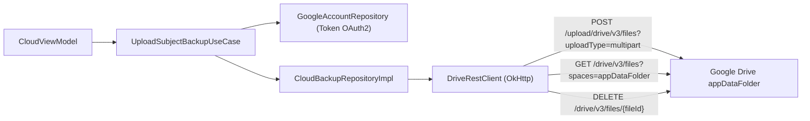

# Integraciones del Sistema y Servicios Externos: NotiFast

| Metadato | Valor |
|---|---|
| **Enfoque de Integración** | Minimalista, desacoplado y con bajo impacto en el tamaño del APK |
| **Nube Privada** | Google Drive REST API v3 (`appDataFolder`) vía OkHttp 4.12.0 |
| **Identidad de Nube** | Google Credential Manager 1.3.0 + Google ID 1.1.1 |
| **Escáner y QR** | ZXing 3.5.3 + Google Play Services Code Scanner 16.1.0 |
| **Procesamiento de Fondo** | AlarmManager exacto + Android WorkManager 2.10.0 |
| **Documentos Relacionados** | [Arquitectura](./system-overview.md) · [Modelo de Datos](./data-model.md) · [ADR-0002](./adr/0002-google-drive-appdatafolder-cloud-backup.md) |

---

## 1. Google Drive REST API v3 (Respaldo en la Nube Privada)

NotiFast descarta deliberadamente el SDK oficial `google-api-services-drive` (+15 MB y dependencias pesadas incompatibles con R8) en favor de un **cliente REST v3 delgado sobre OkHttp 4.12.0** (`DriveRestClient.kt`):



### 1.1 Autenticación con Google Credential Manager
- **Cero Firebase Auth:** La identidad se gestiona directamente mediante las APIs modernas de Android:
  ```kotlin
  val credentialManager = CredentialManager.create(context)
  val googleIdOption = GetGoogleIdOption.Builder()
      .setFilterByAuthorizedAccounts(false)
      .setServerClientId(WEB_CLIENT_ID)
      .setAutoSelectEnabled(true)
      .build()
  ```
- **Autorización OAuth2 de Alcance Oculto:** El token de acceso se solicita para el scope `https://www.googleapis.com/auth/drive.appdata` mediante `Identity.getAuthorizationClient()`.
- **Área Oculta (`appDataFolder`):** Los archivos generados residen en el espacio privado de la aplicación, invisible para el usuario en la interfaz web de Drive y completamente aislado de otras aplicaciones instaladas.

### 1.2 Detección de Cambios con Hash Canónico SHA-256 (`ContentHasher`)
Para determinar si una materia tiene "Cambios sin subir" sin saturar la red:
1. `ContentHasher` genera una representación serializada canónica y ordenada de la materia (apuntes, fechas, hashes de imágenes, horarios, evaluaciones y docente).
2. Se calcula el digest criptográfico `SHA-256(canonicalString)`.
3. Se compara contra `lastSyncedHash` en la tabla `subject_cloud_state`. Si difieren, la UI muestra el chip ámbar *«Cambios sin subir»*.

---

## 2. Transferencia P2P: ZXing y Google Play Services Code Scanner

Para posibilitar el intercambio directo de asignaturas entre estudiantes en el aula:

1. **Generación de QR (Emisor):**
   - El caso de uso `ExportSubjectPackageUseCase` serializa la materia en un objeto `SubjectPackage`.
   - `SubjectPackageCodec` comprime la cadena con `GZIPOutputStream` y la codifica en Base64 seguro para URL.
   - `QRCodeWriter` de **ZXing 3.5.3** genera un bitmap de matriz bidimensional de alta densidad con corrección de errores (Nivel M/Q).
2. **Escaneo de QR (Receptor):**
   - Utiliza **Google Play Services Code Scanner 16.1.0** (`GmsBarcodeScanning.getClient(context)`), ejecutando el reconocimiento de imagen fuera del proceso de la app para no inflar el tamaño del APK.
   - Si los servicios de Google no están presentes en el dispositivo, el sistema ofrece una alternativa accesible de importación pegando el código Base64 o seleccionando el archivo `.notifast`.

---

## 3. Motor de Notificaciones Híbrido: AlarmManager + WorkManager

```
┌────────────────────────────────────────────────────────────────────────┐
│                   MOTOR HÍBRIDO DE NOTIFICACIONES AAA                  │
├───────────────────────────────────┬────────────────────────────────────┤
│   ALARMAS EXACTAS (AlarmManager)  │    TAREAS PERIÓDICAS (WorkManager) │
│ - AlarmManager.setExactAndAllow...│ - PeriodicWorkRequest (07:00 AM)   │
│ - Clases (10, 15, 30 min antes)   │ - Resumen de clases del día        │
│ - Exámenes (1, 2, 3, 7 días antes)│ - Entregas de próximas 48 horas    │
│ - Bypass estricto de Doze Mode    │ - Canales de Android O+            │
├───────────────────────────────────┴────────────────────────────────────┤
│      REPROGRAMACIÓN TRAS REINICIO: BootCompletedReceiver               │
│      (BOOT_COMPLETED, TIME_SET, TIMEZONE_CHANGED)                      │
└────────────────────────────────────────────────────────────────────────┘
```

### 3.1 Canales de Notificación de Android O+
- `notifast_evaluations`: Importancia `IMPORTANCE_HIGH` (banner flotante heads-up, vibración fuerte y sonido prioritario).
- `notifast_classes`: Importancia `IMPORTANCE_HIGH` con vibración táctil rítmica.
- `notifast_daily_summary`: Importancia `IMPORTANCE_DEFAULT` con estilo expandible `NotificationCompat.BigTextStyle`.

### 3.2 Reprogramación Automática (`BootCompletedReceiver`)
Registrado en `AndroidManifest.xml` con filtros para `BOOT_COMPLETED`, `TIME_SET` y `TIMEZONE_CHANGED`. Al recibir el broadcast, ejecuta `RescheduleAllAlertsUseCase` en segundo plano, recalculando los timestamps de todas las clases y evaluaciones activas sin necesidad de que el usuario abra la app.

---

## 4. Motor de Parsing PDF Nativo DACE-UNERG (`UnergPdfScheduleParser`)

Los estudiantes de la Universidad Nacional Experimental Rómulo Gallegos (UNERG) descargan su comprobante de inscripción oficial en formato PDF emitido por la biblioteca ReportLab (`%PDF-1.4`). 

NotiFast incorpora un **parser nativo en Kotlin puro** sin bibliotecas pesadas externas (cero PDFBox):
1. **Decodificación del Stream:** Detecta si el stream de la página contiene compresión dual `/Filter [ /ASCII85Decode /FlateDecode ]` o `/FlateDecode` directo. Aplica decodificación ASCII85 mediante `Ascii85Decoder.kt` y descompresión zlib mediante `java.util.zip.Inflater`.
2. **Tabla de Mapeo Octal ISO-8859-1:** Transforma secuencias octales de ReportLab en caracteres en español:
   - `\301` $\rightarrow$ `Á`, `\311` $\rightarrow$ `É`, `\315` $\rightarrow$ `Í`, `\323` $\rightarrow$ `Ó`, `\332` $\rightarrow$ `Ú`, `\321` $\rightarrow$ `Ñ`.
   - `\341` $\rightarrow$ `á`, `\351` $\rightarrow$ `é`, `\355` $\rightarrow$ `í`, `\363` $\rightarrow$ `ó`, `\372` $\rightarrow$ `ú`, `\361` $\rightarrow$ `ñ`.
3. **Extracción y Filtrado:** Localiza los operadores de texto `BT ... ET`, extrae el código, nombre de materia, **sección**, aula y rango horario; descartando el 100% de las filas marcadas como `NO PRESENCIAL` o a distancia.

---

## 5. Telemetría y Diagnóstico (Firebase Crashlytics & Analytics)

- **Firebase BoM 33.9.0:** Utilizado exclusivamente para el monitoreo de caídas imprevistas (`Crashlytics`) y analítica agregada anónima de rendimiento (`Analytics`).
- **Cero Datos Personales en Servidores:** No se utiliza Cloud Firestore ni Firebase Storage. Ningún apunte, nombre, nota o archivo del estudiante se transmite hacia los servidores de Firebase.
