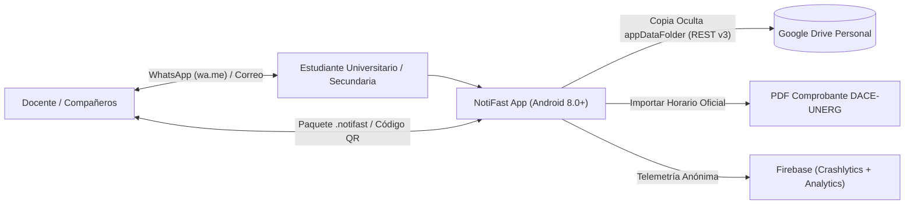
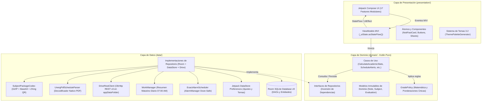

# Arquitectura del Sistema: NotiFast

| Metadato | Valor |
|---|---|
| **Patrón Arquitectónico** | Clean Architecture + MVI Estricto (Model-View-Intent) |
| **Paradigma UI** | Declarativo con Jetpack Compose Material 3 |
| **Inyección de Dependencias** | Hilt 2.59 (Dagger) |
| **Concurrencia y Reactividad** | Kotlin Coroutines & Flow (StateFlow / SharedFlow) |
| **Fuente de Verdad** | Room SQLite v9 (100% Offline-First) + DataStore Preferences |
| **Documentos Relacionados** | [Modelo de Datos](./data-model.md) · [Integraciones](./integrations.md) · [Registro de ADRs](./adr/) |

---

## 1. Diagrama de Contexto del Sistema (C4 Nivel 1)



---

## 2. Diagrama de Contenedores y Subsistemas (C4 Nivel 2)



---

## 3. Principios Arquitecturales y Separación de Capas

NotiFast aplica una separación estricta de responsabilidades dividida en tres capas de abstracción:

### 3.1 Capa de Presentación (`presentation/`)
- **Declarativa y Pasiva:** Los composables `@Composable` se limitan a pintar el estado y emitir eventos. **Está estrictamente prohibido colocar cálculos matemáticos de notas o lógica de negocio en la composición**.
- **Flujo Unidireccional de Datos (UDF):**
  - **Estado Inmutable:** Cada ViewModel expone un único `StateFlow<FeatureUiState>`:
    ```kotlin
    val uiState: StateFlow<FeatureUiState> = _uiState.asStateFlow()
    ```
  - **Punto Único de Entrada:** Toda interacción desde la UI hacia el ViewModel ingresa exclusivamente por el método `onEvent(event: FeatureEvent)`.
  - **Efectos Secundarios Unidireccionales:** Navegación y snackbars viajan a través de un `Channel<FeatureEffect>` consumido mediante `LaunchedEffect` en la UI.
- **Modularidad por Feature:** 17 módulos de presentación aislados (`notes`, `noteeditor`, `schedules`, `grades`, `cloud`, `settings`, `share`, `search`, etc.).
- **Límite de Tamaño (SRP):** Máximo $\approx 250$ líneas de código por archivo composable, extrayendo sub-componentes a carpetas `components/` o al catálogo atómico `atoms/`.

### 3.2 Capa de Dominio (`domain/`)
- **Código Kotlin Puro:** Cero dependencias del framework de Android (sin imports de `android.*` salvo tipos de fechas u interfaces de sistema).
- **Reglas de Negocio Centralizadas:**
  - `GradePolicy`: Fuente de verdad matemática de la aplicación.
  - Casos de uso especializados (`domain/usecase/`) con responsabilidad única (ej. `ScheduleEvaluationAlertUseCase`, `ResolveSubjectNameUseCase`, `ObserveLocalSyncSummaryUseCase`).
- **Inversión de Dependencias (DIP):** Define interfaces abstractas (`NoteRepository`, `EvaluationRepository`, `CloudBackupRepository`) para que la capa de dominio no dependa de cómo se almacenan los datos.

### 3.3 Capa de Datos (`data/`)
- **100% Offline-First:** La persistencia relacional local en Room SQLite (`NotiFastDatabase`) es la **fuente de verdad primaria incondicional**.
- **Reactividad Nativa:** Los DAOs devuelven `Flow<List<T>>`, lo que propaga actualizaciones en tiempo real hacia la UI de forma automática tras cualquier inserción o borrado.
- **Transacciones Atómicas:** Todas las operaciones de impacto múltiple (como el borrado de una materia y sus apuntes/horarios/evaluaciones) se ejecutan dentro de bloques `withTransaction`.
- **Mapeo Limpio de Modelos:** Conversión explícita entre `Entity` (base de datos), `DataModel` (capa de datos) y `DomainModel` (dominio) sin fugas de detalles de almacenamiento.

---

## 4. Inyección de Dependencias (Hilt Modules)

El grafo de dependencias se orquesta mediante Hilt 2.59 en el paquete `di/`:

```
app/src/main/java/com/notifast/app/di/
├── AppModule.kt         # Proveedor Singleton de Room (NotiFastDatabase), DataStore, WorkManager, OkHttpClient y CredentialManager
├── RepositoryModule.kt  # Binds (@Binds) que asocian cada interfaz de domain/ a su implementación concreta en data/
└── UseCaseModule.kt     # Inyección y provisión de casos de uso del dominio
```

---

## 5. Manejo de Errores y Resiliencia

1. **Cero Excepciones Tragadas:** Prohibido el uso de bloques `try { ... } catch (e: Exception) {}` vacíos. Toda operación susceptible a fallo (red, disco, parsing) retorna un `Result<T>` estructurado.
2. **Prevención de Procesos Huérfanos:** Todos los Flows de observación en ViewModels utilizan el operador `stateIn(viewModelScope, SharingStarted.WhileSubscribed(5000), InitialState)` para cancelar coroutines cuando la pantalla no es visible, ahorrando memoria y batería.
3. **Persistencia de Borradores en `SavedStateHandle`:** La información en edición activa se preserva ante la recreación del proceso por parte del sistema operativo Android.
