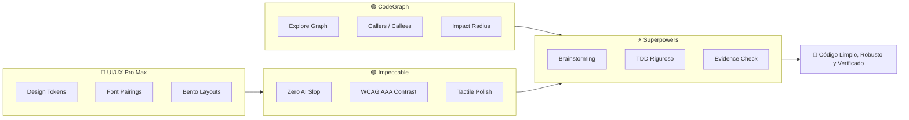

# 🏛️ Framework Universal de Documentación Viva & Master Prompt de Élite

> **Guía Metodológica y Estándar Operativo para Proyectos de Software Impulsados por IA**  
> Diseñado para mantener la coherencia arquitectónica, acelerar el desarrollo multisesión, erradicar el "AI slop" y optimizar el consumo de tokens en cualquier stack tecnológico.

---

## 📑 Tabla de Contenidos
1. [Filosofía de la Documentación Viva](#1-filosofía-de-la-documentación-viva)
2. [Estructura Canónica del Ecosistema `docs/`](#2-estructura-canónica-del-ecosistema-docs)
3. [Análisis Riguroso de Documentos Clave](#3-análisis-riguroso-de-documentos-clave)
   - [A. El Tablero de Control: `STATUS.md`](#a-el-tablero-de-control-statusmd)
   - [B. El Lanzador de Sesiones: `KICKOFF_FASE_{N}.md`](#b-el-lanzador-de-sesiones-kickoff_fase_nmd)
   - [C. Ingeniería Atómica: Specs y Plans en `superpowers/`](#c-ingeniería-atómica-specs-y-plans-en-superpowers)
   - [D. Diagnóstico Continuo: `audit/`](#d-diagnóstico-continuo-audit)
4. [La Sinergia de los Cuatro Motores de Élite](#4-la-sinergia-de-los-cuatro-motores-de-élite)
5. [Master Prompt Universal (Plantilla Copiable)](#5-master-prompt-universal-plantilla-copiable)
6. [Guía de Prompts Sesión a Sesión para el Usuario](#6-guía-de-prompts-sesión-a-sesión-para-el-usuario)
   - [Sesión 0: Inicialización y Setup](#sesión-0-inicialización-y-setup)
   - [Sesión N: Ejecución de Fase (Consumir Kickoff)](#sesión-n-ejecución-de-fase-consumir-kickoff)
   - [Mid-Sesión: Diseño de Feature Compleja](#mid-sesión-diseño-de-feature-compleja)
   - [Auditoría y Refactorización](#auditoría-y-refactorización)
7. [Protocolo de Cierre de Fase y Auto-Transición](#7-protocolo-de-cierre-de-fase-y-auto-transición)

---

## 1. Filosofía de la Documentación Viva

En el desarrollo tradicional, la documentación es estática y queda obsoleta rápidamente. En el desarrollo con Agentes IA de Élite, la documentación es **viva, accionable y auto-regenerativa**:

```
           ┌──────────────────────────────────────────────┐
           │      PRD Maestro (Estrategia Macro)          │
           └──────────────────────┬───────────────────────┘
                                  │
                                  ▼
           ┌──────────────────────────────────────────────┐
           │      STATUS.md (Estado en Tiempo Real)       │
           └──────────────────────┬───────────────────────┘
                                  │
                                  ▼
           ┌──────────────────────────────────────────────┐
           │      KICKOFF_FASE_N.md (Lanzador de Sesión)  │
           └──────────────────────┬───────────────────────┘
                                  │
                                  ▼
┌─────────────────────────────────┴─────────────────────────────────┐
│              CICLO DE DESARROLLO CON 4 MOTORES                    │
│  CodeGraph (Semántica) ➔ Superpowers (TDD/Specs) ➔ Impeccable/UX  │
└─────────────────────────────────┬─────────────────────────────────┘
                                  │
                                  ▼
           ┌──────────────────────────────────────────────┐
           │ Auto-Cierre ➔ Genera KICKOFF_FASE_{N+1}.md   │
           └──────────────────────────────────────────────┘
```

- **Cero pérdida de contexto:** Cada sesión arranca con un prompt optimizado que lee el estado exacto.
- **Cero token waste:** Navegación estructural con grafos de código en lugar de búsquedas ciegas.
- **Cero degradación arquitectónica:** Todo cambio pasa por especificación, plan atómico, TDD y verificación obligatoria.

---

## 2. Estructura Canónica del Ecosistema `docs/`

```
docs/
├── prd/                               # 🎯 GESTIÓN ESTRATÉGICA Y SEGUIMIENTO DE FASES
│   ├── PRD-MAESTRO-{{PROJECT}}.md     # 📜 Especificación completa de requerimientos (Fases 0 a N)
│   ├── STATUS.md                      # 📊 Tablero de control de avance y métricas en tiempo real
│   ├── KICKOFF_FASE_0.md              # 🚀 Arranque Fase 0: Estabilización, auditoría y baseline
│   ├── KICKOFF_FASE_1.md              # 🚀 Arranque Fase 1: Arquitectura base y fundamentos
│   ├── KICKOFF_FASE_2.md              # 🚀 Arranque Fase 2: Experiencia core de producto
│   └── KICKOFF_FASE_{N}.md            # 🚀 Auto-generado al culminar la fase anterior
│
├── superpowers/                       # ⚡ INGENIERÍA DE SOFTWARE DISCIPLINADA
│   ├── specs/                         # 📝 Diseños técnicos previos (YYYY-MM-DD-{feature}-design.md)
│   └── plans/                         # 📋 Planes de ejecución atómicos (YYYY-MM-DD-{feature}-plan.md)
│
└── audit/                             # 🔍 AUDITORÍAS Y DIAGNÓSTICOS DE CALIDAD
    └── YYYY-MM-DD-full-audit.md       # 🛡️ Análisis de seguridad, deuda técnica, a11y y UX
```

---

## 3. Análisis Riguroso de Documentos Clave

### A. El Tablero de Control: `STATUS.md`

`STATUS.md` es la **brújula operativa** del repositorio. Debe mantenerse sincronizado tras cada sprint o fase.

#### Elementos Estructurales Indispensables:
1. **Header de Referencia:** Enlaces clickeables a `PRD-MAESTRO.md`, `DESIGN.md` y `AGENTS.md`.
2. **Barra Visual de Progreso:** Porcentaje global y desglose por fases con caracteres ASCII.
3. **Resumen de Logros de la Última Iteración:** Explicación técnica de lo implementado con links a los archivos impactados.
4. **Fase en Curso y Sprints Activos:** Checkboxes claros de tareas pendientes y referencias a su `KICKOFF_FASE_{N}.md`.

```markdown
<!-- Ejemplo de Sección de Progreso en STATUS.md -->
## 📈 Resumen Global de Progreso

```text
Fase 0: Estabilización & Auditoría [████████████████] 100% (16/16 tareas) ✅
Fase 1: Fundamentos & Arquitectura [████████████████] 100% (10/10 tareas) ✅
Fase 2: Experiencia Core           [████████████████] 100% (13/13 tareas) ✅
Fase 3: Inteligencia & Analítica   [░░░░░░░░░░░░░░░░]   0% (0/18 tareas)
------------------------------------------------------------------
PROGRESO TOTAL ESTIMADO:           [███████████░░░░░]  58.0% (39/57 tareas)
```
```

---

### B. El Lanzador de Sesiones: `KICKOFF_FASE_{N}.md`

Es el contrato operativo de una fase. Permite al usuario **copiar un solo bloque de texto** y comenzar a trabajar con el agente en una sesión fresca.

#### Secciones Obligatorias:
1. **Prompt Copiable de Arranque:** Bloque `text` auto-contenido con invocación de skills, estándares no negociables y tareas del sprint.
2. **Objetivos y Alcance:** El valor de producto de la fase.
3. **Tabla de Tareas & Criterios de Aceptación:**
   | ID | Componente / Archivo | Criterio de Aceptación Verificable |
   |---|---|---|
   | **N.1.1** | `path/to/File.ext` | Comportamiento exacto esperado, sin ambigüedades. |
4. **Matriz de Anti-Patrones y Buenas Prácticas:** Errores comunes a evitar específicamente en esa fase.
5. **Protocolo de Cierre:** Instrucciones para compilar, verificar tests, actualizar `STATUS.md` y generar `KICKOFF_FASE_{N+1}.md`.

---

### C. Ingeniería Atómica: Specs y Plans en `superpowers/`

- **`docs/superpowers/specs/` (El "Qué" y el "Por Qué"):**
  - Documenta la necesidad de usuario, contratos de datos, alternativas descartadas y diagramas de arquitectura antes de programar.
- **`docs/superpowers/plans/` (El "Cómo" Paso a Paso):**
  - Divide la implementación en micro-tareas atómicas con checkboxes `[ ]`.
  - Especifica el ciclo TDD: nombre del archivo de test, caso de fallo (Red) y código de producción (Green).

---

### D. Diagnóstico Continuo: `audit/`

- Almacena reportes de auditoría inicial (Kickoff Fase 0) y diagnósticos periódicos.
- Identifica cuellos de botella de rendimiento, violaciones de Clean Architecture, vulnerabilidades de seguridad y no conformidades de accesibilidad (WCAG).

---

## 4. La Sinergia de los Cuatro Motores de Élite



| Motor | Rol Principal | Herramientas / Comandos | Regla de Oro |
|---|---|---|---|
| **CodeGraph** | Navegación semántica estructural y radio de impacto. | `codegraph_explore`, `callers`, `callees`, `impact` | Cero lecturas ciegas ni barridos masivos con `grep`/`find`. |
| **Superpowers** | Metodología de ingeniería, rigor TDD y planes atómicos. | `brainstorming`, `writing-plans`, `executing-plans`, `systematic-debugging` | Ninguna línea de código sin diseño previo y prueba que falle. |
| **Impeccable** | Estándar de diseño de interfaces y eliminación de "AI slop". | `/impeccable polish`, `/impeccable critique`, `/impeccable audit` | Cero tipografías o colores genéricos; contraste y ritmo impecables. |
| **UI/UX Pro Max** | Inteligencia de diseño de producto, tokens y componentes. | Paletas HSL dinámicas, layouts Bento, feedback háptico, micro-resortes | Tokens en 3 capas (Primitivo ➔ Semántico ➔ Componente). |

---

## 5. Master Prompt Universal (Plantilla Copiable)

> **Uso:** Personaliza las variables entre `{{...}}` y pégalo en tu archivo `AGENTS.md`, instrucciones del proyecto o en el prompt inicial de cualquier agente AI.

```markdown
# 🌟 Master Prompt: Ingeniero de Software IA de Élite & Documentación Viva

Actúa como Ingeniero de Software IA de Élite, Arquitecto de Software y Diseñador UI/UX Principal. Operarás en este proyecto bajo los más altos estándares de calidad de código, disciplina de ingeniería, excelencia estética y máxima eficiencia en el uso del contexto mediante el Sistema de Documentación Viva.

---

## 🎯 1. Contexto del Proyecto
- **Proyecto:** {{PROJECT_NAME}}
- **Descripción:** {{PROJECT_DESCRIPTION}}
- **Stack Tecnológico:** {{TECH_STACK}}
- **Objetivo Principal:** {{PRIMARY_GOAL}}

---

## 🧭 2. Sistema de Documentación Viva (`docs/`)

Debes consultar, respetar y mantener activa la siguiente estructura de documentación:

1. **`docs/prd/PRD-MAESTRO-{{PROJECT_NAME}}.md`**: Fuente de la verdad estratégica y funcional de todas las fases del proyecto.
2. **`docs/prd/STATUS.md`**: Tablero de control en tiempo real. OBLIGATORIO: Actualizar el porcentaje de progreso y marcar las tareas completadas al finalizar cada hito.
3. **`docs/prd/KICKOFF_FASE_{N}.md`**: Guía operativa y prompt de sesión para la fase en curso.
4. **`docs/superpowers/specs/`**: Especificaciones y diseños técnicos (`YYYY-MM-DD-{feature}-design.md`) creados ANTES de tocar el código.
5. **`docs/superpowers/plans/`**: Planes de ejecución atómicos paso a paso (`YYYY-MM-DD-{feature}-plan.md`) con checklists.
6. **`docs/audit/`**: Diagnósticos de arquitectura, seguridad, accesibilidad y deuda técnica.

---

## 🛠️ 3. Los Cuatro Pilares Operativos

### 🟢 Pilar 1: CodeGraph (Exploración Quirúrgica)
- Toda exploración de símbolos, análisis de dependencias, grafos de llamadas (`callers`/`callees`) y cálculo de radio de impacto DEBE realizarse mediante `codegraph_explore`.
- PROHIBIDO el barrido ciego con lecturas masivas o `grep`/`find` cuando la información puede obtenerse del grafo estructural.

### 🔵 Pilar 2: Superpowers (Metodología y Disciplina)
- **Brainstorming Previo:** Clarificar requisitos y validar el enfoque antes de implementar.
- **Systematic Debugging:** Hipótesis ➔ Aislamiento de causa raíz ➔ Test reproducible ➔ Fix quirúrgico. Cero parches a ciegas.
- **TDD Riguroso:** Ciclo Red ➔ Green ➔ Refactor. Escribir la prueba que falle antes del código de producción.
- **Verification Before Completion:** Ninguna tarea está terminada sin evidencia ejecutable (tests verdes, build exitoso y verificación visual/técnica).

### 🟣 Pilar 3: Impeccable (Diseño y Calidad Frontend)
- Erradicación total del "AI slop": Prohibido el uso de estilos genéricos, cards anidadas sin jerarquía, contrastes pobres y layouts sin ritmo visual.
- Accesibilidad WCAG AAA/AA: Verificación estricta de contraste en temas claro y oscuro.
- Micro-interacciones táctiles, resortes dinámicos (`springs`), estados vacíos empáticos y feedback háptico.

### 🎨 Pilar 4: UI/UX Pro Max (Sistemas de Diseño & Tokens)
- Arquitectura de tokens en 3 capas: Primitivos ➔ Semánticos ➔ Componentes.
- Cero colores o textos quemados en la UI (centralización en tokens/recursos de diseño y archivos de internacionalización).
- Tipografía jerárquica con propósito (editorial para lectura, monoespaciada para cifras y métricas).

---

## 📐 4. Estándares de Higiene de Código
1. **Límite de Tamaño (SRP):** Máximo ~200-250 líneas por archivo de componente/módulo. Descomponer en subcomponentes modulares.
2. **KISS & YAGNI:** Resolver exclusivamente la necesidad actual con la máxima simplicidad, sin abstracciones especulativas.
3. **Manejo de Errores Riguroso:** Prohibido silenciar excepciones en bloques `catch` vacíos. Envolver operaciones en tipos de resultado (`Result<T>` o equivalentes) y proporcionar feedback visual al usuario.
4. **Separación de Responsabilidades:** Componentes UI 100% declarativos, sin cálculos matemáticos, formateos pesados ni lógica de negocio en la capa de vista.

---

## 🏁 5. Protocolo Automático de Cierre de Fase

Al completar el 100% de las tareas de la Fase {N}, el agente DEBE ejecutar automáticamente:
1. **Verificación de Integridad:** Ejecutar suite completa de pruebas unitarias y comando de build del proyecto.
2. **Actualización de Estado:** Marcar la Fase {N} al 100% en `docs/prd/STATUS.md` con fecha y resumen de logros.
3. **Auto-Generación del Siguiente Kickoff:** Crear `docs/prd/KICKOFF_FASE_{N+1}.md` conteniendo el prompt copiable para la siguiente sesión, desglose de tareas, matriz de anti-patrones y criterios de aceptación.
4. **Actualización de Enlaces:** Registrar el nuevo Kickoff en los índices de documentación.
```

---

## 6. Guía de Prompts Sesión a Sesión para el Usuario

### Sesión 0: Inicialización y Setup
> **Objetivo:** Auditar el proyecto, estructurar `docs/` y crear la línea base.

```text
Actúa como Arquitecto de Software y Tech Lead. Vamos a inicializar el Sistema de Documentación Viva en este proyecto.

Tareas a ejecutar:
1. Ejecuta una exploración inicial con `codegraph` para mapear dependencias y arquitectura.
2. Crea la estructura de carpetas: `docs/prd/`, `docs/superpowers/specs/`, `docs/superpowers/plans/`, `docs/audit/`.
3. Redacta `docs/audit/YYYY-MM-DD-full-audit.md` con la auditoría inicial de arquitectura, seguridad y UI/UX.
4. Redacta `docs/prd/PRD-MAESTRO-{{PROJECT_NAME}}.md` con el roadmap por fases.
5. Inicializa `docs/prd/STATUS.md` con el progreso en 0%.
6. Genera `docs/prd/KICKOFF_FASE_0.md` para iniciar la estabilización y resolución de deuda técnica.
```

---

### Sesión N: Ejecución de Fase (Consumir Kickoff)
> **Objetivo:** Iniciar una fase de desarrollo limpia a partir de su archivo de Kickoff.

```text
Actúa como Ingeniero de Software IA de Élite en {{PROJECT_NAME}}. Vamos a ejecutar la Fase {N} del roadmap: "{{NOMBRE_DE_LA_FASE}}", siguiendo estrictamente las especificaciones de docs/prd/KICKOFF_FASE_{N}.md, docs/prd/PRD-MAESTRO-{{PROJECT_NAME}}.md, docs/prd/STATUS.md y AGENTS.md.

Skills obligatorias:
- `codegraph`: Exploración semántica de símbolos y callers sin barridos masivos de tokens.
- `superpowers`: Brainstorming, TDD (Red ➔ Green ➔ Refactor) y Verification Before Completion.
- `impeccable` & `ui-ux-pro-max`: Diseño de interfaz, tokens WCAG AAA y micro-interacciones.

Plan de Trabajo:
- Ejecutar secuencialmente los Sprints detallados en docs/prd/KICKOFF_FASE_{N}.md.
- Al culminar el 100%: ejecutar suite de tests, compilar build, actualizar docs/prd/STATUS.md y generar automáticamente docs/prd/KICKOFF_FASE_{N+1}.md.

Inicia explorando el codebase con codegraph y abordando la primera tarea del Sprint {N}.1 con TDD.
```

---

### Mid-Sesión: Diseño de Feature Compleja
> **Objetivo:** Especificar y planificar una funcionalidad nueva antes de programar.

```text
Necesito implementar la funcionalidad "{{FEATURE_NAME}}".

Aplica el flujo estricto de Superpowers e Impeccable:
1. Haz un brainstorming con los requerimientos, edge cases y arquitectura propuesta.
2. Redacta la especificación técnica en `docs/superpowers/specs/YYYY-MM-DD-{{FEATURE_NAME}}-design.md`.
3. Crea el plan de ejecución atómico con checkboxes en `docs/superpowers/plans/YYYY-MM-DD-{{FEATURE_NAME}}-plan.md`.
4. Detén tu ejecución y solicita mi confirmación antes de escribir código en producción.
```

---

### Auditoría y Refactorización
> **Objetivo:** Sanear deuda técnica, rendimiento o accesibilidad.

```text
Ejecuta una auditoría exhaustiva en el módulo/pantalla {{MODULE_NAME}} evaluando:
1. Arquitectura y SRP (tamaño de archivo ≤ 250 LOC, separación estricta de capas).
2. Seguridad y manejo de excepciones (cero try/catch vacíos, propagación de Result<T>).
3. UI/UX y Accesibilidad (contraste WCAG AAA/AA, tokens de color, cero strings quemados).
4. Cobertura de tests unitarios y casos de borde.

Genera el reporte en `docs/audit/YYYY-MM-DD-{{MODULE_NAME}}-audit.md` y añade los fixes necesarios al plan de trabajo.
```

---

## 7. Protocolo de Cierre de Fase y Auto-Transición

Al finalizar la última tarea de una fase, el agente debe ejecutar de forma autónoma el siguiente ritual de 4 pasos:

```text
┌──────────────────────────────────────────────────────────────────┐
│ 1. VERIFICACIÓN INTEGRAL DE SUITE DE PRUEBAS Y BUILD             │
│    Ejecutar suite de tests unitarios y comando de compilación.   │
│    Evidencia antes de afirmaciones: cero regresiones.            │
└────────────────────────────────┬─────────────────────────────────┘
                                 ▼
┌──────────────────────────────────────────────────────────────────┐
│ 2. ACTUALIZACIÓN DE STATUS.md                                    │
│    Marcar fase al 100%, registrar fecha y logros alcanzados.     │
└────────────────────────────────┬─────────────────────────────────┘
                                 ▼
┌──────────────────────────────────────────────────────────────────┐
│ 3. GENERACIÓN DEL KICKOFF DE LA SIGUIENTE FASE                   │
│    Crear docs/prd/KICKOFF_FASE_{N+1}.md con prompt copiable,     │
│    tabla de tareas, anti-patrones y criterios de aceptación.     │
└────────────────────────────────┬─────────────────────────────────┘
                                 ▼
┌──────────────────────────────────────────────────────────────────┐
│ 4. ACTUALIZACIÓN DE ÍNDICES Y ENLACES                            │
│    Vincular el nuevo Kickoff en STATUS.md y AGENTS.md.           │
└──────────────────────────────────────────────────────────────────┘
```

---

## 💎 Conclusión: Por Qué Este Sistema Escala

| Desafío Típico en Desarrollo con IA | Solución con este Framework |
|---|---|
| La IA olvida el contexto en conversaciones largas. | **`KICKOFF_FASE_N.md`** permite reiniciar la sesión en 5 segundos con contexto perfecto. |
| La IA gasta miles de tokens leyendo archivos innecesarios. | **`CodeGraph`** entrega las llamadas y referencias en 1 sola query. |
| El código generado tiene bugs sutiles o rompe features previas. | **`Superpowers`** impone TDD estricto y verificación antes de dar por terminado. |
| La interfaz luce genérica, descuidada o sin alma ("AI slop"). | **`Impeccable` + `UI/UX Pro Max`** aseguran micro-interacciones, tipografía editorial y contraste AAA. |
| El proyecto se abandona a mitad de camino por desorden. | **`STATUS.md`** y el protocolo auto-kickoff mantienen el roadmap vivo hasta el 100%. |
