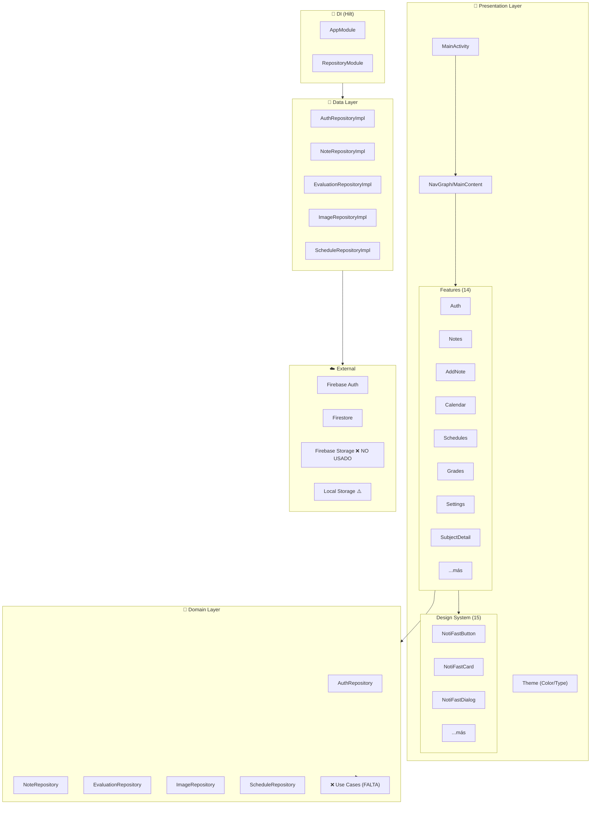

# 🔍 AUDITORÍA EXTREMA — NotiFast v1.0

> **Proyecto:** NotiFast — Hub Educativo / Cuaderno Académico con Esteroides  
> **Stack:** Kotlin • Jetpack Compose • Firebase (Auth + Firestore) • Hilt • Coil  
> **Fecha:** 18 de Junio, 2026  
> **Total líneas de código:** ~8,300 LOC en 56 archivos Kotlin  
> **Arquitectura:** Clean Architecture (Data → Domain → Presentation) + MVVM + MVI Contracts

---

## 📊 Resumen Ejecutivo

| Categoría | Estado | Calificación |
|---|---|---|
| **Arquitectura** | Sólida base Clean + MVVM | ⭐⭐⭐⭐ |
| **Seguridad** | Vulnerabilidades críticas | ⭐⭐ |
| **Rendimiento** | Problemas de escalabilidad | ⭐⭐⭐ |
| **Calidad de Código** | Buena pero con deuda técnica | ⭐⭐⭐ |
| **Testing** | Inexistente | ⭐ |
| **UI/UX** | Funcional con buen diseño | ⭐⭐⭐⭐ |
| **Mantenibilidad** | Aceptable | ⭐⭐⭐ |
| **Documentación** | Rica en specs/plans | ⭐⭐⭐⭐ |

---

## 🟢 LO QUE ESTÁ BIEN

### 1. Arquitectura Limpia y Bien Estructurada
- ✅ **Separación clara en capas:** `data/` → `domain/` → `presentation/`
- ✅ **Patrón Contract (MVI):** Cada feature tiene `Screen`, `ViewModel`, y `Contract` (State + Events)
- ✅ **Inyección de dependencias con Hilt** correctamente configurada con `@HiltAndroidApp`, `@AndroidEntryPoint`, `@HiltViewModel`
- ✅ Uso correcto de `@Binds` en [RepositoryModule.kt](file:///home/analista/AndroidStudioProjects/NotiFast/app/src/main/java/com/example/notifast/di/RepositoryModule.kt) en vez de `@Provides` para los repositorios
- ✅ Interfaces de repositorio en `domain/` con implementaciones en `data/` — inversión de dependencias correcta

### 2. Design System Propio (Atoms)
- ✅ **15 componentes atómicos** en `/presentation/atoms/`: `NotiFastButton`, `NotiFastCard`, `NotiFastTextField`, `NotiFastDialog`, `NotiFastEmptyState`, etc.
- ✅ Identidad visual clara con colores corporativos (`Ruby #BF092F`, `Aqua #3B9797`)
- ✅ Componentes reutilizables: `NotiFastBackground`, `NotiFastStudyBackground`, `NotiFastBottomNav`

### 3. Navegación Bien Organizada
- ✅ [Screen.kt](file:///home/analista/AndroidStudioProjects/NotiFast/app/src/main/java/com/example/notifast/presentation/navigation/Screen.kt) con sealed class para rutas type-safe
- ✅ `createRoute()` functions para rutas con parámetros
- ✅ `bottomNavItems` companion object limpio
- ✅ Manejo correcto de `popUpTo` y `launchSingleTop`

### 4. Buenas Prácticas de Compose
- ✅ `collectAsStateWithLifecycle()` para observar state flows
- ✅ `BackHandler` implementado en la pantalla de notas
- ✅ Animaciones con `AnimatedVisibility`, `fadeIn`, `scaleIn`, `spring` 
- ✅ Edge-to-edge habilitado en [MainActivity.kt](file:///home/analista/AndroidStudioProjects/NotiFast/app/src/main/java/com/example/notifast/MainActivity.kt)

### 5. Modelo de Datos Coherente
- ✅ Data classes inmutables con valores default
- ✅ `@ServerTimestamp` para marcas de tiempo de Firebase
- ✅ Relación `Note` ↔ `Subject` ↔ `Evaluation` coherente
- ✅ `SubjectData` con icono emoji y color hex personalizable

### 6. Documentación del Proceso
- ✅ **9 planes de implementación** y **8 specs de diseño** en `/docs/superpowers/`
- ✅ Historial claro de decisiones: migración MVVM/SOLID, restauración visual, rediseño de notas

---

## 🔴 CRÍTICO — Requiere Atención Inmediata

### C1. `google-services.json` VERSIONADO EN GIT

> [!CAUTION]
> El archivo `google-services.json` está en el repositorio y NO está en `.gitignore`. Este archivo contiene el `project_number`, `api_key`, `client_id` y el `project_id` de Firebase.

**Archivo:** [google-services.json](file:///home/analista/AndroidStudioProjects/NotiFast/app/google-services.json)  
**Riesgo:** Exposición de credenciales de Firebase. Cualquiera con acceso al repo puede hacer llamadas a tu proyecto Firebase.

**Acción:**
1. Añadir `app/google-services.json` a `.gitignore`
2. Rotar API keys en Firebase Console
3. Configurar App Check en Firebase

---

### C2. SIN REGLAS DE SEGURIDAD DE FIRESTORE

> [!CAUTION]
> No hay archivo `firestore.rules` en el proyecto. Sin reglas de seguridad, la base de datos puede estar abierta a cualquier usuario autenticado (o incluso no autenticado dependiendo de la config por defecto).

**Riesgo:** Cualquier usuario autenticado puede leer/escribir los datos de CUALQUIER otro usuario.

**Impacto:** Un usuario malicioso podría:
- Leer los apuntes de todos los usuarios
- Borrar notas ajenas
- Modificar calificaciones de otros
- Acceder a fotos de perfil ajenas

**Acción urgente:** Implementar reglas de Firestore que validen `request.auth.uid == userId` para todas las operaciones.

---

### C3. SIN VALIDACIÓN DE PERMISOS EN FIRESTORE

> [!CAUTION]
> En todo el backend de datos, el `userId` se pasa como parámetro y se usa directamente para construir las rutas de Firestore. NO se verifica que el `userId` pasado sea el mismo que el del usuario autenticado.

**Archivos afectados:**
- [NoteRepositoryImpl.kt](file:///home/analista/AndroidStudioProjects/NotiFast/app/src/main/java/com/example/notifast/data/repository/NoteRepositoryImpl.kt) — todas las operaciones
- [EvaluationRepositoryImpl.kt](file:///home/analista/AndroidStudioProjects/NotiFast/app/src/main/java/com/example/notifast/data/repository/EvaluationRepositoryImpl.kt)
- [ScheduleRepositoryImpl.kt](file:///home/analista/AndroidStudioProjects/NotiFast/app/src/main/java/com/example/notifast/data/repository/ScheduleRepositoryImpl.kt)

**Ejemplo del problema** en [NoteRepositoryImpl.kt:90-92](file:///home/analista/AndroidStudioProjects/NotiFast/app/src/main/java/com/example/notifast/data/repository/NoteRepositoryImpl.kt#L90-L92):
```kotlin
// Cualquier userId se acepta sin validación
db.collection("users").document(userId) // ← userId podría ser de cualquier usuario
    .collection("subjects").document(subject)
    .collection("notes").add(noteMap).await()
```

---

### C4. CERO TESTS UNITARIOS NI DE INTEGRACIÓN

> [!CAUTION]
> El proyecto solo tiene los tests placeholder generados por el template de Android Studio. **No hay ningún test real**.

**Archivos existentes:**
- `ExampleUnitTest.kt` — test placeholder
- `ExampleInstrumentedTest.kt` — test placeholder

**Impacto:** 
- No hay forma automatizada de verificar que la lógica de negocio funciona
- Los cálculos de promedio ponderado no se verifican (lógica compleja)
- Refactorizaciones pueden romper funcionalidad sin que nadie lo note
- Release candidates sin garantía de calidad

---

### C5. RELEASE BUILD SIN MINIFICACIÓN

> [!WARNING]
> `isMinifyEnabled = false` en el release build type.

**Archivo:** [build.gradle.kts:25](file:///home/analista/AndroidStudioProjects/NotiFast/app/build.gradle.kts#L25)
```kotlin
release {
    isMinifyEnabled = false // ← CRÍTICO para producción
}
```

**Impacto:**
- APK significativamente más grande
- Código Kotlin/Java completamente legible con decompiladores
- Sin ofuscación de nombres de clases/métodos
- Sin tree-shaking de código no utilizado

---

## 🟠 BLOQUEANTE — Debe resolverse antes de producción

### B1. Imágenes almacenadas solo localmente — NO sincronizadas

> [!WARNING]
> A pesar de tener `firebase-storage` como dependencia, [ImageRepositoryImpl.kt](file:///home/analista/AndroidStudioProjects/NotiFast/app/src/main/java/com/example/notifast/data/repository/ImageRepositoryImpl.kt) guarda imágenes **solo en almacenamiento local** del dispositivo. Las URLs almacenadas en Firestore son rutas `file://` locales.

**Problema en** [ImageRepositoryImpl.kt:41-61](file:///home/analista/AndroidStudioProjects/NotiFast/app/src/main/java/com/example/notifast/data/repository/ImageRepositoryImpl.kt#L41-L61):
```kotlin
private suspend fun saveImageLocally(relativePath: String, uri: Uri): Result<String> {
    // Guarda en context.filesDir — solo accesible en este dispositivo
    val outputFile = File(context.filesDir, relativePath)
    // ...
    Result.success(Uri.fromFile(outputFile).toString()) // ← URL tipo file://
}
```

**Consecuencias:**
- Las imágenes NO se sincronizan entre dispositivos
- Si el usuario cambia de teléfono, pierde TODAS las imágenes
- Las URLs `file://` almacenadas en Firestore son inservibles desde otro dispositivo
- La dependencia `firebase-storage` está importada pero no se usa → dead code

---

### B2. Subcolecciones Firestore crean N+1 listeners activos

> [!WARNING]
> [getNotes()](file:///home/analista/AndroidStudioProjects/NotiFast/app/src/main/java/com/example/notifast/data/repository/NoteRepositoryImpl.kt#L29-L52) crea un snapshot listener por CADA materia, y luego los combina con `flatMapLatest` + `combine`.

```kotlin
override fun getNotes(userId: String): Flow<List<Note>> {
    return db.collection("users").document(userId)
        .collection("subjects").snapshots()
        .flatMapLatest { snapshot ->
            val subjects = snapshot.documents.map { ... }
            val noteFlows: List<Flow<List<Note>>> = subjects.map { subject ->
                db.collection("users").document(userId)
                    .collection("subjects").document(subject)
                    .collection("notes").snapshots() // ← Listener por materia
            }
            combine(noteFlows) { arrays -> arrays.flatMap { it } }
        }
    }
```

**Impacto:**
- Con 10 materias = 11 listeners activos simultáneos (1 de subjects + 10 de notes)
- Consumo de batería y datos innecesarios
- Costos de Firestore multiplicados
- Potencial Memory leak si no se cancela correctamente

---

### B3. Eliminación de materia NO es atómica

> [!WARNING]
> [deleteSubject()](file:///home/analista/AndroidStudioProjects/NotiFast/app/src/main/java/com/example/notifast/data/repository/NoteRepositoryImpl.kt#L172-L194) elimina las notas de una materia **una por una** en un loop. Si la app se cierra a mitad del proceso, queda en un estado inconsistente.

```kotlin
for (doc in notesSnapshot.documents) {
    // Eliminar imagen (puede fallar silenciosamente)
    try { imageRepository.deleteImage(imageUrl) } catch(e: Exception) {}
    doc.reference.delete().await() // ← Una por una, no atómico
}
// Luego eliminar el documento de la materia
db.collection("users").document(userId)
    .collection("subjects").document(subjectName).delete().await()
```

**Acción:** Usar `WriteBatch` de Firestore para operaciones atómicas (máximo 500 operaciones por batch).

---

### B4. Navegación con nombres de materia como URL — Sin encoding

> [!WARNING]
> Las rutas de navegación usan el nombre de la materia directamente en la URL sin codificación.

**Archivo:** [Screen.kt:42](file:///home/analista/AndroidStudioProjects/NotiFast/app/src/main/java/com/example/notifast/presentation/navigation/Screen.kt#L42)
```kotlin
data object SubjectDetail : Screen("subject_detail/{subjectName}") {
    fun createRoute(subjectName: String) = "subject_detail/$subjectName"
    // ← Si subjectName = "Matemáticas/Cálculo", la ruta se rompe
}
```

**Impacto:** Caracteres especiales (`/`, `?`, `#`, espacios, acentos) en nombres de materias rompen la navegación.  
**Acción:** Usar `Uri.encode()` al crear rutas y `Uri.decode()` al leerlas.

---

### B5. Manejo inconsistente de errores — Fallos silenciosos

> [!WARNING]
> Múltiples operaciones de borrado ignoran completamente los errores:

**En** [NoteRepositoryImpl.kt:182](file:///home/analista/AndroidStudioProjects/NotiFast/app/src/main/java/com/example/notifast/data/repository/NoteRepositoryImpl.kt#L182):
```kotlin
try { imageRepository.deleteImage(imageUrl) } catch(e: Exception) {} // ← Error tragado
```

**En** [deleteEvaluation()](file:///home/analista/AndroidStudioProjects/NotiFast/app/src/main/java/com/example/notifast/data/repository/EvaluationRepositoryImpl.kt#L98-L107) no elimina la imagen asociada antes de borrar la evaluación → imágenes huérfanas.

**En** [SchedulesViewModel.kt:48](file:///home/analista/AndroidStudioProjects/NotiFast/app/src/main/java/com/example/notifast/presentation/feature/schedules/SchedulesViewModel.kt#L48) y [CalendarViewModel.kt:53](file:///home/analista/AndroidStudioProjects/NotiFast/app/src/main/java/com/example/notifast/presentation/feature/calendar/CalendarViewModel.kt#L53): `deleteSchedule` y `deleteEvaluation` no manejan el resultado — si fallan, el usuario nunca lo sabe.

---

## 🟡 IMPORTANTE — Deuda técnica significativa

### I1. Tema NO personalizado — Usando colores de template

El tema usa los colores `Purple80/40`, `PurpleGrey80/40`, `Pink80/40` del template de Android Studio en vez de los colores corporativos.

**Archivo:** [Theme.kt](file:///home/analista/AndroidStudioProjects/NotiFast/app/src/main/java/com/example/notifast/presentation/theme/theme/Theme.kt#L15-L25)
```kotlin
private val DarkColorScheme = darkColorScheme(
    primary = Purple80,     // ← Color del template, NO corporativo
    secondary = PurpleGrey80,
    tertiary = Pink80
)
```

Los colores corporativos `Ruby` y `Aqua` se usan directamente en los composables en vez de a través del tema Material. Esto hace imposible un dark mode coherente.

---

### I2. Tipografía solo tiene `bodyLarge` personalizado

**Archivo:** [Type.kt](file:///home/analista/AndroidStudioProjects/NotiFast/app/src/main/java/com/example/notifast/presentation/theme/type/Type.kt)
```kotlin
val Typography = Typography(
    bodyLarge = TextStyle(
        fontFamily = FontFamily.Default, // ← Solo 1 estilo definido
        fontWeight = FontWeight.Normal,
        fontSize = 16.sp
    )
)
```

**Impacto:** Todos los demás estilos (`titleLarge`, `headlineMedium`, `labelSmall`) usan los defaults de Material 3. No hay tipografía custom.

---

### I3. `getNotesBySubject()` definido como `suspend` pero retorna `Flow`

**Archivo:** [NoteRepository.kt:26](file:///home/analista/AndroidStudioProjects/NotiFast/app/src/main/java/com/example/notifast/domain/repository/NoteRepository.kt#L26)
```kotlin
suspend fun getNotesBySubject(userId: String, subject: String): Flow<List<Note>>
// ← No necesita ser suspend si retorna Flow
```

Un `Flow` ya es lazy por naturaleza. Marcarlo como `suspend` es innecesario y confuso.

---

### I4. Duplicación de lógica de cálculo de promedio ponderado

La misma lógica de cálculo de promedio ponderado se repite en **3 lugares**:
1. [NotesViewModel.kt:102-104](file:///home/analista/AndroidStudioProjects/NotiFast/app/src/main/java/com/example/notifast/presentation/feature/notes/NotesViewModel.kt#L102-L104)
2. [SubjectDetailViewModel.kt:46-48](file:///home/analista/AndroidStudioProjects/NotiFast/app/src/main/java/com/example/notifast/presentation/feature/subjectdetail/SubjectDetailViewModel.kt#L46-L48)
3. Potencialmente en `GradesScreen`

```kotlin
// Código duplicado en 3 ViewModels:
val weightedSum = graded.sumOf { (it.grade ?: 0.0) * (if (it.weight == null || it.weight == 0.0) 1.0 else it.weight) }
val totalWeight = graded.sumOf { if (it.weight == null || it.weight == 0.0) 1.0 else it.weight }
val avg = if (totalWeight > 0.0) weightedSum / totalWeight else null
```

**Acción:** Extraer a un Use Case en la capa `domain/`.

---

### I5. Pantallas MUY grandes — Violación del SRP

| Archivo | Líneas |
|---|---|
| [NotesScreen.kt](file:///home/analista/AndroidStudioProjects/NotiFast/app/src/main/java/com/example/notifast/presentation/feature/notes/NotesScreen.kt) | 466 |
| [CalendarScreen.kt](file:///home/analista/AndroidStudioProjects/NotiFast/app/src/main/java/com/example/notifast/presentation/feature/calendar/CalendarScreen.kt) | 427 |
| [SubjectCard.kt](file:///home/analista/AndroidStudioProjects/NotiFast/app/src/main/java/com/example/notifast/presentation/feature/notes/components/SubjectCard.kt) | 416 |
| [GradesScreen.kt](file:///home/analista/AndroidStudioProjects/NotiFast/app/src/main/java/com/example/notifast/presentation/feature/grades/GradesScreen.kt) | 412 |

Recomendación: Máximo ~200-250 líneas por composable. Extraer sub-componentes.

---

### I6. Falta de capa `domain/usecase`

La capa `domain/` solo contiene interfaces de repositorio. No hay **Use Cases** que encapsulen lógica de negocio reutilizable:

```
domain/
└── repository/     ← Solo interfaces, 0 use cases
    ├── AuthRepository.kt
    ├── EvaluationRepository.kt
    ├── ImageRepository.kt
    ├── NoteRepository.kt
    └── ScheduleRepository.kt
```

**Impacto:** Los ViewModels contienen lógica de negocio directamente → difícil de testear y reutilizar.

---

### I7. `SubjectData` usa nombre como ID (document ID)

**Archivo:** [NoteRepositoryImpl.kt:107-108](file:///home/analista/AndroidStudioProjects/NotiFast/app/src/main/java/com/example/notifast/data/repository/NoteRepositoryImpl.kt#L107-L108)
```kotlin
db.collection("users").document(userId)
    .collection("subjects").document(subjectName) // ← El nombre ES el ID
    .set(data)
```

**Impacto:**
- No se puede renombrar una materia sin migrar TODOS los documentos hijos
- Caracteres especiales en nombres pueden causar problemas
- Colisiones si dos materias tienen el mismo nombre (por diseño, pero limita)

---

### I8. No hay soporte offline real

A pesar de usar Firestore (que tiene cache offline por defecto), la app no maneja explícitamente el modo offline:
- No hay indicador de conectividad
- No hay retry policy para operaciones fallidas
- No hay queue de operaciones pendientes
- Los errores de red se muestran como errores genéricos

---

## 🔵 MEJORAS — Nice to Have

### M1. Compose BOM desactualizado
**Versión actual:** `2024.09.00`  
**Última estable:** `2025.06.x` (aproximado)  
El BOM de Compose se quedó en septiembre 2024.

### M2. Coil v2 → v3 disponible
**Versión actual:** `2.7.0`  
Coil 3.x tiene mejoras significativas de rendimiento y soporte para Compose Multiplatform.

### M3. `play-services-auth` deprecado
**Versión actual:** `21.2.0`  
Google recomienda migrar a **Credential Manager API** para Sign-In.

### M4. No hay `@Preview` composables
Ningún composable tiene funciones `@Preview`. Esto dificulta el desarrollo visual en Android Studio.

### M5. No hay Proguard rules customizadas
El archivo `proguard-rules.pro` probablemente está vacío. Firebase y Hilt necesitan reglas específicas si se habilita minificación.

### M6. Hardcoded strings en UI
Textos como "Hola, $displayName", "Eliminar materia", "Buscar apuntes o materias..." están hardcodeados en los composables en vez de usar `stringResource()`.

### M7. No hay analytics ni crash reporting
No hay Firebase Analytics, Firebase Crashlytics, ni ningún otro sistema de monitoreo.

### M8. Falta accesibilidad
- No hay `contentDescription` en muchos iconos y botones
- No se manejan tamaños de fuente dinámicos (accessibility font scaling)
- No se testea con TalkBack

---

## 📈 Métricas del Proyecto

| Métrica | Valor |
|---|---|
| **Total Kotlin files** | 56 |
| **Total LOC** | ~8,300 |
| **Features implementadas** | 14 (auth, notes, addnote, editnote, addsubject, subjectdetail, calendar, schedules, grades, settings, editprofile, addevaluation, editevaluation, main) |
| **Data models** | 5 (Note, Subject, Evaluation, Schedule, User) |
| **Repositorios** | 5 (Auth, Note, Evaluation, Image, Schedule) |
| **ViewModels** | 12 |
| **Atomic components** | 15 |
| **Unit tests** | 0 reales |
| **Docs/Plans** | 17 archivos |

---

## 🗺️ PRÓXIMOS PASOS — Prioridad ordenada

### 🔴 URGENTE (Sprint 1 — Esta semana)

| # | Tarea | Severidad | Esfuerzo |
|---|---|---|---|
| 1 | Agregar `google-services.json` al `.gitignore` y rotar keys | Crítico | 30 min |
| 2 | Implementar Firestore Security Rules | Crítico | 2-3 hrs |
| 3 | Habilitar `isMinifyEnabled = true` + R8 + Proguard rules | Crítico | 2-4 hrs |
| 4 | Codificar/decodificar nombres de materia en URLs de navegación | Bloqueante | 1 hr |

### 🟠 IMPORTANTE (Sprint 2 — Próxima semana)

| # | Tarea | Severidad | Esfuerzo |
|---|---|---|---|
| 5 | Migrar ImageRepository a Firebase Storage (sincronización real) | Bloqueante | 4-6 hrs |
| 6 | Refactorizar tema con colores corporativos + dark mode | Importante | 3-4 hrs |
| 7 | Extraer cálculo de promedio ponderado a un Use Case | Importante | 2 hrs |
| 8 | Implementar WriteBatch en deleteSubject() | Bloqueante | 2 hrs |
| 9 | Manejar errores de forma consistente (no tragarlos) | Bloqueante | 3 hrs |
| 10 | Optimizar getNotes() — evitar N+1 listeners | Importante | 4-6 hrs |

### 🟡 MEDIA (Sprint 3-4)

| # | Tarea | Severidad | Esfuerzo |
|---|---|---|---|
| 11 | Crear capa de Use Cases en domain/ | Importante | 8-12 hrs |
| 12 | Escribir tests unitarios para ViewModels | Importante | 8-12 hrs |
| 13 | Dividir pantallas grandes (>300 LOC) en sub-composables | Mejora | 4-6 hrs |
| 14 | Migrar hardcoded strings a `strings.xml` | Mejora | 3-4 hrs |
| 15 | Agregar `@Preview` a composables clave | Mejora | 2-3 hrs |
| 16 | Implementar soporte offline explícito con indicador | Mejora | 4-6 hrs |

### 🔵 FUTURO (Backlog)

| # | Tarea | Severidad | Esfuerzo |
|---|---|---|---|
| 17 | Actualizar Compose BOM a versión reciente | Mejora | 1-2 hrs |
| 18 | Migrar de play-services-auth a Credential Manager | Mejora | 4-6 hrs |
| 19 | Agregar Firebase Crashlytics + Analytics | Mejora | 2-3 hrs |
| 20 | Migrar Coil v2 → v3 | Mejora | 2-3 hrs |
| 21 | Mejorar accesibilidad (contentDescription, TalkBack) | Mejora | 3-4 hrs |
| 22 | Implementar paginación en listas largas | Mejora | 4-6 hrs |
| 23 | Agregar notificaciones push para evaluaciones próximas | Feature | 8-12 hrs |
| 24 | Exportar notas/calificaciones a PDF | Feature | 6-8 hrs |

---

## 🏗️ Diagrama de Arquitectura Actual



---

## 🔒 Resumen de Seguridad

| Vulnerabilidad | CWE | Severidad | Estado |
|---|---|---|---|
| Credenciales en repositorio | CWE-798 | 🔴 Crítica | Abierta |
| Sin validación de autorización en data layer | CWE-862 | 🔴 Crítica | Abierta |
| Sin Firestore Security Rules | CWE-285 | 🔴 Crítica | Abierta |
| Sin ofuscación en release | CWE-311 | 🟠 Alta | Abierta |
| Error handling suprimido | CWE-390 | 🟡 Media | Abierta |
| Sin input validation (nombres materia) | CWE-20 | 🟡 Media | Abierta |

---

## 🔬 ANÁLISIS PROFUNDO DE CÓDIGO — Hallazgos Adicionales

Tras revisar las **8,300 líneas** del proyecto archivo por archivo, estos son los hallazgos granulares por pantalla y componente:

---

### 🔐 AUTH — Hallazgos en LoginScreen

#### A1. `WEB_CLIENT_ID` hardcodeado en código fuente

> [!CAUTION]
> El OAuth Client ID de Google está hardcodeado como constante en [LoginScreen.kt:42](file:///home/analista/AndroidStudioProjects/NotiFast/app/src/main/java/com/example/notifast/presentation/feature/auth/LoginScreen.kt#L42):
```kotlin
private const val WEB_CLIENT_ID = "972069019951-kpd69bj1oik7kq9r4sg47rggcvohcdi8.apps.googleusercontent.com"
```
**Riesgo:** CWE-798. Este ID debería estar en `BuildConfig` o como recurso de strings, nunca hardcodeado. Si el repo es público, esto expone el client ID.

#### A2. Google Sign-In usa API deprecada

[LoginScreen.kt:38-39](file:///home/analista/AndroidStudioProjects/NotiFast/app/src/main/java/com/example/notifast/presentation/feature/auth/LoginScreen.kt#L38-L39) usa `GoogleSignIn` y `GoogleSignInOptions` que están **deprecados** desde 2023. Google recomienda **Credential Manager API**.

#### A3. Side-effect en composición — `onLoginSuccess()` sin `LaunchedEffect`

[LoginScreen.kt:52-55](file:///home/analista/AndroidStudioProjects/NotiFast/app/src/main/java/com/example/notifast/presentation/feature/auth/LoginScreen.kt#L52-L55):
```kotlin
if (uiState.isLoggedIn) {
    onLoginSuccess() // ← Se ejecuta durante composición, no como side-effect
    return
}
```
**Problema:** `onLoginSuccess()` dispara navegación durante la fase de composición. Debería envolvirse en un `LaunchedEffect(uiState.isLoggedIn)` para evitar recomposiciones infinitas y comportamiento impredecible.

#### A4. Sin validación de email ni contraseña

No hay validación del formato de email ni longitud mínima de contraseña antes de enviar al ViewModel. Firebase retornará errores, pero la UX sería mejor con validación local.

#### A5. Wildcard imports

[LoginScreen.kt:10,16-18](file:///home/analista/AndroidStudioProjects/NotiFast/app/src/main/java/com/example/notifast/presentation/feature/auth/LoginScreen.kt#L10) usa wildcard imports (`.*`) que dificultan saber qué se usa realmente:
```kotlin
import androidx.compose.foundation.layout.*
import androidx.compose.material.icons.filled.*
import androidx.compose.material3.*
import androidx.compose.runtime.*
```

---

### 📅 CALENDAR — Hallazgos en CalendarScreen

#### CAL1. `isSameDay()` crea 2 Calendar instances por llamada

[CalendarScreen.kt:423-427](file:///home/analista/AndroidStudioProjects/NotiFast/app/src/main/java/com/example/notifast/presentation/feature/calendar/CalendarScreen.kt#L423-L427):
```kotlin
fun isSameDay(date1: Date?, date2: Date): Boolean {
    val cal1 = Calendar.getInstance().apply { time = date1 }
    val cal2 = Calendar.getInstance().apply { time = date2 }
    // ...
}
```
**Impacto:** Esta función se llama para CADA celda del calendario × CADA nota × CADA evaluación. Con 31 días y 50 notas/evaluaciones, son ~3,100 llamadas con ~6,200 objetos Calendar creados por cada recomposición. Debería cachearse o usar `LocalDate` de `java.time`.

#### CAL2. Composables públicos que deberían ser privados

`NoteExpandableItem`, `EvaluationExpandableItem`, `DetailRow`, `CalendarGrid` son `public` por defecto pero solo se usan dentro de `CalendarScreen.kt`. Deberían ser `private`.

#### CAL3. El FAB se superpone al Scaffold sin `floatingActionButton`

El `FloatingActionButton` se posiciona con un `Box` manual en vez de usar el parámetro `floatingActionButton` del `Scaffold`, lo que puede causar problemas de solapamiento con el contenido scrolleable.

---

### 📊 GRADES — Hallazgos en GradesScreen

#### G1. Lógica de promedio ponderado repetida por CUARTA vez

[GradesScreen.kt:128-134](file:///home/analista/AndroidStudioProjects/NotiFast/app/src/main/java/com/example/notifast/presentation/feature/grades/GradesScreen.kt#L128-L134) (`MainAverageDashboard`) y [GradesScreen.kt:211-216](file:///home/analista/AndroidStudioProjects/NotiFast/app/src/main/java/com/example/notifast/presentation/feature/grades/GradesScreen.kt#L211-L216) (`SubjectRevampCard`) repiten la misma lógica en el **composable** en vez del ViewModel. Ahora hay **4 implementaciones** del mismo cálculo:
1. `NotesViewModel` 
2. `SubjectDetailViewModel`
3. `GradesScreen` → `MainAverageDashboard`
4. `GradesScreen` → `SubjectRevampCard`

#### G2. Promedio global calculado como promedio de promedios ≠ Promedio real

[GradesScreen.kt:137](file:///home/analista/AndroidStudioProjects/NotiFast/app/src/main/java/com/example/notifast/presentation/feature/grades/GradesScreen.kt#L137):
```kotlin
val generalAverage = if (subjectAverages.isNotEmpty()) subjectAverages.average() else 0.0
```
**Bug matemático:** Calcula el promedio de los promedios por materia, no el promedio ponderado real de TODAS las evaluaciones. Si "Matemáticas" tiene 10 evaluaciones y "Arte" tiene 1, ambas pesan igual en el global. Debería calcular con peso proporcional.

#### G3. Escala hardcodeada a 10

```kotlin
val maxScale = 10f // ← Hardcodeado
val threshold = 6.0 // ← Hardcodeado
```
No todos los sistemas de calificación son sobre 10. Esto debería ser configurable.

#### G4. `weight` mostrado como porcentaje sin validación

[SubjectCard.kt:342](file:///home/analista/AndroidStudioProjects/NotiFast/app/src/main/java/com/example/notifast/presentation/feature/notes/components/SubjectCard.kt#L342):
```kotlin
Text("${(weight * 100).toInt()}%", ...)
```
Si `weight = 0.3`, muestra "30%". Pero si `weight = 30.0` (como un porcentaje ya), muestra "3000%". No hay convención clara de si weight es un factor (0.0-1.0) o un porcentaje (0-100).

---

### ✏️ EDIT — Hallazgos en EditNoteViewModel

#### E1. Carga nota buscando en TODAS las notas

[EditNoteViewModel.kt:33-34](file:///home/analista/AndroidStudioProjects/NotiFast/app/src/main/java/com/example/notifast/presentation/feature/editnote/EditNoteViewModel.kt#L33-L34):
```kotlin
val notes = noteRepository.getNotes(userId).first() // ← Carga TODAS las notas
val note = notes.find { it.id == noteId } // ← Para buscar una sola
```
**Impacto:** Carga todas las notas de todas las materias (activando N+1 listeners) solo para encontrar UNA nota por ID. Debería existir un método `getNoteById()` en el repositorio.

#### E2. EditEvaluationViewModel colecta Flow infinitamente

[EditEvaluationViewModel.kt:36-53](file:///home/analista/AndroidStudioProjects/NotiFast/app/src/main/java/com/example/notifast/presentation/feature/editevaluation/EditEvaluationViewModel.kt#L36-L53):
```kotlin
evaluationRepository.getEvaluations(userId).collect { evaluations ->
    val eval = evaluations.find { it.id == evalId } ?: return@collect
    _uiState.update { ... }
}
```
**Problema:** Usa `collect` (infinito) en vez de `first()`. Esto mantiene un listener activo por todo el tiempo que la pantalla esté abierta, y el estado se sobreescribe cada vez que CUALQUIER evaluación cambia en Firestore. Si el usuario está editando y otro cambio entra, pierde su input.

---

### 👤 PROFILE — Hallazgos en EditProfileViewModel

#### P1. `_saved` StateFlow separado del UiState

[EditProfileViewModel.kt:68-69](file:///home/analista/AndroidStudioProjects/NotiFast/app/src/main/java/com/example/notifast/presentation/feature/editprofile/EditProfileViewModel.kt#L68-L69):
```kotlin
private val _saved = MutableStateFlow(false)
val saved: StateFlow<Boolean> = _saved.asStateFlow()
```
Inconsistencia: `saved` está fuera del `UiState` principal, mientras que en otros ViewModels todo está en el state. También ocurre en `AddEvaluationViewModel` y `EditEvaluationViewModel`.

---

### 📆 SCHEDULES — Hallazgos en SchedulesScreen

#### S1. No hay forma de CREAR horarios desde la UI

[SchedulesScreen.kt](file:///home/analista/AndroidStudioProjects/NotiFast/app/src/main/java/com/example/notifast/presentation/feature/schedules/SchedulesScreen.kt) NO tiene botón para crear horarios nuevos. Solo muestra horarios existentes. El repositorio tiene `addSchedule()` y `updateSchedule()` pero no hay pantalla para usarlos.

#### S2. No hay forma de ELIMINAR horarios desde la UI

`SchedulesViewModel` tiene `deleteSchedule()` pero la `ScheduleCard` no tiene opción de eliminar o editar. La feature está incompleta.

---

### 🎨 UI/COMPONENTES — Hallazgos Generales

#### UI1. `NoteEstheticCard` — Delete sin confirmación

[NoteEstheticCard.kt:97](file:///home/analista/AndroidStudioProjects/NotiFast/app/src/main/java/com/example/notifast/presentation/feature/notes/components/NoteEstheticCard.kt#L97): El botón de eliminar ejecuta `onDelete` directamente sin diálogo de confirmación. Una nota se puede borrar accidentalmente con un tap.

#### UI2. `SubjectCard` — `String.format` sin Locale

[SubjectCard.kt:176](file:///home/analista/AndroidStudioProjects/NotiFast/app/src/main/java/com/example/notifast/presentation/feature/notes/components/SubjectCard.kt#L176):
```kotlin
Text(text = String.format("%.1f", info.averageGrade), ...)
```
Falta `Locale` explícito. En locales con coma decimal (como español), esto podría mostrar "8,5" en vez de "8.5", lo cual es correcto en español pero inconsistente con la coma usada en otros lugares.

#### UI3. Color parsing duplicado en 5+ archivos

La lógica `try { Color(android.graphics.Color.parseColor(colorHex)) } catch(e: Exception) { fallbackColor }` se repite en:
- `NoteEstheticCard.kt`
- `NotesScreen.kt` (2 veces)
- `SubjectCard.kt`
- Potencialmente otros

Debería ser una extension function en el theme.

#### UI4. `NotiFastStudyBackground` se renderiza en CADA pantalla

Cada screen tiene su propio `NotiFastStudyBackground()` call. Si este background es pesado (gradientes, animaciones), se recrea en cada navegación. Podría estar en el `Scaffold` de `MainContent`.

---

### 📱 NAVIGATION — Hallazgos adicionales

#### N1. Doble navegación al login exitoso

El login exitoso navega desde DOS lugares:
1. [LoginScreen.kt:52-55](file:///home/analista/AndroidStudioProjects/NotiFast/app/src/main/java/com/example/notifast/presentation/feature/auth/LoginScreen.kt#L52-L55) — llama `onLoginSuccess()` cuando `isLoggedIn = true`
2. [NavGraph.kt:58-64](file:///home/analista/AndroidStudioProjects/NotiFast/app/src/main/java/com/example/notifast/presentation/navigation/NavGraph.kt#L58-L64) — `LaunchedEffect(authState)` también navega cuando auth cambia

Potencial race condition donde ambos intentan navegar simultáneamente.

#### N2. `navController` se recrea si `authState` cambia

Si el auth state va de `null` → `true`, se pasa del loading a crear un nuevo `navController`. Esto está correcto, pero si `authState` oscila (network issues), podría recrearse innecesariamente.

---

## 📋 Resumen de Bugs Encontrados

| # | Bug | Archivo | Severidad | Tipo |
|---|---|---|---|---|
| 1 | Promedio global es promedio de promedios, no promedio real | [GradesScreen.kt:137](file:///home/analista/AndroidStudioProjects/NotiFast/app/src/main/java/com/example/notifast/presentation/feature/grades/GradesScreen.kt#L137) | 🟠 Alta | Lógica |
| 2 | Side-effect `onLoginSuccess()` en composición | [LoginScreen.kt:52](file:///home/analista/AndroidStudioProjects/NotiFast/app/src/main/java/com/example/notifast/presentation/feature/auth/LoginScreen.kt#L52) | 🟠 Alta | Compose |
| 3 | EditEvaluation sobreescribe edits con listener infinito | [EditEvaluationViewModel.kt:36](file:///home/analista/AndroidStudioProjects/NotiFast/app/src/main/java/com/example/notifast/presentation/feature/editevaluation/EditEvaluationViewModel.kt#L36) | 🟠 Alta | UX |
| 4 | EditNote carga TODAS las notas para buscar una | [EditNoteViewModel.kt:33](file:///home/analista/AndroidStudioProjects/NotiFast/app/src/main/java/com/example/notifast/presentation/feature/editnote/EditNoteViewModel.kt#L33) | 🟡 Media | Performance |
| 5 | Delete nota sin confirmación | [NoteEstheticCard.kt:97](file:///home/analista/AndroidStudioProjects/NotiFast/app/src/main/java/com/example/notifast/presentation/feature/notes/components/NoteEstheticCard.kt#L97) | 🟡 Media | UX |
| 6 | Doble navegación al login | LoginScreen + NavGraph | 🟡 Media | Navigation |
| 7 | Schedules: no hay CRUD completo desde UI | [SchedulesScreen.kt](file:///home/analista/AndroidStudioProjects/NotiFast/app/src/main/java/com/example/notifast/presentation/feature/schedules/SchedulesScreen.kt) | 🟡 Media | Feature incompleta |
| 8 | `weight` ambiguo (factor vs porcentaje) | SubjectCard + data model | 🟡 Media | Diseño datos |
| 9 | `isSameDay()` crea objetos excesivos | [CalendarScreen.kt:423](file:///home/analista/AndroidStudioProjects/NotiFast/app/src/main/java/com/example/notifast/presentation/feature/calendar/CalendarScreen.kt#L423) | 🔵 Baja | Performance |
| 10 | WEB_CLIENT_ID hardcodeado | [LoginScreen.kt:42](file:///home/analista/AndroidStudioProjects/NotiFast/app/src/main/java/com/example/notifast/presentation/feature/auth/LoginScreen.kt#L42) | 🔴 Crítica | Seguridad |

---

## 💡 Conclusión

**NotiFast tiene una base arquitectural sólida** — la separación en capas, el uso de Hilt, el patrón Contract/MVI, y el design system son signos de un proyecto bien pensado. Sin embargo, **tiene vulnerabilidades de seguridad críticas** que DEBEN resolverse antes de cualquier release a producción:

1. Las credenciales expuestas en git (`google-services.json` + `WEB_CLIENT_ID`) son un riesgo real e inmediato
2. La ausencia de Firestore Rules significa que cualquier usuario puede acceder a datos ajenos  
3. La falta de tests hace imposible garantizar la calidad de features como el cálculo de promedios ponderados
4. El bug del promedio global (promedio de promedios vs promedio ponderado real) produce calificaciones incorrectas
5. Features incompletas (Horarios sin CRUD, notas sin confirmación de borrado) necesitan atención

**Nota positiva:** El proyecto tiene 14 features funcionales, un design system maduro, y documentación de evolución. Con las correcciones señaladas, NotiFast tiene gran potencial.

**Recomendación:** Abordar los ítems **C1-C5** y **A1** de forma inmediata, luego los **B1-B5**, y finalmente los bugs de la tabla. El resto puede planificarse en sprints posteriores.
