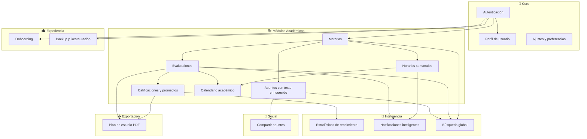
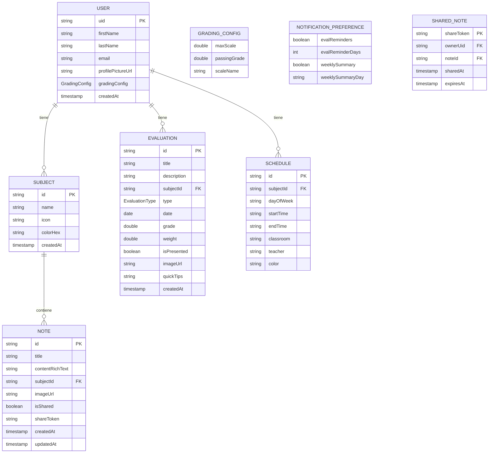
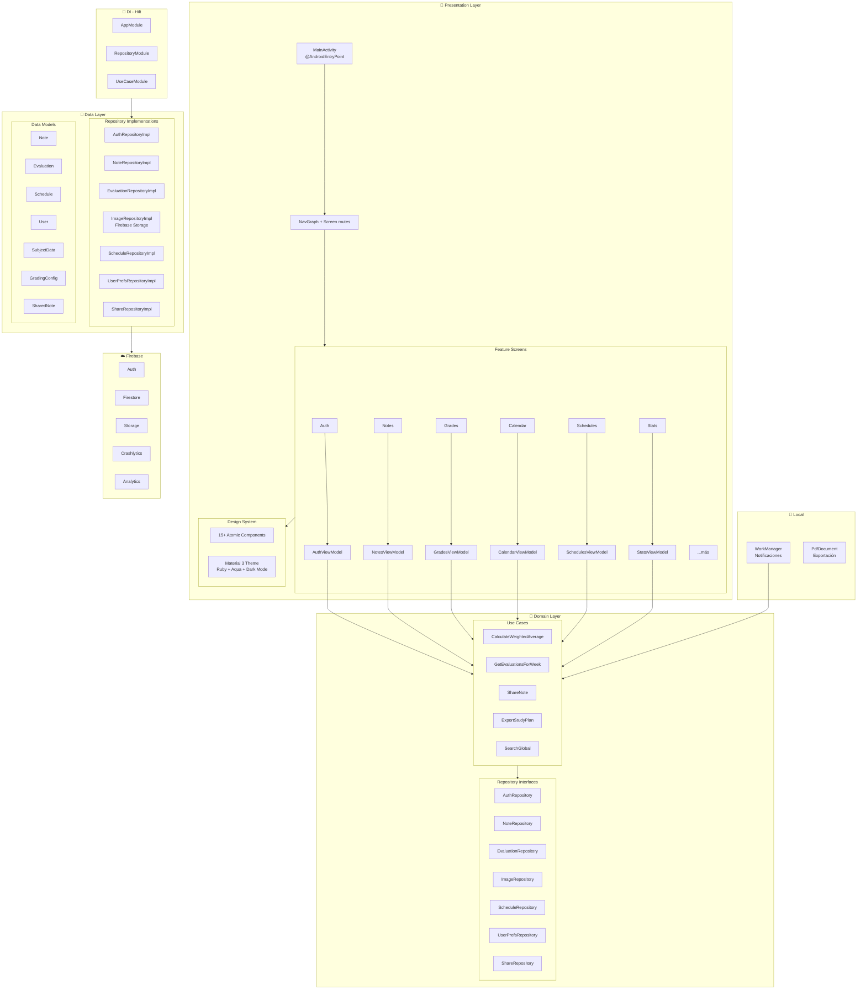
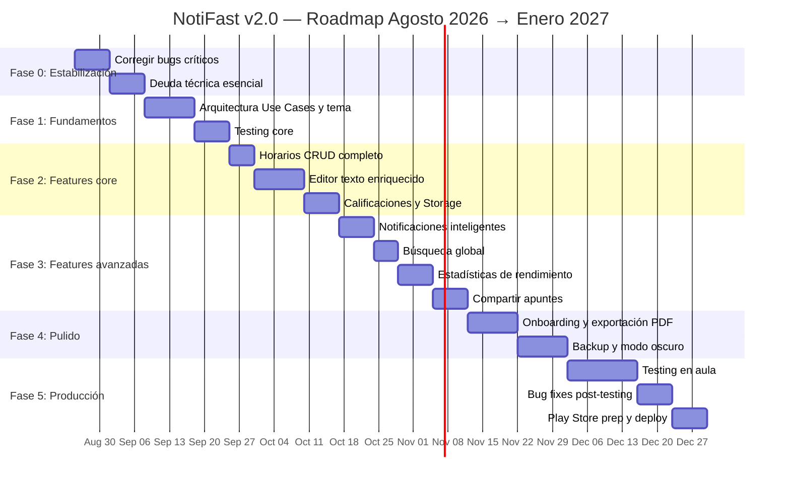

# 📋 PRD Maestro — NotiFast v2.0

> **Product Requirements Document**
> Versión: 1.0 | Fecha: 21 de agosto, 2026
> Autor: Equipo NotiFast | Horizonte: Agosto 2026 → Enero 2027

---

## 1. Resumen Ejecutivo

**NotiFast** es una aplicación Android nativa que funciona como hub educativo y cuaderno académico integral para estudiantes de secundaria y universidad. Permite gestionar apuntes con texto enriquecido, materias, evaluaciones, calificaciones con sistema configurable, horarios semanales, calendario académico, y estadísticas de rendimiento — todo centralizado en una sola app diseñada para reducir la ansiedad académica.

### Propósito dual

| Dimensión | Objetivo |
|---|---|
| **Producto comercial** | Distribuir gratuitamente en Google Play Store como herramienta de productividad estudiantil |
| **Proyecto académico** | Servir como proyecto de tesis, demostrando el ciclo completo de desarrollo de software: diseño, implementación, testing en aula y despliegue |

### Datos clave

| Aspecto | Valor |
|---|---|
| Plataforma | Android (API 26+) |
| Lenguaje | Kotlin + Jetpack Compose |
| Backend | Firebase (Auth + Firestore + Storage + Cloud Messaging) |
| Modelo de negocio | Gratuita (sin monetización inicial) |
| Idioma | Español |
| Público objetivo | Estudiantes de secundaria y universidad |
| Deadline | Diciembre 2026 – Enero 2027 |
| Equipo | 1 desarrollador + AI assistant |

---

## 2. Conexión Académica

> [!NOTE]
> Esta sección vincula el producto con los objetivos de la tesis. El PRD se centra en el producto; la tesis se gestiona por separado.

### Hipótesis de producto

*Una herramienta digital centralizada que integre gestión de apuntes, evaluaciones, horarios y calificaciones puede reducir la ansiedad académica y mejorar la organización del estudiante, medido a través de satisfacción de usuario y adopción real en aula.*

### Métricas de evaluación académica

| Métrica | Instrumento | Momento |
|---|---|---|
| Satisfacción de usuario | Encuesta SUS (System Usability Scale) | Post-testing en aula |
| Frecuencia de uso | Firebase Analytics (eventos) | Durante beta |
| Percepción de organización | Encuesta Likert pre/post | Antes y después del testing |
| Tasa de adopción | Usuarios activos vs. registrados | Durante beta |
| Reportes de bugs | Crashlytics + feedback manual | Durante beta |

### Aporte a la comunidad estudiantil

- Herramienta gratuita y sin anuncios para organización académica
- Compartir apuntes entre compañeros (fomento del estudio colaborativo pasivo)
- Notificaciones inteligentes para prevenir olvidos de evaluaciones
- Estadísticas que permiten al estudiante autodiagnosticar su rendimiento

---

## 3. Análisis del Estado Actual

### 3.1 Inventario técnico

```
📦 NotiFast (agosto 2026)
├── ~8,300 líneas de código Kotlin
├── 56 archivos fuente
├── 14 features implementadas
├── 15 componentes del design system
├── 5 repositorios (Auth, Note, Evaluation, Image, Schedule)
├── 12 ViewModels
├── 12 planes de implementación documentados
├── 10 specs de diseño documentados
├── 1 auditoría completa (junio 2026)
└── 0 tests reales
```

### 3.2 Features existentes — Estado real

| # | Feature | Estado | Bugs conocidos |
|---|---|---|---|
| 1 | **Autenticación** (email + Google) | ⚠️ Funcional con problemas | API de Google deprecada, `WEB_CLIENT_ID` hardcodeado, side-effect en composición |
| 2 | **Materias** (CRUD con icono y color) | ✅ Funcional | Nombre como document ID (no renombrable) |
| 3 | **Apuntes** (CRUD con imágenes) | ⚠️ Funcional con problemas | Imágenes solo locales, delete sin confirmación, editor solo texto plano |
| 4 | **Detalle de materia** | ✅ Funcional | — |
| 5 | **Evaluaciones** (CRUD) | ⚠️ Funcional con problemas | EditEvaluation sobreescribe edits con listener infinito |
| 6 | **Calificaciones** | 🔴 Con bug crítico | Promedio global = promedio de promedios (incorrecto), lógica duplicada 4x, escala hardcodeada a 10 |
| 7 | **Calendario** | ⚠️ Funcional con problemas | `isSameDay()` crea objetos excesivos, FAB mal posicionado |
| 8 | **Horarios** | 🔴 Incompleto | Solo visualización — no hay CRUD desde la UI |
| 9 | **Perfil** | ⚠️ Funcional | `_saved` fuera del UiState principal |
| 10 | **Ajustes** | ✅ Funcional | — |
| 11 | **Navegación** | ⚠️ Funcional con problemas | Doble navegación al login, crashes potenciales |
| 12 | **Design System** | ⚠️ Incompleto | Tema usa colores de template (Purple), no corporativos (Ruby/Aqua) |
| 13 | **Modo oscuro** | 🔴 Roto | Colores corporativos no integrados en `MaterialTheme` |
| 14 | **Búsqueda** | ⚠️ Básica | Solo local en pantalla de notas |

### 3.3 Deuda técnica — Inventario completo

#### 🔴 Crítica (bloquea despliegue)

| ID | Problema | Impacto | Esfuerzo est. |
|---|---|---|---|
| DT-01 | **0 tests reales** | Imposible garantizar calidad | 20-30h |
| DT-02 | **`WEB_CLIENT_ID` hardcodeado** | Credencial expuesta en código | 1h |
| DT-03 | **Release sin minificación (R8)** | APK grande, código legible | 3h |
| DT-04 | **Google Sign-In con API deprecada** | Puede dejar de funcionar | 6h |
| DT-05 | **Imágenes solo locales** (Firebase Storage sin usar) | Pérdida de datos al cambiar dispositivo | 6h |
| DT-06 | **Sin Firebase Crashlytics** | Sin visibilidad de crashes en producción | 2h |
| DT-07 | **Sin Firebase Analytics** | Sin métricas para tesis ni producto | 3h |

#### 🟠 Alta (degrada calidad)

| ID | Problema | Impacto | Esfuerzo est. |
|---|---|---|---|
| DT-08 | **Bug promedio global** (promedio de promedios) | Calificaciones incorrectas | 3h |
| DT-09 | **Promedio ponderado duplicado 4x** | Mantenibilidad, inconsistencias | 2h |
| DT-10 | **N+1 listeners en `getNotes()`** | Batería, datos, costos Firebase | 5h |
| DT-11 | **`EditNote` carga TODAS las notas** para buscar una | Performance degradada | 2h |
| DT-12 | **`EditEvaluation` listener infinito** sobreescribe edits | UX destructiva | 2h |
| DT-13 | **Eliminación de materia no atómica** | Estado inconsistente si falla | 2h |
| DT-14 | **Errores tragados** (`catch(e) {}` vacío) | Fallos silenciosos | 3h |
| DT-15 | **Tema Material 3 con colores de template** | Identidad visual rota | 4h |

#### 🟡 Media (mejoras de arquitectura)

| ID | Problema | Impacto | Esfuerzo est. |
|---|---|---|---|
| DT-16 | **Sin capa de Use Cases** en `domain/` | Lógica en ViewModels, no testeable | 10h |
| DT-17 | **Pantallas muy grandes** (>400 LOC) | Dificultad de mantenimiento | 6h |
| DT-18 | **Strings hardcodeados** en composables | Sin i18n futura, difícil mantenimiento | 4h |
| DT-19 | **Sin `@Preview`** en composables | Desarrollo visual lento | 3h |
| DT-20 | **Color parsing duplicado** en 5+ archivos | Código repetido | 1h |
| DT-21 | **`SubjectData` usa nombre como ID** | No se puede renombrar materias | 8h (migración) |
| DT-22 | **Compose BOM desactualizado** (2024.09) | Bugs conocidos, sin mejoras recientes | 2h |
| DT-23 | **Coil v2 → v3** disponible | Performance de imágenes | 2h |
| DT-24 | **Sin soporte offline explícito** | UX degradada sin conexión | 5h |

---

## 4. Visión del Producto Final (v2.0)

### 4.1 Módulos del sistema y correlación



### 4.2 Correlación detallada entre módulos

| Módulo origen | Módulo destino | Relación |
|---|---|---|
| **Materias** → Apuntes | Una materia contiene N apuntes | 1:N |
| **Materias** → Evaluaciones | Una materia tiene N evaluaciones | 1:N |
| **Materias** → Horarios | Una materia tiene N bloques horarios | 1:N |
| **Evaluaciones** → Calificaciones | Las calificaciones se calculan desde evaluaciones con grade ≠ null | Computado |
| **Evaluaciones** → Calendario | Las evaluaciones aparecen en el calendario por fecha | Vista |
| **Horarios** → Calendario | Los horarios recurrentes se proyectan en el calendario | Vista |
| **Calificaciones** → Estadísticas | Las estadísticas se computan de los promedios por materia | Computado |
| **Evaluaciones** → Notificaciones | Evaluaciones próximas disparan recordatorios | Trigger |
| **Horarios** → Notificaciones | (Futuro) Bloques de clase próximos disparan recordatorios | Trigger |
| **Apuntes** → Compartir | Un apunte puede compartirse como link de solo lectura | Acción |
| **Apuntes** → Búsqueda | El contenido de los apuntes es indexable | Indexado |
| **Evaluaciones** + Calificaciones → PDF | Se exporta el plan de estudio con evaluaciones y estados | Exportación |

### 4.3 Modelo de datos objetivo



> [!IMPORTANT]
> **Cambio estructural clave:** `SubjectData` actualmente usa el nombre como document ID. En v2.0, cada materia tendrá un ID autogenerado, permitiendo renombrar materias. Esto requiere una migración de datos para usuarios existentes.

---

## 5. Requisitos Funcionales — Feature por Feature

### FR-01: Autenticación

| Aspecto | Requisito |
|---|---|
| **Login** | Email/contraseña + Google Sign-In |
| **Registro** | Email/contraseña con validación local (formato email, contraseña ≥ 6 chars) |
| **Google Sign-In** | Migrar de `play-services-auth` (deprecado) a **Credential Manager API** |
| **Seguridad** | `WEB_CLIENT_ID` en `BuildConfig` o recurso, NO hardcodeado |
| **Side-effect** | Navegación post-login envuelta en `LaunchedEffect`, no en composición directa |
| **Persistencia** | Sesión persistente con Firebase Auth state listener |

### FR-02: Onboarding

| Aspecto | Requisito |
|---|---|
| **Trigger** | Se muestra solo al primer login del usuario |
| **Contenido** | 3-4 pantallas que explican: materias, apuntes, evaluaciones, horarios |
| **Interacción** | Swipe horizontal con indicadores de progreso |
| **Saltar** | Botón "Omitir" visible en todo momento |
| **Persistencia** | Flag `onboardingCompleted` en el documento del usuario en Firestore |

### FR-03: Materias (CRUD completo)

| Aspecto | Requisito |
|---|---|
| **Crear** | Nombre, icono (emoji picker), color (paleta predefinida) |
| **Editar** | Renombrar materia (requiere migración del ID del documento) |
| **Eliminar** | Confirmación con diálogo + eliminación atómica (`WriteBatch`) de notas, evaluaciones y horarios asociados |
| **Listar** | Grid/lista con icono, color, contador de notas y promedio ponderado |
| **Validación** | Nombre no vacío, máximo 50 caracteres, caracteres especiales permitidos |

### FR-04: Apuntes con texto enriquecido

| Aspecto | Requisito |
|---|---|
| **Editor** | Texto enriquecido con: **negrita**, *itálica*, ~~tachado~~, listas (ordenadas y desordenadas), encabezados (H1, H2, H3), bloques de código |
| **Imágenes** | Adjuntar desde cámara o galería, almacenadas en **Firebase Storage**, URL remota en Firestore |
| **Asociación** | Cada nota pertenece a exactamente una materia |
| **Búsqueda** | Título y contenido indexables para búsqueda global |
| **Timestamps** | `createdAt` y `updatedAt` con `@ServerTimestamp` |
| **Eliminación** | Confirmación con diálogo antes de borrar |

> [!IMPORTANT]
> **Editor de texto enriquecido:** Evaluar las opciones: (a) Compose RichEditor libraries existentes (ej. `compose-richeditor`), (b) Markdown renderer con barra de herramientas. La decisión se tomará en la fase de diseño técnico.

### FR-05: Evaluaciones (CRUD completo)

| Aspecto | Requisito |
|---|---|
| **Campos** | Título, descripción, materia, tipo (examen/tarea/proyecto/quiz), fecha, calificación, peso, estado (presentada/pendiente), imagen, tips rápidos |
| **Carga** | `EditEvaluation` debe usar `first()` en vez de `collect` infinito para evitar sobreescribir edits del usuario |
| **Calificación** | Rango configurable según `GradingConfig` del usuario (default: 0-10) |
| **Peso** | Convención unificada: factor 0.0-1.0 (se muestra como porcentaje en UI) |

### FR-06: Sistema de calificaciones configurable

| Aspecto | Requisito |
|---|---|
| **Escala por defecto** | 0-10 |
| **Configuración** | El usuario puede ajustar: `maxScale` (escala máxima) y `passingGrade` (nota mínima aprobatoria) |
| **Ubicación del config** | Almacenado en el documento del usuario en Firestore |
| **Cálculo promedio por materia** | Promedio ponderado: `Σ(grade × weight) / Σ(weight)` — extraído a un Use Case único |
| **Cálculo promedio global** | Promedio ponderado de TODAS las evaluaciones calificadas (NO promedio de promedios) |
| **Indicador visual** | Color verde (≥ passing), amarillo (entre passing y passing-2), rojo (< passing-2) |

### FR-07: Horarios semanales (CRUD completo)

| Aspecto | Requisito |
|---|---|
| **Crear** | Materia, día de la semana, hora inicio, hora fin, aula, profesor |
| **Editar** | Todos los campos modificables |
| **Eliminar** | Con diálogo de confirmación |
| **Visualización** | Vista semanal con bloques de color por materia |
| **Validación** | No permitir horarios solapados en el mismo día |
| **Integración** | Los horarios se reflejan en el Calendario |

### FR-08: Calendario académico

| Aspecto | Requisito |
|---|---|
| **Vista** | Mensual con indicadores por día (puntos de color) |
| **Contenido** | Muestra evaluaciones (por fecha) y bloques de horario (recurrentes) |
| **Detalle** | Al tocar un día, muestra lista expandible de evaluaciones y clases |
| **Performance** | Reemplazar `isSameDay()` con `java.time.LocalDate` para evitar creación excesiva de objetos Calendar |
| **FAB** | Usar `floatingActionButton` del Scaffold, no Box manual |

### FR-09: Estadísticas de rendimiento

| Aspecto | Requisito |
|---|---|
| **Dashboard** | Promedio general, promedio por materia, número de evaluaciones presentadas vs. pendientes |
| **Gráficos** | Gráfico de barras por materia, gráfico de línea de evolución temporal del promedio |
| **Indicadores** | Materia con mejor/peor rendimiento, tendencia (mejorando/empeorando) |
| **Periodo** | Todas las evaluaciones del usuario (sin filtro temporal por ahora) |
| **Librería** | Evaluar: Vico (Charts para Compose), YCharts, o custom Canvas |

### FR-10: Notificaciones inteligentes

| Aspecto | Requisito |
|---|---|
| **Recordatorio de evaluación** | N días antes de la fecha (configurable, default: 3 días) |
| **Resumen semanal** | Notificación cada lunes con evaluaciones de la semana |
| **Recordatorio personalizado** | El usuario crea un recordatorio con texto y fecha/hora |
| **Implementación** | **WorkManager** para notificaciones locales programadas (no FCM push para v2.0 — el contenido es local) |
| **Preferencias** | El usuario puede activar/desactivar cada tipo de notificación |
| **Canal** | Canal de notificación dedicado "NotiFast Recordatorios" |

> [!NOTE]
> Se usa WorkManager + notificaciones locales en vez de FCM push porque los triggers son datos locales del usuario (evaluaciones, horarios). FCM se reservaría para features futuras que requieran server-initiated notifications.

### FR-11: Búsqueda global

| Aspecto | Requisito |
|---|---|
| **Alcance** | Buscar en: títulos de notas, contenido de notas, títulos de evaluaciones, nombres de materias |
| **Ubicación** | Barra de búsqueda en pantalla principal o pantalla dedicada accesible desde bottom nav |
| **Resultado** | Lista agrupada por tipo (Notas, Evaluaciones, Materias) con highlight del término |
| **Performance** | Búsqueda local sobre datos ya cargados en memoria (Firestore cache), con debounce de 300ms |

### FR-12: Compartir apuntes

| Aspecto | Requisito |
|---|---|
| **Mecanismo** | Generar un `shareToken` único que crea un documento en la colección `shared_notes` |
| **Link** | Deep link que abre el apunte en modo solo lectura dentro de NotiFast |
| **Requisito receptor** | Debe tener NotiFast instalado para abrir el link |
| **Expiración** | Los links expiran en 30 días (configurable) |
| **Contenido compartido** | Título + contenido con formato + imágenes (URLs de Firebase Storage) |
| **Seguridad** | El receptor puede leer pero NO editar, eliminar, ni copiar el apunte a sus propias materias (v2.0) |
| **Firebase Rules** | Regla especial: cualquier usuario autenticado puede leer un `shared_note` si conoce el `shareToken` |

### FR-13: Exportación de plan de estudio (PDF)

| Aspecto | Requisito |
|---|---|
| **Contenido** | Lista de evaluaciones por materia con: título, fecha, tipo, estado (presentada/pendiente), calificación |
| **Formato** | PDF generado localmente |
| **Librería** | Android `PdfDocument` API nativa o iText (evaluar licencias) |
| **Branding** | Logo de NotiFast + nombre del estudiante en encabezado |
| **Compartir** | Intent de Android para compartir el PDF generado |

### FR-14: Backup y restauración

| Aspecto | Requisito |
|---|---|
| **Backup** | Exportar todos los datos del usuario a un archivo JSON estructurado |
| **Destino** | Google Drive (via Drive API) o almacenamiento local |
| **Restauración** | Importar desde archivo JSON — merge o reemplazo completo (con confirmación) |
| **Frecuencia** | Manual (el usuario inicia el backup) |
| **Alcance** | Todas las materias, notas, evaluaciones, horarios, preferencias |

### FR-15: Perfil y ajustes

| Aspecto | Requisito |
|---|---|
| **Perfil** | Editar nombre, apellido, foto de perfil (subida a Firebase Storage) |
| **Escala de calificación** | Configurar `maxScale` y `passingGrade` |
| **Notificaciones** | Toggle por tipo de notificación, días de anticipación para evaluaciones |
| **Tema** | Toggle modo claro/oscuro |
| **Cuenta** | Cerrar sesión, eliminar cuenta (con confirmación y borrado de datos) |
| **Sobre** | Versión de la app, créditos, política de privacidad |

---

## 6. Requisitos No Funcionales

### NFR-01: Rendimiento

| Métrica | Objetivo |
|---|---|
| Tiempo de inicio en frío | < 2 segundos |
| Tiempo de carga de pantalla | < 500ms para datos en cache |
| Tamaño del APK | < 15MB (con R8/minificación) |
| Consumo de batería | Sin listeners innecesarios (resolver N+1) |
| Consumo de datos | Minimizar lecturas de Firestore |

### NFR-02: Seguridad

| Aspecto | Requisito |
|---|---|
| Credenciales | CERO credenciales en código fuente. Todo en `BuildConfig`, recursos o config remota |
| Firestore Rules | Ya implementadas — validar `request.auth.uid == userId` |
| Minificación | `isMinifyEnabled = true` + ProGuard rules para Firebase + Hilt |
| Firebase App Check | Habilitado para prevenir acceso no autorizado a APIs |
| HTTPS | Todo el tráfico via Firebase SDK (HTTPS por defecto) |

### NFR-03: Calidad

| Aspecto | Objetivo |
|---|---|
| Tests unitarios | Cobertura ≥ 60% en ViewModels y Use Cases |
| Tests de integración | Al menos 1 test por repositorio |
| Tests de UI | Smoke tests de navegación principal |
| Crash rate | < 1% (medido con Crashlytics) |
| ANR rate | < 0.5% |
| Code review | AI-assisted review antes de cada merge |

### NFR-04: Accesibilidad

| Aspecto | Requisito |
|---|---|
| `contentDescription` | En todos los iconos y botones interactivos |
| Font scaling | Soporte de tamaños de texto dinámicos |
| Contraste | Cumplir WCAG AA (4.5:1 para texto normal) |
| TalkBack | Navegación funcional con lector de pantalla |
| Touch targets | Mínimo 48dp × 48dp |

### NFR-05: Estabilidad y observabilidad

| Herramienta | Propósito |
|---|---|
| Firebase Crashlytics | Reportes de crashes automáticos |
| Firebase Analytics | Eventos de uso (para métricas de tesis) |
| Firebase Performance | Trazas de rendimiento de operaciones críticas |

---

## 7. Arquitectura Objetivo

### 7.1 Diagrama de capas



### 7.2 Cambios arquitectónicos clave vs. estado actual

| Aspecto | Estado actual | Estado objetivo |
|---|---|---|
| Use Cases | Inexistentes | `domain/usecase/` con lógica de negocio reutilizable |
| ImageRepository | Almacenamiento local | Firebase Storage |
| SubjectData ID | Nombre como document ID | ID autogenerado |
| Tema Material 3 | Colores de template | Ruby/Aqua con dark mode completo |
| Notificaciones | Inexistentes | WorkManager + canales locales |
| Observabilidad | Inexistente | Crashlytics + Analytics + Performance |
| Editor de notas | Texto plano | Texto enriquecido |
| Testing | 0 tests | ≥ 60% cobertura en lógica |

---

## 8. Plan de Fases

### Visión general del timeline



---

### Fase 0: Estabilización (Semanas 1-2)

> **Objetivo:** Convertir la app de "compila con bugs" a "funciona correctamente con las features actuales".

#### Sprint 0.1 — Bugs críticos (Semana 1)

| # | Tarea | Prioridad | Esfuerzo | Detalle |
|---|---|---|---|---|
| 0.1.1 | **Mover `WEB_CLIENT_ID` a `BuildConfig`** | 🔴 | 1h | Usar `buildConfigField` en `build.gradle.kts` |
| 0.1.2 | **Habilitar R8 + minificación** en release | 🔴 | 3h | `isMinifyEnabled = true`, agregar ProGuard rules para Firebase, Hilt, Coil |
| 0.1.3 | **Fix: promedio global** | 🔴 | 3h | Calcular promedio ponderado de TODAS las evaluaciones, no promedio de promedios |
| 0.1.4 | **Fix: side-effect `onLoginSuccess()`** | 🔴 | 1h | Envolver en `LaunchedEffect(uiState.isLoggedIn)` |
| 0.1.5 | **Fix: doble navegación al login** | 🟠 | 2h | Unificar punto de navegación post-login |
| 0.1.6 | **Fix: `EditEvaluation` listener infinito** | 🟠 | 2h | Reemplazar `collect` con `first()` |
| 0.1.7 | **Fix: delete nota sin confirmación** | 🟠 | 1h | Agregar `NotiFastDialog` de confirmación |
| 0.1.8 | **Fix: errores tragados** (`catch` vacío) | 🟠 | 3h | Loguear errores, mostrar Snackbar al usuario |

**Entregable:** App funcional sin bugs críticos conocidos.

#### Sprint 0.2 — Deuda técnica esencial (Semana 2)

| # | Tarea | Prioridad | Esfuerzo | Detalle |
|---|---|---|---|---|
| 0.2.1 | **Eliminación atómica** de materias con `WriteBatch` | 🟠 | 2h | Batch delete notas + materia + evaluaciones asociadas |
| 0.2.2 | **Optimizar `getNotes()`** — resolver N+1 listeners | 🟠 | 5h | Refactorizar a CollectionGroup query o flatten structure |
| 0.2.3 | **Fix: `EditNote` carga todas las notas** | 🟠 | 2h | Crear `getNoteById()` en `NoteRepository` |
| 0.2.4 | **Unificar lógica de promedio ponderado** | 🟠 | 2h | Extraer a función pura, usar en los 4 lugares |
| 0.2.5 | **Unificar convención de `weight`** | 🟡 | 1h | Documentar: weight = factor 0.0-1.0, UI muestra % |
| 0.2.6 | **Fix: color parsing duplicado** | 🟡 | 1h | Crear extension function `String.toComposeColor()` |
| 0.2.7 | **Integrar Firebase Crashlytics** | 🔴 | 2h | Dependencia + inicialización + test de crash |
| 0.2.8 | **Integrar Firebase Analytics** | 🟠 | 3h | Eventos básicos: login, create_note, create_evaluation, view_screen |

**Entregable:** App estable, observable (crashes), métricas básicas funcionando.

---

### Fase 1: Fundamentos de Arquitectura (Semanas 3-5)

> **Objetivo:** Establecer la arquitectura objetivo y el foundation de testing que soporte todo el desarrollo posterior.

#### Sprint 1.1 — Arquitectura (Semanas 3-4)

| # | Tarea | Prioridad | Esfuerzo | Detalle |
|---|---|---|---|---|
| 1.1.1 | **Crear capa de Use Cases** en `domain/usecase/` | 🟠 | 10h | `CalculateWeightedAverageUseCase`, `GetSubjectWithStatsUseCase`, etc. |
| 1.1.2 | **Refactorizar Material 3 Theme** con colores corporativos | 🟠 | 4h | `Ruby` como primary, `Aqua` como secondary, dark mode coherente |
| 1.1.3 | **Actualizar Compose BOM** a versión estable reciente | 🟡 | 2h | Verificar compatibilidad con dependencias actuales |
| 1.1.4 | **Dividir pantallas grandes** (>300 LOC) | 🟡 | 6h | `NotesScreen`, `CalendarScreen`, `GradesScreen`, `SubjectCard` |
| 1.1.5 | **Crear `UserPrefsRepository`** | 🟠 | 3h | Para configuración de escala de calificación y preferencias de notificación |
| 1.1.6 | **Quitar `suspend` innecesario** de funciones que retornan `Flow` | 🟡 | 1h | `getNotesBySubject()` y similares |

#### Sprint 1.2 — Testing foundation (Semana 5)

| # | Tarea | Prioridad | Esfuerzo | Detalle |
|---|---|---|---|---|
| 1.2.1 | **Configurar testing infrastructure** | 🔴 | 3h | JUnit 5, MockK, Turbine (para Flows), Coroutines test |
| 1.2.2 | **Tests unitarios para Use Cases** | 🔴 | 4h | `CalculateWeightedAverageUseCase` con edge cases |
| 1.2.3 | **Tests unitarios para ViewModels core** | 🔴 | 6h | `NotesViewModel`, `GradesViewModel`, `CalendarViewModel` |
| 1.2.4 | **Tests de integración para Repositories** | 🟠 | 4h | Mock de Firestore, verificar mapeo de datos |

**Entregable:** Arquitectura limpia con Use Cases, tema corporativo, ≥ 60% cobertura en lógica de negocio.

---

### Fase 2: Features Core Completas (Semanas 6-9)

> **Objetivo:** Completar las features existentes que están rotas o incompletas, y agregar las funcionalidades core nuevas.

#### Sprint 2.1 — Horarios CRUD (Semana 6)

| # | Tarea | Prioridad | Esfuerzo | Detalle |
|---|---|---|---|---|
| 2.1.1 | **Pantalla `AddScheduleScreen`** + ViewModel + Contract | 🔴 | 4h | Formulario con materia, día, hora inicio/fin, aula, profesor |
| 2.1.2 | **Pantalla `EditScheduleScreen`** + ViewModel + Contract | 🔴 | 3h | Precarga datos existentes, permite editar |
| 2.1.3 | **Acción de eliminar en `ScheduleCard`** | 🔴 | 2h | Swipe-to-delete o botón con confirmación |
| 2.1.4 | **Validación de horarios solapados** | 🟠 | 2h | Verificar que no haya conflictos en el mismo día |
| 2.1.5 | **Tests para SchedulesViewModel** | 🟠 | 2h | CRUD + validación de solapamiento |

#### Sprint 2.2 — Editor de texto enriquecido (Semanas 7-8)

| # | Tarea | Prioridad | Esfuerzo | Detalle |
|---|---|---|---|---|
| 2.2.1 | **Investigación y selección de librería** | 🔴 | 3h | Evaluar `compose-richeditor`, `Markwon`, custom Canvas |
| 2.2.2 | **Integrar editor en `AddNoteScreen`** | 🔴 | 6h | Barra de herramientas flotante (bold, italic, lists, headings) |
| 2.2.3 | **Integrar editor en `EditNoteScreen`** | 🔴 | 4h | Parsear contenido existente al formato del editor |
| 2.2.4 | **Renderizar contenido formateado en vistas de lectura** | 🔴 | 3h | `NoteEstheticCard`, `SubjectDetail` |
| 2.2.5 | **Migración de datos existentes** | 🟠 | 2h | Notas existentes (texto plano) deben funcionar sin problemas |
| 2.2.6 | **Tests del editor** | 🟠 | 3h | Serialización/deserialización del formato |

#### Sprint 2.3 — Calificaciones configurables + Firebase Storage (Semana 9)

| # | Tarea | Prioridad | Esfuerzo | Detalle |
|---|---|---|---|---|
| 2.3.1 | **Pantalla de configuración de escala** en Ajustes | 🔴 | 3h | Inputs para `maxScale` y `passingGrade` |
| 2.3.2 | **`GradingConfig` data model** + persistencia en Firestore | 🔴 | 2h | En documento del usuario |
| 2.3.3 | **Adaptar cálculos y UI** al sistema configurable | 🔴 | 3h | Indicadores de color relativos a `passingGrade` |
| 2.3.4 | **Migrar `ImageRepositoryImpl` a Firebase Storage** | 🔴 | 6h | Upload, download URL, delete — reemplazar `file://` con `https://` |
| 2.3.5 | **Migración de URLs existentes** | 🟠 | 2h | Detectar `file://` y subir a Storage si el archivo local existe |
| 2.3.6 | **Tests de ImageRepository** | 🟠 | 2h | Mock de Storage, verificar flujo upload/download |

**Entregable:** Todas las features core 100% funcionales y testeadas.

---

### Fase 3: Features Avanzadas (Semanas 10-13)

> **Objetivo:** Agregar las features de inteligencia y social que diferencian a NotiFast.

#### Sprint 3.1 — Notificaciones inteligentes (Semana 10)

| # | Tarea | Prioridad | Esfuerzo | Detalle |
|---|---|---|---|---|
| 3.1.1 | **Configurar WorkManager** como dependencia | 🔴 | 1h | `implementation("androidx.work:work-runtime-ktx")` |
| 3.1.2 | **`EvalReminderWorker`** | 🔴 | 4h | Consulta evaluaciones próximas, dispara notificación N días antes |
| 3.1.3 | **`WeeklySummaryWorker`** | 🔴 | 3h | Lunes: genera resumen de evaluaciones de la semana |
| 3.1.4 | **`CustomReminderWorker`** | 🟠 | 3h | Recordatorio personalizado con texto y fecha/hora |
| 3.1.5 | **Canal de notificación** + UI de preferencias | 🔴 | 2h | Toggles en Ajustes para cada tipo |
| 3.1.6 | **Tests de Workers** | 🟠 | 2h | `WorkManagerTestRule` |

#### Sprint 3.2 — Búsqueda global (Semana 11)

| # | Tarea | Prioridad | Esfuerzo | Detalle |
|---|---|---|---|---|
| 3.2.1 | **`SearchViewModel`** + Contract | 🔴 | 3h | Manejo de query con debounce 300ms |
| 3.2.2 | **`SearchScreen`** con resultados agrupados | 🔴 | 4h | Secciones: Materias, Notas, Evaluaciones |
| 3.2.3 | **`SearchUseCase`** | 🔴 | 3h | Buscar en datos en memoria (ya cargados por otros VMs) |
| 3.2.4 | **Integración con navegación** | 🟠 | 1h | Navegar al detalle al tocar un resultado |

#### Sprint 3.3 — Estadísticas de rendimiento (Semana 12)

| # | Tarea | Prioridad | Esfuerzo | Detalle |
|---|---|---|---|---|
| 3.3.1 | **Selección de librería de gráficos** | 🔴 | 2h | Evaluar Vico, YCharts, custom Canvas |
| 3.3.2 | **`StatsViewModel`** + Contract | 🔴 | 3h | Computar métricas desde evaluaciones |
| 3.3.3 | **`StatsScreen`** — dashboard con gráficos | 🔴 | 6h | Barras por materia, línea temporal, indicadores |
| 3.3.4 | **Integración en pantalla de Calificaciones** | 🟠 | 2h | Expandir `GradesScreen` o crear tab |

#### Sprint 3.4 — Compartir apuntes (Semana 13)

| # | Tarea | Prioridad | Esfuerzo | Detalle |
|---|---|---|---|---|
| 3.4.1 | **`ShareRepository`** + Firestore collection `shared_notes` | 🔴 | 3h | CRUD de tokens de compartir |
| 3.4.2 | **`ShareNoteUseCase`** | 🔴 | 2h | Generar token, crear documento, retornar deep link |
| 3.4.3 | **UI de compartir** en detalle de nota | 🔴 | 2h | Botón "Compartir" → genera link → intent de compartir |
| 3.4.4 | **Deep link handler** | 🔴 | 4h | `AndroidManifest` intent-filter + pantalla de lectura de apunte compartido |
| 3.4.5 | **Firestore Rules** para `shared_notes` | 🔴 | 1h | Cualquier autenticado puede leer si tiene el token |
| 3.4.6 | **Tests del flujo de compartir** | 🟠 | 2h | Generación de token, lectura, expiración |

**Entregable:** NotiFast con todas las features avanzadas integradas y funcionales.

---

### Fase 4: Pulido y Experiencia (Semanas 14-17)

> **Objetivo:** Pulir la UX, completar onboarding, exportación, backup, modo oscuro y accesibilidad. Preparar para testing real.

#### Sprint 4.1 — Onboarding + Exportación (Semanas 14-15)

| # | Tarea | Prioridad | Esfuerzo | Detalle |
|---|---|---|---|---|
| 4.1.1 | **Onboarding screens** (3-4 pantallas) | 🟠 | 4h | Animaciones, ViewPager/HorizontalPager, botón "Omitir" |
| 4.1.2 | **Lógica de mostrar una sola vez** | 🟠 | 1h | Flag en Firestore documento del usuario |
| 4.1.3 | **Generación de PDF** con plan de estudio | 🟠 | 5h | `PdfDocument` API, evaluaciones por materia |
| 4.1.4 | **Compartir PDF** via intent | 🟠 | 1h | `FileProvider` + share intent |
| 4.1.5 | **Migrar strings hardcodeados** a `strings.xml` | 🟡 | 4h | Para todas las pantallas |

#### Sprint 4.2 — Backup + Modo oscuro + Accesibilidad (Semanas 16-17)

| # | Tarea | Prioridad | Esfuerzo | Detalle |
|---|---|---|---|---|
| 4.2.1 | **Backup a JSON** | 🟠 | 4h | Serializar todos los datos del usuario |
| 4.2.2 | **Restauración desde JSON** | 🟠 | 4h | Deserializar y escribir en Firestore |
| 4.2.3 | **UI de Backup/Restauración** en Ajustes | 🟠 | 2h | Botones + diálogo de confirmación |
| 4.2.4 | **Modo oscuro completo** | 🔴 | 4h | `darkColorScheme` con Ruby/Aqua adaptados, verificar TODAS las pantallas |
| 4.2.5 | **Accesibilidad** | 🟠 | 3h | `contentDescription`, touch targets 48dp, verificar contraste WCAG AA |
| 4.2.6 | **`@Preview` para composables clave** | 🟡 | 3h | Light + Dark preview para las 5 pantallas principales |
| 4.2.7 | **Revisión integral de UX** | 🟠 | 4h | Flow completo de usuario, edge cases, estados vacíos |

**Entregable:** App pulida, accesible, con experiencia completa de onboarding a exportación.

---

### Fase 5: Producción y Despliegue (Semanas 18-22)

> **Objetivo:** Testing real en aula, corrección de bugs encontrados, y publicación en Google Play Store.

#### Sprint 5.1 — Preparación para testing en aula (Semana 18)

| # | Tarea | Prioridad | Esfuerzo | Detalle |
|---|---|---|---|---|
| 5.1.1 | **Internal testing track** en Google Play Console | 🔴 | 3h | Subir AAB, crear grupo de testers |
| 5.1.2 | **Preparar encuestas** (SUS + Likert pre/post) | 🔴 | 3h | Google Forms |
| 5.1.3 | **Documento de instrucciones** para testers | 🟠 | 2h | Guía de instalación + tareas a realizar |
| 5.1.4 | **Verificar Firebase quotas** (plan gratuito) | 🔴 | 1h | Reads, writes, storage estimados para N estudiantes |
| 5.1.5 | **Smoke testing completo** interno | 🔴 | 4h | Todos los flows de la app en dispositivo real |

#### Sprint 5.2 — Testing en aula (Semanas 19-20)

| # | Tarea | Prioridad | Esfuerzo | Detalle |
|---|---|---|---|---|
| 5.2.1 | **Distribuir app** a grupo de estudiantes | 🔴 | — | Via Internal Testing de Play Console |
| 5.2.2 | **Monitorear Crashlytics y Analytics** | 🔴 | Continuo | Dashboard de crashes y eventos |
| 5.2.3 | **Recopilar encuesta pre-testing** | 🔴 | — | Google Forms |
| 5.2.4 | **Periodo de uso activo** (2 semanas) | — | — | Los estudiantes usan la app normalmente |
| 5.2.5 | **Recopilar encuesta post-testing** | 🔴 | — | Google Forms + SUS |
| 5.2.6 | **Compilar feedback cualitativo** | 🟠 | 3h | Bugs reportados, sugerencias, frustraciones |

#### Sprint 5.3 — Bug fixes post-testing (Semana 21)

| # | Tarea | Prioridad | Esfuerzo | Detalle |
|---|---|---|---|---|
| 5.3.1 | **Triagear bugs** por severidad | 🔴 | 2h | Crashes > UX breaks > visuales |
| 5.3.2 | **Corregir bugs críticos** encontrados | 🔴 | Variable | Basado en Crashlytics + feedback |
| 5.3.3 | **Implementar mejoras quick-win** del feedback | 🟠 | Variable | Solo si el esfuerzo es ≤ 2h por mejora |
| 5.3.4 | **Re-testing de correcciones** | 🔴 | 2h | Verificar que los fixes funcionan |

#### Sprint 5.4 — Play Store deployment (Semana 22)

| # | Tarea | Prioridad | Esfuerzo | Detalle |
|---|---|---|---|---|
| 5.4.1 | **Crear cuenta de desarrollador** en Google Play Console | 🔴 | 1h | Pago único $25 USD |
| 5.4.2 | **Preparar listing de la app** | 🔴 | 4h | Título, descripción, screenshots, icono, feature graphic |
| 5.4.3 | **Política de privacidad** | 🔴 | 3h | Documento web público (requerido por Play Store) |
| 5.4.4 | **Data Safety Form** | 🔴 | 2h | Declarar qué datos se recopilan y cómo se usan |
| 5.4.5 | **Content rating questionnaire** | 🔴 | 1h | IARC rating (Everyone / E) |
| 5.4.6 | **Signing key setup** | 🔴 | 2h | Play App Signing + upload key |
| 5.4.7 | **Build release AAB** | 🔴 | 1h | `./gradlew bundleRelease` |
| 5.4.8 | **Subir a producción** | 🔴 | 1h | Review de Google (1-3 días) |
| 5.4.9 | **Verificar publicación** | 🔴 | — | App visible en Play Store |

**Entregable:** NotiFast publicada en Google Play Store + datos de testing en aula para la tesis.

---

## 9. Riesgos y Mitigaciones

| # | Riesgo | Probabilidad | Impacto | Mitigación |
|---|---|---|---|---|
| R1 | **Firebase quotas excedidas** en testing masivo | Media | Alto | Monitorear dashboard, limitar grupo de testers a 20-30, implementar rate limiting en código |
| R2 | **Librería de texto enriquecido** inmadura o con bugs | Media | Alto | Spike de 3h en Fase 2 para validar antes de comprometerse; tener fallback a Markdown simple |
| R3 | **Timeline ajustado** — 1 desarrollador para 5 fases | Alta | Medio | Priorizar features core (Fases 0-2). Fases 3-4 pueden recortarse si hay retraso |
| R4 | **Migración de SubjectData** (nombre→ID) rompe datos existentes | Media | Alto | Crear migración incremental con backward compatibility; NO hacer big-bang |
| R5 | **Google rechaza la app** en Play Store review | Baja | Alto | Cumplir con todas las políticas desde el inicio (privacidad, data safety, content) |
| R6 | **Bugs críticos descubiertos en testing en aula** | Alta | Medio | Buffer de 1 semana (Sprint 5.3) dedicado exclusivamente a fixes |
| R7 | **Deep links de compartir** bloqueados por dispositivos | Media | Bajo | Fallback a compartir via clipboard si deep links no funcionan |
| R8 | **Baja adopción en testing en aula** | Media | Alto | Hacer onboarding presencial, ofrecer incentivo (puntos extra?) |

---

## 10. Criterios de Éxito

### Para el producto

| Criterio | Métrica | Objetivo |
|---|---|---|
| Estabilidad | Crash-free rate (Crashlytics) | ≥ 99% |
| Rendimiento | Cold start time | < 2s |
| Completitud | Features funcionales | 15/15 sin bugs críticos |
| Calidad | Test coverage (lógica de negocio) | ≥ 60% |
| Accesibilidad | WCAG AA compliance | Contraste y touch targets |

### Para la tesis

| Criterio | Métrica | Objetivo |
|---|---|---|
| Adopción | Usuarios que completaron onboarding / total registrados | ≥ 70% |
| Satisfacción | SUS Score | ≥ 68 (promedio aceptable) |
| Uso sostenido | Sesiones por semana por usuario activo | ≥ 3 |
| Percepción | Encuesta Likert "Me siento más organizado" | ≥ 4/5 promedio |
| Feedback | Bugs reportados por usuario | < 3 en 2 semanas |

---

## 11. Features Diferidas (Post v2.0 / Backlog)

Estas features NO están en el alcance de v2.0 pero se documentan para roadmap futuro:

| Feature | Justificación de diferimiento |
|---|---|
| Internacionalización (multi-idioma) | Requiere infraestructura de i18n; solo español por ahora |
| Widget de Android | Feature de conveniencia, no core |
| Integración con Google Calendar | Complejidad de OAuth scopes adicionales |
| Colaboración en tiempo real | Contradice el modelo individual; requiere arquitectura diferente |
| Monetización (suscripción/ads) | No es prioridad en fase académica |
| Gamificación (logros, rachas) | Nice-to-have que se puede agregar post-launch |
| Sincronización offline avanzada | Firestore cache básico es suficiente para v2.0 |
| AI-powered study suggestions | Requiere integración con LLM; fuera de alcance de tesis |
| Migrar Coil v2 → v3 | Mejora de performance que no es bloqueante |
| Migrar a Credential Manager API | Puede hacerse post-launch si `play-services-auth` sigue funcionando |

---

## 12. Glosario

| Término | Definición |
|---|---|
| **Use Case** | Clase en `domain/usecase/` que encapsula una unidad de lógica de negocio reutilizable |
| **Contract** | Archivo que define `UiState` (data class) y `Event` (sealed class) para el patrón MVI |
| **Promedio ponderado** | `Σ(calificación × peso) / Σ(peso)` donde peso es un factor 0.0-1.0 |
| **WriteBatch** | API de Firestore para ejecutar múltiples operaciones de escritura de forma atómica |
| **WorkManager** | API de Android para ejecutar tareas en background de forma confiable |
| **Deep link** | URL que abre directamente una pantalla específica dentro de la app |
| **SUS** | System Usability Scale — cuestionario estandarizado de 10 preguntas para evaluar usabilidad |
| **R8/ProGuard** | Herramientas de minificación y ofuscación de código Android |

---

## 13. Apéndice: Estimación de Esfuerzo Total

| Fase | Semanas | Horas estimadas |
|---|---|---|
| Fase 0: Estabilización | 2 | 35h |
| Fase 1: Fundamentos | 3 | 42h |
| Fase 2: Features Core | 4 | 55h |
| Fase 3: Features Avanzadas | 4 | 50h |
| Fase 4: Pulido | 4 | 34h |
| Fase 5: Producción | 5 | 30h + tiempo de testing |
| **Total** | **22 semanas** | **~246h de desarrollo** |

> [!WARNING]
> **Con 1 desarrollador trabajando ~12-15 horas semanales**, el timeline de 22 semanas es ajustado pero alcanzable (agosto → enero). El buffer principal está en Fase 4 (Pulido) — si hay retrasos, las features de esta fase pueden simplificarse sin afectar el core del producto ni la tesis.

### Plan de contingencia por retraso

Si al llegar a la Semana 13 hay un retraso de ≥ 2 semanas:

1. **Diferir Backup/Restauración** a post-launch
2. **Simplificar Onboarding** a 2 pantallas estáticas (sin animaciones)
3. **Simplificar Exportación PDF** a formato básico sin branding
4. **Mantener testing en aula** — es imprescindible para la tesis

---

> **Siguiente paso:** Revisión y aprobación de este PRD por el equipo. Una vez aprobado, se genera el plan de implementación detallado comenzando por la Fase 0.
