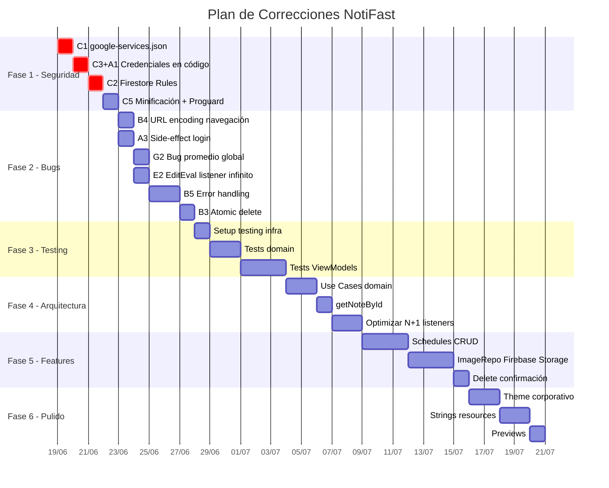

# 🛠️ Plan Maestro de Correcciones — NotiFast

> Plan sistemático para resolver los **35+ hallazgos** de la [auditoría del 2026-06-18](file:///home/analista/AndroidStudioProjects/NotiFast/docs/audit/2026-06-18-full-audit.md).  
> Organizado en **6 fases secuenciales**, de mayor a menor urgencia.

---

## Resumen de Fases



| Fase | Nombre | Ítems | Esfuerzo |
|---|---|---|---|
| **1** | 🔴 Seguridad Crítica | C1, C2, C3, C5, A1 | 8-12 hrs |
| **2** | 🟠 Bugs Bloqueantes | B3, B4, B5, A3, G2, E2 | 12-16 hrs |
| **3** | 🟡 Infraestructura de Testing | C4, tests unitarios | 14-18 hrs |
| **4** | 🔵 Arquitectura Domain | I4, I6, B2, E1 | 12-16 hrs |
| **5** | 🟣 UX / Features Incompletas | S1, S2, B1, UI1 | 16-22 hrs |
| **6** | ⚪ Pulido y Optimización | I1, I2, M1-M8 | 12-18 hrs |
| | **TOTAL** | | **~80-110 hrs** |

---

## Fase 1: 🔴 Seguridad Crítica

> [!CAUTION]
> Esta fase DEBE completarse antes de cualquier deploy. Cada tarea es independiente y puede ejecutarse en paralelo.

---

### 1.1 — Proteger `google-services.json` (Auditoría: C1)

**Problema:** El archivo `google-services.json` está versionado en git y contiene credenciales del proyecto Firebase.

#### [MODIFY] [.gitignore](file:///home/analista/AndroidStudioProjects/NotiFast/.gitignore)

Agregar al final:
```diff
+# Firebase credentials
+app/google-services.json
```

#### Acciones manuales requeridas:
1. `git rm --cached app/google-services.json` (dejar archivo local, quitar de git)
2. Rotar API keys en [Firebase Console](https://console.firebase.google.com/) → Project Settings → API keys
3. Habilitar **Firebase App Check** para proteger las APIs

**Esfuerzo:** 30 min

---

### 1.2 — Mover credenciales fuera del código fuente (Auditoría: C3, A1)

**Problema:** `WEB_CLIENT_ID` hardcodeado en `LoginScreen.kt`

#### [MODIFY] [build.gradle.kts](file:///home/analista/AndroidStudioProjects/NotiFast/app/build.gradle.kts)

Agregar `buildConfigField` para mover el client ID a BuildConfig:
```kotlin
android {
    buildFeatures {
        buildConfig = true
    }
    defaultConfig {
        // Leer de local.properties o usar variable de entorno
        val webClientId = project.findProperty("WEB_CLIENT_ID") as? String
            ?: System.getenv("WEB_CLIENT_ID")
            ?: ""
        buildConfigField("String", "WEB_CLIENT_ID", "\"$webClientId\"")
    }
}
```

#### [MODIFY] [local.properties](file:///home/analista/AndroidStudioProjects/NotiFast/local.properties)

Agregar (ya está en .gitignore):
```properties
WEB_CLIENT_ID=972069019951-kpd69bj1oik7kq9r4sg47rggcvohcdi8.apps.googleusercontent.com
```

#### [MODIFY] [LoginScreen.kt](file:///home/analista/AndroidStudioProjects/NotiFast/app/src/main/java/com/example/notifast/presentation/feature/auth/LoginScreen.kt)

```diff
-private const val WEB_CLIENT_ID = "972069019951-kpd69bj1oik7kq9r4sg47rggcvohcdi8.apps.googleusercontent.com"
+// Client ID now loaded from BuildConfig (set in local.properties)
```

Y en el composable:
```diff
-            .requestIdToken(WEB_CLIENT_ID)
+            .requestIdToken(BuildConfig.WEB_CLIENT_ID)
```

**Esfuerzo:** 1 hr

---

### 1.3 — Implementar Firestore Security Rules (Auditoría: C2)

**Problema:** No hay reglas de seguridad. Cualquier usuario puede acceder a datos de otros usuarios.

#### [NEW] firestore.rules

```
rules_version = '2';
service cloud.firestore {
  match /databases/{database}/documents {
    // Regla base: denegar todo
    match /{document=**} {
      allow read, write: if false;
    }
    
    // Regla para usuarios: solo el propietario puede leer/escribir
    match /users/{userId} {
      allow read, write: if request.auth != null && request.auth.uid == userId;
      
      // Subjects y sus notas
      match /subjects/{subjectId} {
        allow read, write: if request.auth != null && request.auth.uid == userId;
        
        match /notes/{noteId} {
          allow read, write: if request.auth != null && request.auth.uid == userId;
        }
      }
      
      // Evaluaciones
      match /evaluations/{evalId} {
        allow read, write: if request.auth != null && request.auth.uid == userId;
      }
      
      // Horarios
      match /schedules/{scheduleId} {
        allow read, write: if request.auth != null && request.auth.uid == userId;
      }
    }
  }
}
```

#### [NEW] firebase.json

```json
{
  "firestore": {
    "rules": "firestore.rules"
  }
}
```

#### Acciones manuales:
1. Instalar Firebase CLI: `npm install -g firebase-tools`
2. `firebase login`
3. `firebase deploy --only firestore:rules`

**Esfuerzo:** 2-3 hrs (incluyendo testing)

---

### 1.4 — Habilitar minificación en Release (Auditoría: C5)

**Problema:** `isMinifyEnabled = false` permite decompilar el APK y ver todo el código.

#### [MODIFY] [build.gradle.kts](file:///home/analista/AndroidStudioProjects/NotiFast/app/build.gradle.kts)

```diff
 release {
-    isMinifyEnabled = false
+    isMinifyEnabled = true
+    isShrinkResources = true
     proguardFiles(
         getDefaultProguardFile("proguard-android-optimize.txt"),
         "proguard-rules.pro"
     )
 }
```

#### [MODIFY] proguard-rules.pro

```proguard
# Firebase
-keepattributes Signature
-keepattributes *Annotation*

# Firestore data models - keep all fields for serialization
-keep class com.example.notifast.data.model.** { *; }

# Hilt
-dontwarn dagger.hilt.**
-keep class dagger.hilt.** { *; }
-keep class javax.inject.** { *; }
-keep class * extends dagger.hilt.android.lifecycle.HiltViewModel

# Coil
-dontwarn coil.**

# Kotlin Coroutines
-keepnames class kotlinx.coroutines.internal.MainDispatcherFactory {}
-keepnames class kotlinx.coroutines.CoroutineExceptionHandler {}

# Keep Compose
-dontwarn androidx.compose.**
```

**Esfuerzo:** 2-4 hrs (probar que la app funciona con R8)

---

## Fase 2: 🟠 Bugs Bloqueantes

---

### 2.1 — URL Encoding en navegación (Auditoría: B4)

**Problema:** Nombres de materias con `/`, `?`, `#` rompen la navegación.

#### [MODIFY] [Screen.kt](file:///home/analista/AndroidStudioProjects/NotiFast/app/src/main/java/com/example/notifast/presentation/navigation/Screen.kt)

Agregar encoding en TODAS las rutas con parámetros:
```kotlin
import android.net.Uri

data object SubjectDetail : Screen("subject_detail/{subjectName}") {
    fun createRoute(subjectName: String) = "subject_detail/${Uri.encode(subjectName)}"
}

data object AddNote : Screen("add_note?subject={subject}") {
    fun createRoute(subject: String = "") = "add_note?subject=${Uri.encode(subject)}"
}

data object EditNote : Screen("edit_note/{noteId}") {
    fun createRoute(noteId: String) = "edit_note/${Uri.encode(noteId)}"
}

// ... igual para AddEvaluation, EditEvaluation
```

#### [MODIFY] [NavGraph.kt](file:///home/analista/AndroidStudioProjects/NotiFast/app/src/main/java/com/example/notifast/presentation/navigation/NavGraph.kt)

Agregar decoding donde se leen los argumentos:
```kotlin
composable(Screen.SubjectDetail.route, arguments = listOf(navArgument("subjectName") { type = NavType.StringType })) {
    val subjectName = Uri.decode(it.arguments?.getString("subjectName") ?: "")
    // ...
}
```

**Esfuerzo:** 1-2 hrs

---

### 2.2 — Corregir side-effect en LoginScreen (Auditoría: A3)

**Problema:** `onLoginSuccess()` se ejecuta durante la composición, no como side-effect.

#### [MODIFY] [LoginScreen.kt](file:///home/analista/AndroidStudioProjects/NotiFast/app/src/main/java/com/example/notifast/presentation/feature/auth/LoginScreen.kt)

```diff
-    if (uiState.isLoggedIn) {
-        onLoginSuccess()
-        return
-    }
+    LaunchedEffect(uiState.isLoggedIn) {
+        if (uiState.isLoggedIn) {
+            onLoginSuccess()
+        }
+    }
+    
+    if (uiState.isLoggedIn) return
```

**Esfuerzo:** 30 min

---

### 2.3 — Corregir bug del promedio global (Auditoría: G2)

**Problema:** El promedio global calcula promedio de promedios en vez de promedio ponderado de todas las evaluaciones.

#### [MODIFY] [GradesScreen.kt](file:///home/analista/AndroidStudioProjects/NotiFast/app/src/main/java/com/example/notifast/presentation/feature/grades/GradesScreen.kt)

Refactorizar `MainAverageDashboard` para calcular el promedio real:
```kotlin
@Composable
fun MainAverageDashboard(evaluationsBySubject: Map<String, List<Evaluation>>) {
    // Promedio REAL: todas las evaluaciones calificadas con sus pesos
    val allGraded = evaluationsBySubject.values.flatten().filter { it.grade != null }
    val generalAverage = if (allGraded.isNotEmpty()) {
        val weightedSum = allGraded.sumOf { eval ->
            val w = if (eval.weight == null || eval.weight == 0.0) 1.0 else eval.weight
            (eval.grade ?: 0.0) * w
        }
        val totalWeight = allGraded.sumOf { eval ->
            if (eval.weight == null || eval.weight == 0.0) 1.0 else eval.weight
        }
        if (totalWeight > 0.0) weightedSum / totalWeight else 0.0
    } else 0.0
    // ... resto del composable
}
```

> [!IMPORTANT]
> **Decisión de diseño requerida:** ¿El promedio global debería ser:
> - (A) Promedio ponderado de TODAS las evaluaciones (propuesto arriba)
> - (B) Promedio de los promedios por materia (comportamiento actual, pero es matemáticamente incorrecto si las materias tienen diferente cantidad de evaluaciones)

**Esfuerzo:** 1 hr

---

### 2.4 — Corregir listener infinito en EditEvaluationViewModel (Auditoría: E2)

**Problema:** Usa `collect` (infinito) que sobreescribe los edits del usuario.

#### [MODIFY] [EditEvaluationViewModel.kt](file:///home/analista/AndroidStudioProjects/NotiFast/app/src/main/java/com/example/notifast/presentation/feature/editevaluation/EditEvaluationViewModel.kt)

```diff
     private fun loadEvaluation() {
         viewModelScope.launch {
             _uiState.update { it.copy(isLoading = true) }
             val userId = authRepository.getCurrentUserId() ?: return@launch
-            evaluationRepository.getEvaluations(userId).collect { evaluations ->
+            val evaluations = evaluationRepository.getEvaluations(userId).first()
             val eval = evaluations.find { it.id == evalId } ?: return@launch
             _uiState.update {
                 it.copy(
                     isLoading = false,
                     // ... campos
                 )
             }
-            }
         }
     }
```

**Esfuerzo:** 30 min

---

### 2.5 — Error handling consistente (Auditoría: B5)

**Problema:** Errores tragados silenciosamente en operaciones de borrado.

#### Archivos afectados:
- [MODIFY] [NoteRepositoryImpl.kt](file:///home/analista/AndroidStudioProjects/NotiFast/app/src/main/java/com/example/notifast/data/repository/NoteRepositoryImpl.kt) — `deleteSubject()`, `deleteNote()`
- [MODIFY] [EvaluationRepositoryImpl.kt](file:///home/analista/AndroidStudioProjects/NotiFast/app/src/main/java/com/example/notifast/data/repository/EvaluationRepositoryImpl.kt) — `deleteEvaluation()` (añadir borrado de imagen)
- [MODIFY] [SchedulesViewModel.kt](file:///home/analista/AndroidStudioProjects/NotiFast/app/src/main/java/com/example/notifast/presentation/feature/schedules/SchedulesViewModel.kt)
- [MODIFY] [CalendarViewModel.kt](file:///home/analista/AndroidStudioProjects/NotiFast/app/src/main/java/com/example/notifast/presentation/feature/calendar/CalendarViewModel.kt)

**Patrón a aplicar:** Todas las operaciones de borrado deben:
1. Retornar `Result<Unit>` desde el repositorio
2. Actualizar el UiState con error si falla
3. Mostrar un Snackbar o Dialog al usuario

```kotlin
// En el ViewModel:
private fun deleteEvaluation(evaluation: Evaluation) {
    viewModelScope.launch {
        val userId = authRepository.getCurrentUserId() ?: return@launch
        evaluationRepository.deleteEvaluation(userId, evaluation)
            .onFailure { e ->
                _uiState.update { it.copy(error = "Error al eliminar: ${e.message}") }
            }
    }
}
```

**Esfuerzo:** 3-4 hrs

---

### 2.6 — Operaciones de borrado atómicas (Auditoría: B3)

**Problema:** `deleteSubject()` borra notas una por una — no atómico.

#### [MODIFY] [NoteRepositoryImpl.kt](file:///home/analista/AndroidStudioProjects/NotiFast/app/src/main/java/com/example/notifast/data/repository/NoteRepositoryImpl.kt)

```kotlin
override suspend fun deleteSubject(userId: String, subjectName: String): Result<Unit> = try {
    val batch = db.batch()
    
    // Recopilar todas las notas para borrar
    val notesSnapshot = db.collection("users").document(userId)
        .collection("subjects").document(subjectName)
        .collection("notes").get().await()
    
    // Borrar imágenes primero (no puede ir en batch)
    for (doc in notesSnapshot.documents) {
        val imageUrl = doc.getString("imageUrl")
        if (!imageUrl.isNullOrBlank()) {
            try { imageRepository.deleteImage(imageUrl) } 
            catch (e: Exception) { Log.w("NoteRepo", "Failed to delete image: $imageUrl", e) }
        }
    }
    
    // Agregar todas las operaciones al batch
    for (doc in notesSnapshot.documents) {
        batch.delete(doc.reference)
    }
    batch.delete(
        db.collection("users").document(userId)
            .collection("subjects").document(subjectName)
    )
    
    // Ejecutar batch atómicamente
    batch.commit().await()
    Result.success(Unit)
} catch (e: Exception) {
    Result.failure(e)
}
```

**Esfuerzo:** 2 hrs

---

## Fase 3: 🟡 Infraestructura de Testing

---

### 3.1 — Setup de testing (Auditoría: C4)

#### [MODIFY] [build.gradle.kts](file:///home/analista/AndroidStudioProjects/NotiFast/app/build.gradle.kts)

Agregar dependencias de testing:
```kotlin
dependencies {
    // Testing
    testImplementation("junit:junit:4.13.2")
    testImplementation("org.jetbrains.kotlinx:kotlinx-coroutines-test:1.9.0")
    testImplementation("io.mockk:mockk:1.13.13")
    testImplementation("app.cash.turbine:turbine:1.2.0") // Para testear Flows
    testImplementation("com.google.truth:truth:1.4.4")
    
    // Android Testing
    androidTestImplementation("androidx.test.ext:junit:1.2.1")
    androidTestImplementation("androidx.test.espresso:espresso-core:3.6.1")
    androidTestImplementation("com.google.dagger:hilt-android-testing:2.59")
}
```

#### [NEW] `app/src/test/java/com/example/notifast/TestUtils.kt`

Utilidades comunes de testing:
```kotlin
package com.example.notifast

import com.example.notifast.data.model.*
import java.util.Date

object TestData {
    fun evaluation(
        id: String = "eval-1",
        grade: Double? = 8.5,
        weight: Double? = 0.3,
        isPresented: Boolean = true,
        subjectName: String = "Matemáticas"
    ) = Evaluation(id = id, grade = grade, weight = weight, isPresented = isPresented, subjectName = subjectName, title = "Parcial 1", date = Date())
    
    fun note(
        id: String = "note-1",
        subject: String = "Matemáticas",
        title: String = "Apunte 1"
    ) = Note(id = id, subject = subject, title = title, content = "Contenido")
}
```

**Esfuerzo:** 2 hrs

---

### 3.2 — Tests para lógica de cálculo de promedios

#### [NEW] `app/src/test/java/com/example/notifast/domain/usecase/CalculateWeightedAverageTest.kt`

```kotlin
class CalculateWeightedAverageTest {
    @Test fun `average with equal weights`()
    @Test fun `average with different weights`()
    @Test fun `average with null grades excluded`()
    @Test fun `average with zero weight treated as 1`()
    @Test fun `average with no graded evaluations returns null`()
    @Test fun `average with single evaluation`()
    @Test fun `global average is weighted by evaluation count per subject`()
}
```

**Esfuerzo:** 3-4 hrs

---

### 3.3 — Tests para ViewModels

#### [NEW] Tests para los ViewModels críticos:
- `NotesViewModelTest.kt` — filtrado, búsqueda, computeSubjectInfos
- `GradesViewModelTest.kt` — updateGrade
- `AddNoteViewModelTest.kt` — validaciones
- `CalendarViewModelTest.kt` — loadData, deleteEvaluation

Cada test usará `mockk` para repositorios y `Turbine` para verificar emisiones de StateFlow.

**Esfuerzo:** 8-12 hrs

---

## Fase 4: 🔵 Arquitectura Domain

---

### 4.1 — Crear capa de Use Cases (Auditoría: I4, I6)

**Problema:** Lógica de negocio duplicada en ViewModels. No hay capa de Use Cases.

#### [NEW] Estructura de Use Cases:

```
domain/
├── repository/          # (existente)
└── usecase/
    ├── CalculateWeightedAverageUseCase.kt
    ├── CalculateGlobalAverageUseCase.kt
    ├── GetSubjectInfosUseCase.kt
    ├── GetNoteByIdUseCase.kt
    └── DeleteSubjectUseCase.kt
```

#### [NEW] `domain/usecase/CalculateWeightedAverageUseCase.kt`

```kotlin
class CalculateWeightedAverageUseCase @Inject constructor() {
    operator fun invoke(evaluations: List<Evaluation>): Double? {
        val graded = evaluations.filter { it.grade != null && it.isPresented }
        if (graded.isEmpty()) return null
        
        val weightedSum = graded.sumOf { eval ->
            val weight = eval.weight.takeIf { it != null && it > 0.0 } ?: 1.0
            (eval.grade ?: 0.0) * weight
        }
        val totalWeight = graded.sumOf { eval ->
            eval.weight.takeIf { it != null && it > 0.0 } ?: 1.0
        }
        
        return if (totalWeight > 0.0) {
            kotlin.math.round(weightedSum / totalWeight * 10) / 10.0
        } else null
    }
}
```

#### ViewModels a refactorizar:
- [MODIFY] `NotesViewModel` — usar `CalculateWeightedAverageUseCase`
- [MODIFY] `SubjectDetailViewModel` — usar `CalculateWeightedAverageUseCase`
- [MODIFY] `GradesScreen` — mover lógica al `GradesViewModel` usando el use case

**Esfuerzo:** 6-8 hrs

---

### 4.2 — Agregar `getNoteById()` al repositorio (Auditoría: E1)

**Problema:** `EditNoteViewModel` carga TODAS las notas para buscar una.

#### [MODIFY] [NoteRepository.kt](file:///home/analista/AndroidStudioProjects/NotiFast/app/src/main/java/com/example/notifast/domain/repository/NoteRepository.kt)

```kotlin
suspend fun getNoteById(userId: String, noteId: String): Result<Note?>
```

#### [MODIFY] [NoteRepositoryImpl.kt](file:///home/analista/AndroidStudioProjects/NotiFast/app/src/main/java/com/example/notifast/data/repository/NoteRepositoryImpl.kt)

Implementar query directa usando `collectionGroup`:
```kotlin
override suspend fun getNoteById(userId: String, noteId: String): Result<Note?> = try {
    val snapshot = db.collectionGroup("notes")
        .whereEqualTo(FieldPath.documentId(), noteId)
        .get().await()
    val doc = snapshot.documents.firstOrNull()
    if (doc != null) {
        Result.success(doc.toObject(Note::class.java)?.copy(id = doc.id))
    } else {
        Result.success(null)
    }
} catch (e: Exception) {
    Result.failure(e)
}
```

**Esfuerzo:** 2-3 hrs

---

### 4.3 — Optimizar N+1 listeners (Auditoría: B2)

**Problema:** `getNotes()` crea un listener por materia.

**Estrategia:** Usar `collectionGroup("notes")` para obtener todas las notas en una sola query.

> [!WARNING]
> **Prerequisito:** Crear un índice de Firestore para `collectionGroup("notes")` y agregar un campo `userId` a cada nota para poder filtrar.

**Alternativa más simple:** Desnormalizar — guardar un campo `userId` en cada nota y usar una colección `notes` flat en vez de subcolecciones.

> [!IMPORTANT]
> **Decisión de diseño requerida:** ¿Migrar a colección flat (`users/{userId}/notes/{noteId}` sin anidar en subjects) o usar `collectionGroup`? La colección flat es más simple pero rompe la estructura actual.

**Esfuerzo:** 4-6 hrs

---

## Fase 5: 🟣 UX / Features Incompletas

---

### 5.1 — Implementar CRUD completo de Horarios (Auditoría: S1, S2)

**Problema:** La pantalla de horarios solo muestra — no permite crear, editar ni eliminar.

#### [NEW] Archivos nuevos:
```
feature/addschedule/
├── AddScheduleScreen.kt
├── AddScheduleViewModel.kt
└── AddScheduleContract.kt
```

#### [MODIFY] [SchedulesScreen.kt](file:///home/analista/AndroidStudioProjects/NotiFast/app/src/main/java/com/example/notifast/presentation/feature/schedules/SchedulesScreen.kt)

Agregar:
1. FAB para crear nuevo horario
2. Long-press o swipe en `ScheduleCard` para editar/eliminar
3. Diálogo de confirmación para eliminar

#### [MODIFY] [NavGraph.kt](file:///home/analista/AndroidStudioProjects/NotiFast/app/src/main/java/com/example/notifast/presentation/navigation/NavGraph.kt)

Agregar ruta para `AddScheduleScreen`.

#### [MODIFY] [Screen.kt](file:///home/analista/AndroidStudioProjects/NotiFast/app/src/main/java/com/example/notifast/presentation/navigation/Screen.kt)

Agregar `data object AddSchedule : Screen("add_schedule")`.

**Esfuerzo:** 8-12 hrs

---

### 5.2 — Migrar ImageRepository a Firebase Storage (Auditoría: B1)

**Problema:** Las imágenes se guardan solo localmente — no se sincronizan.

#### [MODIFY] [ImageRepositoryImpl.kt](file:///home/analista/AndroidStudioProjects/NotiFast/app/src/main/java/com/example/notifast/data/repository/ImageRepositoryImpl.kt)

Cambiar la implementación para:
1. Subir imagen a Firebase Storage
2. Obtener download URL
3. Guardar la download URL (no file://) en Firestore
4. Mantener cache local como fallback

```kotlin
private suspend fun uploadToStorage(relativePath: String, uri: Uri): Result<String> {
    val storageRef = FirebaseStorage.getInstance().reference.child(relativePath)
    val uploadTask = storageRef.putFile(uri).await()
    val downloadUrl = storageRef.downloadUrl.await()
    return Result.success(downloadUrl.toString())
}
```

> [!WARNING]
> **Migración de datos:** Las notas y evaluaciones existentes tienen URLs `file://` que dejarán de funcionar si se elimina la lógica local. Se necesita un script de migración o mantener backward compatibility.

**Esfuerzo:** 6-8 hrs

---

### 5.3 — Diálogo de confirmación para borrado de notas (Auditoría: UI1)

#### [MODIFY] [NotesScreen.kt](file:///home/analista/AndroidStudioProjects/NotiFast/app/src/main/java/com/example/notifast/presentation/feature/notes/NotesScreen.kt)

Agregar estado para el diálogo:
```kotlin
var noteToDelete by remember { mutableStateOf<Note?>(null) }

noteToDelete?.let { note ->
    NotiFastDialog(
        title = "¿Eliminar apunte?",
        message = "\"${note.title}\" se eliminará permanentemente.",
        onConfirm = {
            viewModel.onEvent(NotesEvent.DeleteNote(note))
            noteToDelete = null
        },
        onDismiss = { noteToDelete = null },
        confirmText = "Eliminar",
        confirmColor = Ruby
    )
}
```

**Esfuerzo:** 1 hr

---

## Fase 6: ⚪ Pulido y Optimización

---

### 6.1 — Tema corporativo con Dark Mode (Auditoría: I1)

#### [MODIFY] [Color.kt](file:///home/analista/AndroidStudioProjects/NotiFast/app/src/main/java/com/example/notifast/presentation/theme/color/Color.kt)

Definir paleta completa light + dark basada en Ruby y Aqua:
```kotlin
// Light
val RubyLight = Color(0xFFBF092F)
val AquaLight = Color(0xFF3B9797)
val SurfaceLight = Color(0xFFFAFAFA)
val OnSurfaceLight = Color(0xFF1C1B1F)

// Dark
val RubyDark = Color(0xFFFF6B7A)
val AquaDark = Color(0xFF6DD3D3)
val SurfaceDark = Color(0xFF1C1B1F)
val OnSurfaceDark = Color(0xFFE6E1E5)
```

#### [MODIFY] [Theme.kt](file:///home/analista/AndroidStudioProjects/NotiFast/app/src/main/java/com/example/notifast/presentation/theme/theme/Theme.kt)

```diff
-private val DarkColorScheme = darkColorScheme(
-    primary = Purple80,
-    secondary = PurpleGrey80,
-    tertiary = Pink80
-)
+private val DarkColorScheme = darkColorScheme(
+    primary = RubyDark,
+    secondary = AquaDark,
+    surface = SurfaceDark,
+    onSurface = OnSurfaceDark
+)
```

**Esfuerzo:** 4-6 hrs

---

### 6.2 — Migrar hardcoded strings a resources (Auditoría: M6)

#### [NEW] `app/src/main/res/values/strings.xml`

Migrar todos los textos hardcodeados:
```xml
<resources>
    <string name="app_name">NotiFast</string>
    <string name="login_title">NotiFast</string>
    <string name="login_subtitle">Tu aprendizaje, a la velocidad de tus ideas.</string>
    <string name="login_button">ENTRAR</string>
    <string name="signup_button">CREAR CUENTA</string>
    <string name="google_button">Continuar con Google</string>
    <string name="delete_subject_title">¿Eliminar materia?</string>
    <string name="delete_evaluation_title">¿Eliminar evaluación?</string>
    <string name="search_placeholder">Buscar apuntes o materias…</string>
    <!-- ... 50+ strings más -->
</resources>
```

**Esfuerzo:** 3-4 hrs

---

### 6.3 — Agregar @Preview composables (Auditoría: M4)

Crear previews para los componentes del design system y las pantallas principales:

```kotlin
@Preview(showBackground = true, name = "SubjectCard Expanded")
@Composable
fun SubjectCardPreview() {
    NotiFastTheme {
        SubjectCard(
            info = SubjectInfo(name = "Matemáticas", icon = "Calculate", colorHex = "#3B9797", ...),
            isExpanded = true,
            onToggle = {}, onAddNote = {}, onAddEvaluation = {},
            onNoteClick = {}, onDeleteSubject = {}, onSubjectDetail = {}
        )
    }
}
```

**Esfuerzo:** 2-3 hrs

---

## Open Questions

> [!IMPORTANT]
> Las siguientes decisiones impactan el plan de implementación:

1. **Promedio global (2.3):** ¿Promedio ponderado real de todas las evaluaciones, o promedio de promedios por materia?
2. **Estructura Firestore (4.3):** ¿Migrar notas a colección flat o usar `collectionGroup`?
3. **Imágenes existentes (5.2):** ¿Migrar imágenes locales a Storage o solo afectar nuevas?
4. **Escala de calificaciones (G3):** ¿Hacerla configurable (0-10, 0-20, 0-100) o dejar fija en 10?
5. **¿Qué fase quieres que empiece primero?** ¿O quieres modificar el orden/alcance?

---

## Verification Plan

### Automated Tests
- `./gradlew test` — Unit tests (Fase 3)
- `./gradlew connectedAndroidTest` — Instrumented tests (futuro)

### Manual Verification
1. **Fase 1:** Verificar que Firestore rules bloquean acceso a datos ajenos usando Firebase Emulator
2. **Fase 2:** Probar navegación con materias con caracteres especiales (`/`, `?`, `á`, espacios)
3. **Fase 2:** Verificar que el promedio global coincide con cálculo manual
4. **Fase 4:** Confirmar que `getNoteById()` funciona sin activar N+1 listeners
5. **Fase 5:** Crear, editar y eliminar un horario completo
6. **Fase 5:** Subir imagen → cerrar app → verificar que imagen persiste en otro dispositivo
7. **Fase 6:** Compilar release APK con `isMinifyEnabled = true` y verificar funcionalidad
