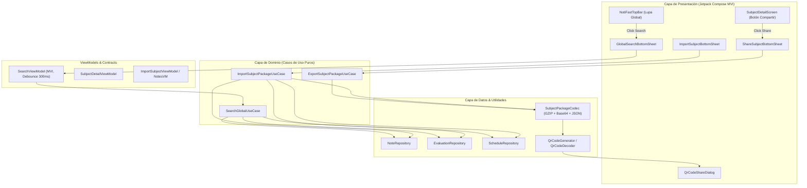

# 📐 Especificación de Diseño Técnico — Fase 3.2: Búsqueda Global Multientidad y Pack Académico P2P

> **Documento de Diseño Formal (Superpowers Architectural Spec)**  
> **Fecha:** 23 de Agosto, 2026  
> **Estado:** Aprobado para Planificación e Implementación  
> **Referencias:** [`docs/prd/KICKOFF_FASE_3.2.md`](file:///home/p0xd/Documentos/NotiFast/docs/prd/KICKOFF_FASE_3.2.md) | [`docs/prd/PRD-MAESTRO-NOTIFAST.md`](file:///home/p0xd/Documentos/NotiFast/docs/prd/PRD-MAESTRO-NOTIFAST.md) | [`AGENTS.md`](file:///home/p0xd/Documentos/NotiFast/AGENTS.md) | [`DESIGN.md`](file:///home/p0xd/Documentos/NotiFast/DESIGN.md)

---

## 🎯 1. Resumen Ejecutivo y Objetivos

La Fase 3.2 culmina el 100% de la **Fase 3 (Features Avanzadas)** de NotiFast v3.0 mediante la entrega de dos subsistemas de alto impacto:
1. **Sprint 3.3 — Motor de Búsqueda Global Multientidad en Tiempo Real:** Búsqueda reactiva, instantánea y con normalización diacrítica sobre Materias, Apuntes, Evaluaciones y Horarios, accesible desde el header editorial táctil (`NotiFastTopBar`) mediante un `GlobalSearchBottomSheet`.
2. **Sprint 3.4 — Pack Académico P2P y Resiliencia Offline:** Serialización comprimida (.notifast vía GZIP + Base64) de asignaturas completas (cátedra, horarios semanales, syllabus de evaluaciones y notas clave), con generación de Códigos QR para intercambio presencial instantáneo en el aula y exportación vía Android Sharesheet.

---

## 🏗️ 2. Arquitectura del Sistema



---

## 🔍 3. Sprint 3.3: Búsqueda Global Multientidad

### 3.1 Modelos de Dominio (`domain/model/search/`)
- `SearchResultType`: Enum (`SUBJECT`, `NOTE`, `EVALUATION`, `SCHEDULE`).
- `SearchFilter`: Enum (`ALL`, `SUBJECTS`, `NOTES`, `EVALUACIONES`, `SCHEDULES`).
- `SearchResultItem`:
  ```kotlin
  data class SearchResultItem(
      val id: String,
      val type: SearchResultType,
      val title: String,
      val subtitle: String,
      val snippet: String? = null,
      val subjectName: String,
      val subjectColorHex: String = "",
      val badgeText: String? = null,
      val targetRoute: String
  )
  ```

### 3.2 `SearchGlobalUseCase.kt`
- Agrega de manera reactiva `noteRepository.getSubjects(userId)`, `noteRepository.getNotes(userId)`, `evaluationRepository.getEvaluations(userId)` y `scheduleRepository.getSchedules(userId)`.
- Algoritmo de normalización:
  - Eliminación de marcas diacríticas/tildes (`Normalizer.Form.NFD` + regex `\p{M}`).
  - Tokenización de búsqueda por términos múltiples (coincidencia si todos los tokens del query están presentes en los campos indexados).
- Generación determinista de rutas `targetRoute` para navegación directa al item (`Screen.SubjectDetail`, `Screen.EditNote`, `Screen.EditEvaluation`, `Screen.Schedules`).

### 3.3 MVI & UI Tactile Studio 3.0
- `SearchContract.kt`:
  - `SearchUiState`: `query`, `activeFilter`, `results`, `recentSearches`, `isLoading`.
  - `SearchEvent`: `UpdateQuery`, `SelectFilter`, `ClearQuery`, `SelectRecentSearch`, `ClearRecentSearches`, `ResultClicked`.
- `SearchViewModel.kt`:
  - `queryFlow.debounce(300)` para búsquedas fluidas sin saltos.
  - Gestión de historial de búsquedas recientes (máximo 5) en memoria o DataStore.
- `GlobalSearchBottomSheet.kt`:
  - Modal táctil con esquinas 28dp, micro-bordes `outlineVariant`, soporte completo de `WindowInsets.ime`.
  - Campo de texto táctil estilo pergamino con autofoco.
  - Carrusel horizontal `SearchFilterChips` con contadores de coincidencia.
  - Lista de resultados con monogramas HSL accesibles, badges semánticos de entidad y snippets resaltados.

---

## 📦 4. Sprint 3.4: Pack Académico P2P y Resiliencia Offline

### 4.1 Schema y Serialización `.notifast`
- `SubjectPackage`:
  ```kotlin
  data class SubjectPackage(
      val schemaVersion: Int = 1,
      val exportTimestamp: Long = System.currentTimeMillis(),
      val subject: SubjectData,
      val schedules: List<Schedule> = emptyList(),
      val evaluations: List<Evaluation> = emptyList(),
      val notes: List<Note> = emptyList()
  )
  ```
- `SubjectPackageCodec`:
  - Serialización a JSON estructurado (`org.json.JSONObject`).
  - Compresión de flujo con `java.util.zip.GZIPOutputStream` y codificación `android.util.Base64.NO_WRAP`.
  - Ratio de compresión típico > 75%, permitiendo empaquetar una materia completa con horarios y syllabus en < 1.5 KB.

### 4.2 Casos de Uso de Exportación e Importación
- `ExportSubjectPackageUseCase.kt`:
  - Recopila datos de la materia, horarios semanales, evaluaciones y apuntes asociados.
  - Produce el payload comprimido `.notifast` en Base64 y asiste en la creación del archivo temporal para compartir.
- `ImportSubjectPackageUseCase.kt`:
  - Decodifica Base64, descomprime GZIP, valida esquema y compatibilidad de versión.
  - Estrategia de resolución de colisiones:
    * `RENAME`: Agrega sufijo numérico o `"(Copia)"` si ya existe una asignatura con el mismo nombre.
    * `OVERWRITE`: Reemplaza la asignatura existente y actualiza sus horarios y evaluaciones.
    * `SKIP_IF_EXISTS`: Aborta la importación si la materia ya está registrada.
  - Persiste atómicamente la materia y todas sus entidades hijas vinculadas.

### 4.3 Generador de Códigos QR y UI de Compartir
- `QrCodeGenerator.kt`:
  - Utiliza `com.google.zxing:core:3.5.3` para renderizar mapas de bits QR 512x512 de alto contraste.
- `ShareSubjectBottomSheet.kt`:
  - Desplegable desde `SubjectDetailScreen` con 3 acciones:
    1. **Compartir Archivo `.notifast`:** Lanza Android Sharesheet con el archivo `.notifast` para WhatsApp, Drive, Bluetooth, Telegram.
    2. **Código QR Offline:** Abre `QrCodeShareDialog` con el código QR para escaneo inmediato en aula.
    3. **Copiar Resumen:** Copia al portapapeles un resumen estructurado en Markdown (profesor, aula, horarios y fechas de exámenes).
- `ImportSubjectBottomSheet.kt`:
  - Permite importar un pack pegando el código de texto / Base64, seleccionando un archivo `.notifast` del almacenamiento local, o escaneando un código QR.

---

## 🛡️ 5. Manejo de Errores y Seguridad
1. **Validación de Integridad:** Se verifica que el JSON deserializado contenga los campos requeridos y que `schemaVersion <= CURRENT_VERSION`.
2. **Sanitización de Datos:** Se sanitizan los nombres de materia para prevenir inyecciones o caracteres ilegales en Firestore.
3. **Privacidad de Usuario:** Al exportar un Pack Académico, se limpian los IDs de usuario originales (`userId = ""`) y URLs de imágenes privadas de Cloud Storage para no exponer datos sensibles.
4. **Manejo de Excepciones:** Todas las operaciones retornan `Result<T>` con logging estructurado y mensajes amigables al usuario.

---

## 🧪 6. Plan de Pruebas y Verificación

### Tests Unitarios (TDD)
- `SearchGlobalUseCaseTest.kt`:
  - Búsqueda por coincidencia exacta y parcial.
  - Normalización de acentos y caracteres especiales ("Física" encuentra "fisica").
  - Filtrado por cada entidad individual (`SUBJECTS`, `NOTES`, `EVALUATIONS`, `SCHEDULES`).
  - Coincidencia multitoken ("Parcial Calculo").
- `SearchViewModelTest.kt`:
  - Emisión de estados `UiState`, debounce de query, selección de filtros y gestión de historial reciente.
- `SubjectPackageCodecTest.kt` & `ExportImportSubjectPackageUseCaseTest.kt`:
  - Ciclo completo de serialización ➔ compresión ➔ descompresión ➔ deserialización con igualdad de datos.
  - Manejo de paquetes corruptos o versiones incompatibles.
  - Resolución de colisiones con estrategia `RENAME` y `OVERWRITE`.

### Verificación de Compilación
- `./gradlew testDebugUnitTest` ➔ 100% pruebas pasando.
- `./gradlew assembleDebug` ➔ APK compilado sin errores.
