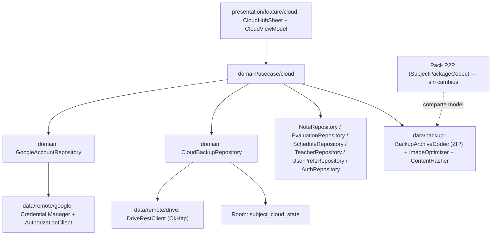

# Diseño — Fase Cloud Backup: Cuenta Google + Copia modular por materia en Google Drive

> **Fecha:** 2026-10-15
> **Estado:** Borrador para aprobación del usuario
> **Matriz de escenarios:** [`2026-10-15-cloud-backup-scenario-matrix.md`](2026-10-15-cloud-backup-scenario-matrix.md)
> **Plan de implementación:** _pendiente (se redacta con `writing-plans` tras aprobar este documento)_
> **Antecede:** [`2026-10-05-offline-first-local-storage-design.md`](2026-10-05-offline-first-local-storage-design.md) (Room como fuente de verdad, perfil local UUID)

---

## 1. Intención (el porqué)

NotiFast es offline-first: el estudiante entra con solo nombre y apellido y todo vive en Room. Cuando ya se enganchó con la app, necesita dos cosas: **no perder su cuaderno** y **llevarlo a otro teléfono**. Queremos lograrlo con **cero fricción y cero costo**, para el usuario y para el proyecto. Por eso los datos se guardan en el **Google Drive del propio usuario**, no en un backend propio. El sistema reemplaza desde cero el código de Firebase Auth/Firestore heredado.

## 2. Objetivos, no-objetivos y anti-objetivos

**Objetivos**
1. El onboarding local (nombre + apellido) **no cambia**. La app sigue funcionando al 100 % sin cuenta.
2. El usuario vincula su cuenta de Google **solo cuando quiere** subir sus datos o restaurarlos, desde el botón de nube del dashboard.
3. **Copia manual y modular por materia**: el usuario elige subir todas o algunas, y restaurar todas o algunas.
4. Cada materia muestra su estado con contraste visual claro: *Sincronizada*, *Cambios sin subir*, *Solo en el teléfono*, *Solo en la nube*.
5. La copia incluye notas (con imágenes optimizadas), evaluaciones, horarios y, como ítem aparte, **perfil, preferencias y directorio de profesores**.
6. Los choques de nombre al restaurar se resuelven con la decisión del usuario: **sobrescribir** o **agregar renombrada** (`Cálculo (1)`), con validación de unicidad.
7. Al borrar una materia se puede elegir **solo local** o **local + nube**.

**No-objetivos (YAGNI)**
- Sincronización automática, en segundo plano o en tiempo real. No hay WorkManager de sync.
- Edición simultánea en dos teléfonos ni fusión campo a campo. La unidad de copia es la materia entera y la última subida gana.
- Backend propio, Firestore o Firebase Storage.
- Opción "Restaurar con Google" en el onboarding.
- Ver los archivos en la interfaz de Drive (la carpeta es oculta).

**Anti-objetivos (cuentan como fracaso aunque "funcione")**
- Romper o cambiar el formato de compartir por QR/Sharesheet (Pack P2P).
- Perder datos locales en silencio: ninguna sobrescritura ni borrado ocurre sin confirmación explícita.
- Bloquear el uso offline o exigir cuenta para cualquier función que no sea de nube.
- Mostrar un estado de sincronización falso (por ejemplo, "nube" sin cuenta vinculada).

## 3. Decisiones confirmadas por el usuario

| # | Decisión |
|---|---|
| D1 | La copia es **manual**: el usuario toca el botón de nube cuando quiere. |
| D2 | Choque de nombre al restaurar → diálogo con **Sobrescribir** o **Agregar como "Nombre (n)"**. El nombre se puede editar y se valida para que no se repita (sin distinguir mayúsculas). |
| D3 | El teléfono nuevo pasa por el onboarding local y **restaura desde el dashboard**. |
| D4 | Las imágenes de las notas **se suben**, optimizadas automáticamente. |
| D5 | Borrar materia → confirmación con "Solo en este teléfono" / "En el teléfono y en la nube" (la segunda solo si hay cuenta y copia). Lo borrado solo en local permanece en Drive y aparece como *Solo en la nube*. |
| D6 | El panel de nube muestra todas las materias con su estado en contraste y permite "Todas" o selección múltiple. |
| D7 | Almacenamiento **oculto** en Drive (`appDataFolder`, scope `drive.appdata`). |
| D8 | Se puede **desvincular o cambiar** la cuenta de Google desde Ajustes. Los datos locales quedan intactos. |
| D9 | También se respaldan **perfil, preferencias y directorio de profesores**. |

## 4. Decisiones técnicas (del diseñador; el usuario puede revertirlas)

| # | Decisión | Motivo |
|---|---|---|
| T1 | **Sin Firebase Auth, Firestore ni Storage.** Identidad con **Credential Manager + Sign in with Google** (`androidx.credentials`, `googleid`); acceso a Drive con **`Identity.getAuthorizationClient()`** pidiendo `https://www.googleapis.com/auth/drive.appdata`. | Los datos van a Drive; Firebase no aporta nada en este flujo. Analytics y Crashlytics se mantienen. |
| T2 | Cliente Drive **REST v3 delgado** sobre OkHttp (multipart upload, `files.list`, `files.get?alt=media`, `files.delete`) en vez de `google-api-services-drive`. | Ese SDK es pesado, depende de `google-http-client` y es incómodo con R8. Solo se necesitan 5 endpoints. |
| T3 | **Sin manifiesto central en Drive.** Cada materia es un archivo y sus metadatos viajan en `appProperties`. | No hay archivo índice que pueda corromperse o quedar inconsistente entre dispositivos. Una sola llamada `files.list` arma el panel. |
| T4 | Formato nuevo de **archivo de respaldo** (`.nfbak`, ZIP) que **reutiliza `SubjectPackage`** como JSON interno, más una carpeta de imágenes. El Pack P2P (`SubjectPackageCodec`, GZIP+Base64) **no se modifica**. | El modelo de datos es uno solo y los transportes son independientes. Así coexisten sin afectarse. |
| T5 | Se **unifica la resolución de nombres** en `ResolveSubjectNameUseCase`. El sufijo pasa a ser ` (n)` también en el Pack P2P (antes ` (Copia)`). | Un solo comportamiento predecible en los dos flujos. ⚠️ Es el único cambio visible en el flujo QR: **confirmar**. |
| T6 | "Cambios sin subir" se detecta con un **hash SHA-256 canónico** del contenido de la materia, comparado con el hash de la última subida. | Funciona aunque no existan marcas `updatedAt` fiables en todas las tablas, y detecta también imágenes cambiadas. |
| T7 | Optimización de imágenes: lado largo máx. **1600 px**, JPEG **calidad 80**, sin EXIF (se respeta la orientación al reescalar). Si la original ya es más pequeña, se recomprime solo cuando el resultado pese menos. | Buen balance para fotos de pizarra. Las originales locales no se tocan. |

## 5. Arquitectura



### 5.1 Capas nuevas

```
data/
  backup/
    BackupArchive.kt            # data class: manifest + SubjectPackage + imágenes
    BackupArchiveCodec.kt       # ZIP <-> BackupArchive (subject.json, images/<hash>.jpg)
    GlobalBackup.kt             # perfil + prefs + profesores (global.json + avatar)
    ImageOptimizer.kt           # reescalado/compresión (T7)
    ContentHasher.kt            # hash canónico (T6)
  remote/
    google/GoogleAuthDataSource.kt      # Credential Manager + AuthorizationClient
    drive/DriveRestClient.kt            # list/upload/update/download/delete en appDataFolder
    drive/DriveFileDto.kt
  local/
    entity/SubjectCloudStateEntity.kt
    dao/SubjectCloudStateDao.kt
  repository/
    GoogleAccountRepositoryImpl.kt
    DriveCloudBackupRepositoryImpl.kt
domain/
  model/cloud/   # CloudSubjectStatus, CloudSubjectItem, CloudAccount, RestoreConflict, NameResolution
  repository/    # GoogleAccountRepository, CloudBackupRepository
  usecase/cloud/ # BuildCloudOverviewUseCase, UploadSubjectsUseCase, RestoreSubjectsUseCase,
                 # DeleteCloudSubjectUseCase, UploadGlobalDataUseCase, RestoreGlobalDataUseCase
  usecase/ResolveSubjectNameUseCase.kt   # compartido con ImportSubjectPackageUseCase
presentation/feature/cloud/
  CloudContract.kt, CloudViewModel.kt, CloudHubSheet.kt
  components/ (CloudAccountHeader, CloudSubjectRow, CloudStatusChip, RestoreConflictDialog,
               CloudProgressOverlay, LinkAccountPrompt)
```

### 5.2 Formato en Drive (`appDataFolder`)

| Archivo | Contenido | `appProperties` |
|---|---|---|
| `subject_<subjectId>.nfbak` | ZIP: `manifest.json`, `subject.json` (`SubjectPackage`), `images/<sha1>.jpg` | `kind=subject`, `subjectId`, `subjectName`, `icon`, `colorHex`, `schemaVersion`, `contentHash`, `uploadedAt`, `deviceModel`, `noteCount`, `evaluationCount` |
| `global.nfbak` | ZIP: `manifest.json`, `global.json` (perfil, prefs, profesores), `avatar.jpg` opcional | `kind=global`, `schemaVersion`, `contentHash`, `uploadedAt`, `deviceModel` |

- `manifest.json` = `{ "format": "notifast-backup", "schemaVersion": 1, "kind": ..., "createdAt": ... }`. Si al restaurar `schemaVersion` es mayor que el soportado, se muestra "Actualiza NotiFast para restaurar esta copia" y no se toca nada.
- Las imágenes se referencian desde el JSON por nombre relativo (`images/<sha1>.jpg`). Al restaurar se copian a `filesDir/images/` y se reescriben las rutas (`imageUrl`, bloques de imagen en `blocksJson`, `profilePictureUrl`).
- `subjectId` es la **identidad estable** de la materia entre dispositivos. Al restaurar sin conflicto se conserva el mismo `subjectId`, así la materia queda *Sincronizada* en el teléfono nuevo.
- Subir una materia que ya tiene `driveFileId` hace `PATCH` del contenido (update), no crea un duplicado. Si Drive responde 404 (borrada desde otro teléfono), se crea un archivo nuevo.

### 5.3 Estado local de nube (Room, migración **4 → 5**)

```kotlin
@Entity(tableName = "subject_cloud_state", primaryKeys = ["accountId", "subjectId"])
data class SubjectCloudStateEntity(
    val accountId: String,        // sub/ID de la cuenta Google (no el email)
    val subjectId: String,
    val driveFileId: String,
    val lastUploadedHash: String,
    val lastSyncedAt: Long        // última subida o restauración
)
```
- El estado se guarda **por cuenta**: si el usuario cambia de cuenta, las materias aparecen como *Solo en el teléfono* para la nueva cuenta, sin estados heredados por error.
- Al borrar una materia localmente se borra su fila (la copia en Drive se mantiene si eligió "solo local").
- La cuenta vinculada (`accountId`, email, nombre visible, foto) se guarda en **DataStore** (`linked_google_account`). **Nunca se persisten tokens**: el access token se pide a `AuthorizationClient` en cada operación (lo cachea Play Services).
- Migración Room explícita (`Migration(4,5)`) con su test. Prohibido `fallbackToDestructiveMigration`.

### 5.4 Clasificación de estado (lógica pura, testeable)

`BuildCloudOverviewUseCase` cruza materias locales, archivos Drive (`kind=subject`) y `subject_cloud_state`:

| Local | Drive | Estado guardado | Hash local vs guardado | → Estado |
|---|---|---|---|---|
| ✔ | ✔ (mismo `driveFileId`) | ✔ | igual, y `contentHash` de Drive = guardado | **Sincronizada** |
| ✔ | ✔ | ✔ | distinto | **Cambios sin subir** |
| ✔ | ✔ | ✔ | igual, pero `contentHash` de Drive ≠ guardado | **Nube más reciente** (otro teléfono subió después) |
| ✔ | ✔ (mismo `subjectId`, sin estado) | ✘ | — | **En ambos, sin vincular** (se trata como conflicto al restaurar y como sobrescritura al subir; ver matriz) |
| ✔ | ✘ | — | — | **Solo en el teléfono** |
| ✘ | ✔ | — | — | **Solo en la nube** |

"Nube más reciente" y "En ambos, sin vincular" son variantes necesarias para no perder datos. Se presentan con el mismo chip de advertencia (Ruby) y un texto específico.

## 6. Flujos

### 6.1 Botón de nube en el dashboard
- El indicador del TopBar (`isCloudSynced`, hoy `true` por defecto) se vuelve **honesto**: icono de teléfono sin cuenta, nube con check si todo está sincronizado y nube con punto si hay cambios sin subir. El estado sale de un cálculo local barato (hash vs `lastUploadedHash`), **sin red**.
- Al tocarlo se abre `CloudHubSheet` (bottom sheet normalizado, como los existentes).

### 6.2 Sin cuenta vinculada
`LinkAccountPrompt`: explicación breve ("Guarda tus materias en tu Google Drive, gratis y privado. Solo NotiFast puede ver estos archivos.") y el botón **Continuar con Google**.
1. Credential Manager (`GetSignInWithGoogleOption`) → `GoogleIdTokenCredential` (email, nombre, foto, `id`).
2. `AuthorizationClient.authorize(drive.appdata)` → si pide resolución, se lanza el `PendingIntent` desde la UI con `rememberLauncherForActivityResult`.
3. Se guarda la cuenta en DataStore y se carga la vista general. Si hay copias en Drive, aparece el banner **"Encontramos N materias en tu nube. ¿Quieres restaurarlas?"**.
- El nombre y la foto del perfil local **no se reemplazan** por los de Google. Solo cambian si el usuario restaura "Perfil y ajustes".

### 6.3 Panel con cuenta vinculada
- Cabecera: avatar y email de la cuenta, y fecha de la última copia.
- Lista: la fila "Perfil y ajustes" primero, luego las materias (icono, color, nombre, conteos, chip de estado). Cada fila tiene checkbox.
- Acciones: **Seleccionar todas** / **Subir seleccionadas** / **Restaurar seleccionadas**. Cada acción solo se habilita si la selección contiene ítems aplicables (no se sube un *Solo en la nube*, no se restaura un *Solo en el teléfono*).
- Progreso por ítem (`n / total`), cancelable entre ítems. Al final, resumen con éxitos y fallos y la opción "Reintentar fallidas".
- Sin red: el panel muestra el estado local conocido y deshabilita las acciones con el mensaje "Sin conexión".
- Antes de subir con datos móviles: aviso único si el tamaño total estimado es mayor a **20 MB** (decisión mía).

### 6.4 Subida (por materia, aislada)
1. Leer la materia completa desde los repositorios (misma fuente que `ExportSubjectPackageUseCase`).
2. Optimizar imágenes en un directorio temporal en `cacheDir`.
3. Armar el ZIP y calcular `contentHash` (sobre el contenido **antes** de optimizar, para que sea estable: JSON canónico + hash de los archivos originales).
4. Si el estado es "Nube más reciente" → confirmación "La copia en la nube es más reciente (subida desde <dispositivo> el <fecha>). ¿Reemplazarla con la de este teléfono?".
5. Crear o actualizar el archivo en Drive → upsert de `subject_cloud_state` → borrar los temporales (en `finally`).
- Si una materia falla, no se aborta el lote: se reporta y se sigue con la siguiente.

### 6.5 Restauración (por materia, transaccional)
1. Descargar el ZIP a `cacheDir`, validar el manifiesto y el esquema y reutilizar las validaciones de `ImportSubjectPackageUseCase` (pesos, notas, horarios).
2. **Conflicto de nombre** (existe una materia local con el mismo nombre, sin distinguir mayúsculas, o con el mismo `subjectId`): `RestoreConflictDialog` con
   - **Sobrescribir**: reemplaza la materia local (borrado en cascada + inserción en **una sola transacción Room**; las imágenes viejas se borran después del commit).
   - **Agregar como…**: campo prellenado con `ResolveSubjectNameUseCase` (`Cálculo (1)`, `Cálculo (2)`…). Se valida en vivo: vacío, más de la longitud máxima actual o duplicado sin distinguir mayúsculas deshabilitan el botón y muestran el error. La materia renombrada recibe un **`subjectId` nuevo** y queda *Solo en el teléfono* (no se vincula con la copia original).
   - **Omitir**.
   - Con varias materias en conflicto: casilla "Aplicar a las demás" para Sobrescribir/Omitir. *Agregar como* siempre es individual.
3. Insertar todo (materia, horarios, evaluaciones, notas, imágenes) en una transacción. Si algo falla, rollback completo y borrado de las imágenes copiadas.
4. Upsert de `subject_cloud_state` con el hash del archivo descargado → *Sincronizada*.
5. **Reprogramar alertas** (`RescheduleAllAlertsUseCase`) al terminar el lote.

### 6.6 Perfil y ajustes (ítem global)
- **Subir:** nombre, apellido, foto (optimizada), todas las claves de `UserPrefsRepository` y el directorio de profesores.
- **Restaurar:** confirmación "Esto reemplazará tu nombre, foto y preferencias". Las preferencias se sobrescriben. Los profesores se **fusionan**: se agrega quien no existe con el mismo nombre y apellido sin distinguir mayúsculas; si coincide, se conservan los datos locales y se suman las materias de `subjectNamesJson`. El `userId` local **no cambia**: todo se re-asigna al UUID del perfil local.

### 6.7 Borrar materia (`NotesDialogs` / `DeleteSubjectCascadeUseCase`)
- Sin cuenta, o con cuenta pero sin copia de esa materia: el diálogo actual queda igual.
- Con cuenta y copia: diálogo con **Solo en este teléfono** / **En el teléfono y en la nube** / Cancelar.
- "Teléfono y nube": primero `files.delete` en Drive y, solo si responde OK o 404, el borrado local. Sin red o con error: mensaje "No se pudo borrar de la nube. ¿Borrar solo en este teléfono?" (nunca se borra de la nube algo que sigue en el teléfono sin avisar).
- En el panel de nube, un ítem *Solo en la nube* tiene la acción secundaria **Borrar de la nube** (con confirmación).

### 6.8 Ajustes → Cuenta de Google
- Sin cuenta: fila "Vincular cuenta de Google" (mismo flujo de 6.2).
- Con cuenta: email, **Cambiar de cuenta** y **Desvincular**. Desvincular hace `ClearCredentialStateRequest`, borra `linked_google_account`, borra las filas de `subject_cloud_state` de esa cuenta y revoca el acceso (`revokeAccess` cuando esté disponible; si falla, se registra en el log y no bloquea). Los datos locales no se tocan y la copia en Drive se conserva.
- `SettingsProfileHeroCard` deja de mostrar el badge "Cloud" fijo: lo muestra solo con cuenta vinculada.

## 7. Coexistencia con el Pack P2P
- `SubjectPackage` y `SubjectPackageCodec` no cambian y no se tocan los tests de Pack.
- `ImportSubjectPackageUseCase` solo delega el cálculo del nombre a `ResolveSubjectNameUseCase` (T5). Su API y su `ConflictStrategy` se mantienen.
- Una materia importada por QR es una materia local más: aparece como *Solo en el teléfono* y se puede subir.

## 8. Limpieza (refactor desde cero)
- **Verificado:** ya no hay código Firebase Auth ni Firestore en `app/`. Solo quedan entradas sin usar (`firebase-auth`, `firebase-firestore`, `firebase-storage`) en `libs.versions.toml`: se eliminan. `play-services-auth` (21.2.0) se mantiene para `Identity.getAuthorizationClient`.
- Agregar: `androidx.credentials`, `credentials-play-services-auth`, `googleid`, `okhttp`, y para tests `mockwebserver` y `robolectric`. JSON: **Gson** (ya presente; reutilizar el adaptador UTC de `SubjectPackageCodec` y el manejo polimórfico existente de `NoteBlock`).
- Revisar las reglas R8/ProGuard para los DTO de Drive y los modelos de respaldo.
- `backup_rules.xml` / `data_extraction_rules.xml`: sin cambios (Auto Backup sigue siendo independiente).

## 9. Configuración externa (requisito previo, manual)
1. Google Cloud Console del proyecto Firebase existente: habilitar **Google Drive API**.
2. Pantalla de consentimiento OAuth con el scope `drive.appdata`. Verificar si Google lo exige para producción; para pruebas basta con agregar usuarios de prueba.
3. Clientes OAuth: **Android** (SHA-1 de debug y de release / Play App Signing) y **Web** (su client ID se usa como `serverClientId` en `GetSignInWithGoogleOption`). El Web client ID va en `BuildConfig` mediante `local.properties`, no versionado.

## 10. Errores y mensajes (todos en `strings.xml`)
| Caso | Comportamiento |
|---|---|
| Usuario cancela el selector de cuenta o el permiso | Vuelve al prompt sin error rojo. |
| Sin Play Services / Credential Manager no disponible | Mensaje "Tu dispositivo no permite iniciar sesión con Google". El resto de la app sigue igual. |
| 401 / token revocado | Se reintenta una vez pidiendo un token nuevo. Si sigue fallando: "Vuelve a vincular tu cuenta". |
| Cuota de Drive llena (403 `storageQuotaExceeded`) | "Tu Google Drive está lleno". |
| Red caída a mitad de lote | Los ítems pendientes quedan como fallidos y se pueden reintentar. Nada queda a medio escribir (en local hay transacción; en Drive el archivo se reemplaza de forma atómica por la API). |
| Archivo corrupto o esquema futuro | El ítem se marca como "Copia no compatible" y se omite. |

Todas las capas devuelven `Result<T>`, registran con `Log.e` y Crashlytics y el error se propaga a `CloudUiState.error` o al resumen.

## 11. Pruebas (TDD)
- **Unitarias puras:** `ResolveSubjectNameUseCase`, `BuildCloudOverviewUseCase` (todas las filas de 5.4), `ContentHasher` (estabilidad y orden), `BackupArchiveCodec` (ida y vuelta, rechazo de esquema futuro, rutas de imágenes reescritas), `ImageOptimizer` (dimensiones y calidad; Robolectric), `RestoreSubjectsUseCase` (sobrescribir, renombrar, omitir, rollback), fusión de profesores, borrado dual.
- **Drive:** `DriveRestClient` contra **MockWebServer** (multipart correcto, `spaces=appDataFolder`, manejo de 401/403/404).
- **Room:** test de `Migration(4,5)` y DAO en memoria.
- **ViewModel:** `CloudViewModel` con fakes de los repositorios (estados, selección, habilitación de acciones, resumen).
- **Regresión Pack P2P:** los tests existentes deben pasar sin cambios, salvo el del sufijo (T5).
- **Manual:** dos dispositivos o emuladores con la misma cuenta siguiendo la matriz de escenarios.

## 12. Etapas sugeridas (el plan las detalla)
| Etapa | Contenido | Entregable verificable |
|---|---|---|
| **E0** | Configuración externa (sección 9), dependencias, limpieza de Firebase Auth/Firestore | `assembleDebug` verde sin Firebase Auth |
| **E1** | Núcleo de datos: `ResolveSubjectNameUseCase` (+ adopción en Pack), `ContentHasher`, `ImageOptimizer`, `BackupArchiveCodec`, `GlobalBackup`, migración Room 4→5 | Tests unitarios verdes |
| **E2** | Cuenta Google: `GoogleAuthDataSource`, `GoogleAccountRepository`, DataStore, vincular/desvincular | Vincular en el dispositivo y token con `drive.appdata` |
| **E3** | `DriveRestClient` + `DriveCloudBackupRepository` (list/upload/update/download/delete) | Tests MockWebServer + prueba real de ida y vuelta |
| **E4** | Casos de uso cloud (overview, upload, restore con conflictos, global, delete) | Tests con fakes |
| **E5** | UI: `CloudHubSheet`, chips de estado, diálogo de conflicto, progreso/resumen, TopBar honesto | Flujo completo en el dispositivo |
| **E6** | Borrado dual, sección Cuenta en Ajustes, badge del perfil | Escenarios de la matriz |
| **E7** | Endurecimiento: errores, R8 release, a11y, strings, verificación de la matriz en 2 dispositivos, STATUS.md | `assembleRelease` + matriz al 100 % |

## 13. Queda a criterio del implementador
- Nombres exactos de clases internas, distribución de componentes (≤ 250 LOC por archivo) y textos finales en `strings.xml` (español, tono tranquilizador).
- Iconografía de los chips, siempre que se respeten los tokens: Aqua (`tertiary`/secundario) = sincronizada; Ruby (`primary`/error) = requiere atención; neutro = solo en el teléfono; contorno = solo en la nube.
- Librería JSON: la misma que ya usa `SubjectPackageCodec`.

## 14. Aclaraciones tras la revisión técnica (vinculantes; prevalecen sobre secciones anteriores)

1. **Ruta transaccional propia.** Los repositorios actuales generan IDs propios y trabajan por *nombre* de materia, así que no sirven para restaurar conservando el `subjectId` ni para hacerlo en una sola transacción. Se agrega la interfaz de dominio `SubjectBackupStore` (`readSnapshot(userId, subjectId)`, `insertSnapshot(userId, snapshot)`, `replaceSnapshot(userId, oldSubjectId, snapshot)`), implementada en `data/local/backup/RoomSubjectBackupStore` con `db.withTransaction` y DAOs directos. Los casos de uso cloud usan esta interfaz en lugar de los repositorios para leer y escribir materias completas. *(Decisión del diseñador.)*
2. **Imágenes cubiertas:** `Note.imageUrl`, `NoteBlock.Image.path` dentro de `blocksJson` (su `annotationJson` viaja en el JSON), `Evaluation.imageUrl` y la foto de perfil. Las rutas locales pueden ser `file://…` (`Uri.fromFile`) o rutas planas: el codec acepta ambas y al restaurar escribe el mismo formato que produce `ImageRepositoryImpl`. Si una imagen referenciada no existe en disco, la referencia se elimina con un warning en el log y no falla la copia.
3. **Hash canónico** (`ContentHasher`): JSON canónico (claves ordenadas, listas ordenadas por `id`) del snapshot **excluyendo** `userId`, `exportTimestamp` y todos los `updatedAt`. Cada ruta de imagen se sustituye por el SHA-1 de los bytes **originales**. `createdAt` y los IDs sí entran (se preservan al restaurar). Ese mismo hash es el `contentHash` de `appProperties` y el `lastUploadedHash` local. Tras restaurar se **recalcula localmente** y se guarda ese valor. Si no coincide con el de Drive (por ejemplo, porque las imágenes de la copia ya estaban optimizadas), se guarda igual el local recalculado para que el estado quede *Sincronizada*, y se registra la diferencia en el log.
   - Consecuencia aceptada: el hash de las imágenes restauradas es el de la versión optimizada. Volver a subirlas desde el teléfono B no genera cambios porque ya son ≤ 1600 px (T7 recomprime solo si el resultado pesa menos).
4. **Concurrencia:** se acepta *la última subida gana*. Después de confirmar "Reemplazar", el `PATCH` no es condicional.
5. **Sobrescribir:** sobrevive el `subjectId` **de la nube**. Se borra la materia local (por su id) y la fila `subject_cloud_state` de ese id viejo, y se inserta el snapshot con el id de la nube.
6. **Longitud máxima de nombre de materia: 50 caracteres** (hoy no existe una constante). Se crea `SubjectNameRules.MAX_LENGTH = 50` en `domain/util` y se aplica también al crear y editar materias. *(Decisión del diseñador.)*
7. **T5 confirmado por el usuario:** el sufijo `(n)` se unifica también en el Pack P2P.
8. **QR funcional (pedido por el usuario, dentro de alcance):** `ExportSubjectPackageUseCase` elimina los bloques `NoteBlock.Image` de las notas exportadas (el QR no transporta imágenes) y no deja rutas locales en ningún campo. Se agrega un test de ida y vuelta Export → Import con notas y bloques para garantizar que la materia importada se abre y edita sin errores. El formato GZIP+Base64 y `schemaVersion` del Pack no cambian.
9. **Identidad por nombre en los repositorios:** la limpieza de `subject_cloud_state` al borrar requiere resolver nombre → id dentro de `DeleteSubjectCascadeUseCase` / `deleteSubject`.
